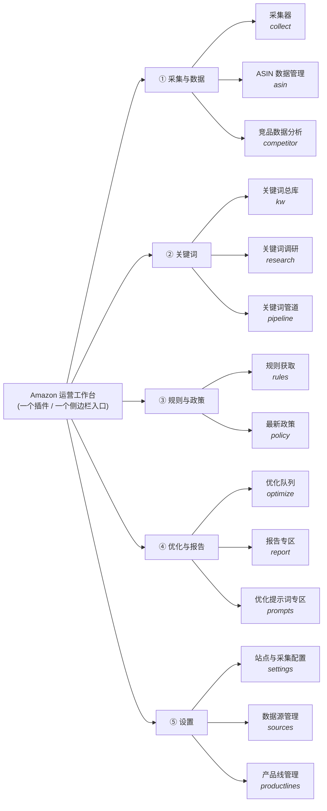
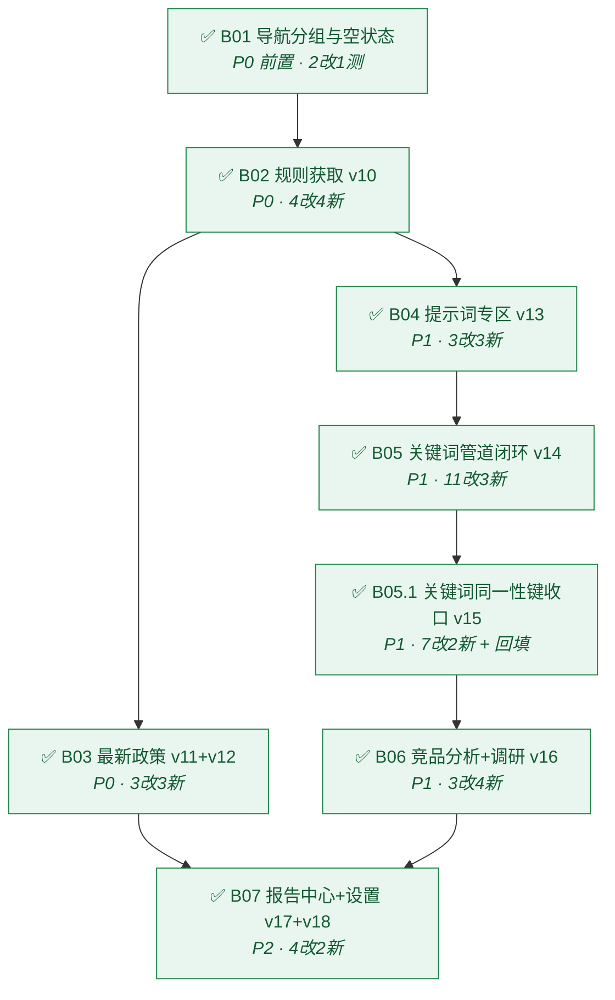
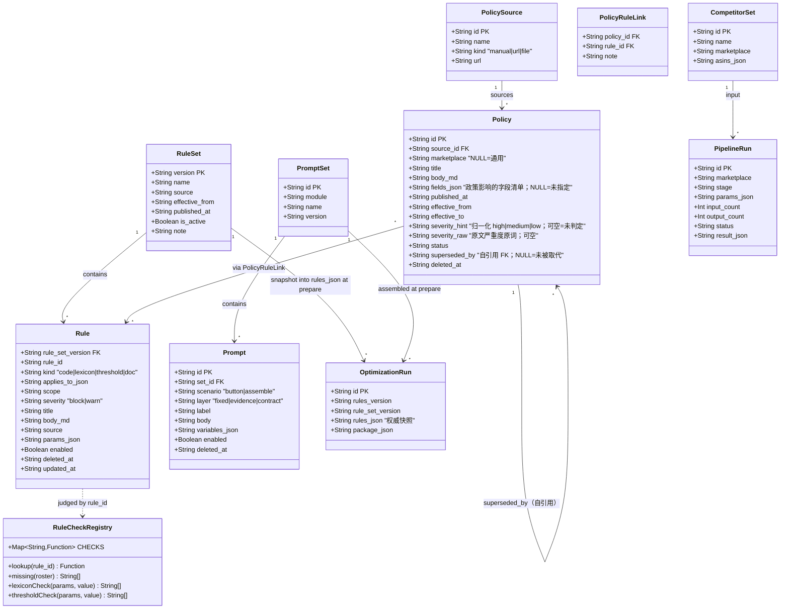
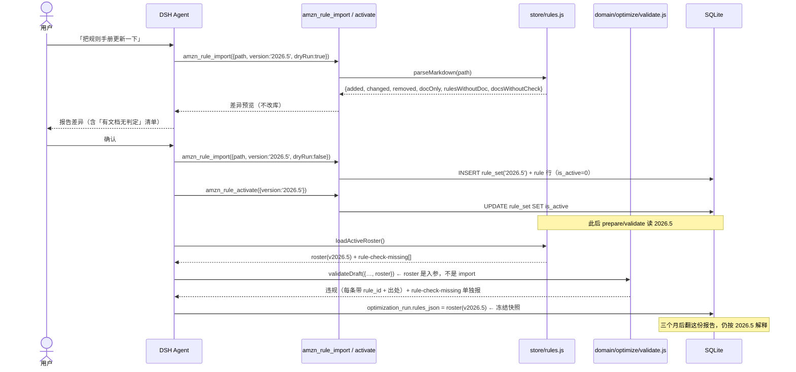
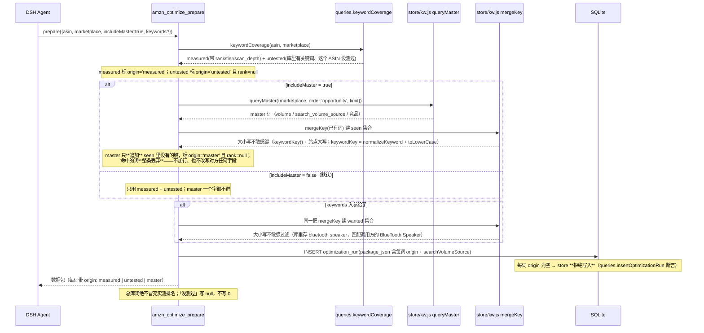
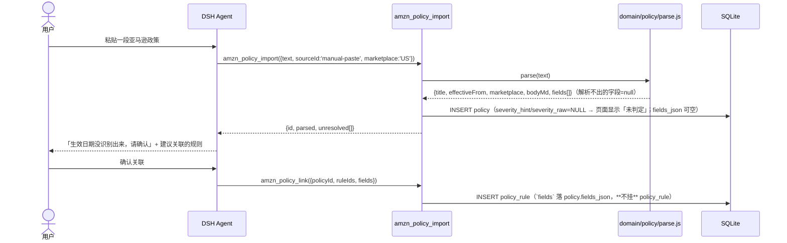

# amazon-ops 工作台 · 架构设计 + 分批任务

> 2026-09-24 · 高见远（架构师）· 任务 #2
> 上游：许清楚《模块清单与差距》`amazon-ops-workbench-PRD-2026-09-24.md`
> 对象：`D:\deepseek-harness-h\workspace\dsh-plugins\amazon-ops`（本地 DSH 插件）
> 方法：只读调研现状代码；本文件是**唯一交付物**，未改动 `D:\deepseek-harness-h` 下任何文件。

---

## 0. 结论先行（五条）

| # | 结论 | 一句话理由 |
|---|---|---|
| 1 | **不拆子插件，做一个插件 + 分组导航** | 工具名进程全局唯一、profile 要改两处、共用同一批实体与同一个 Chrome、侧边栏只有一个入口；拆开没有干净接缝（见 §2）。 |
| 2 | **11 项需求 → 5 组 + 12 页签 + 2 页内分区（合计 14 个呈现位）** | 现在 7 个平铺页签塞不下 11+ 模块，必须两层；分组依据是**数据流**（采集→关键词→规则→优化→设置）。口径见 §1.6。 |
| 3 | **规则「入库」= 把 roster 搬进表，判定函数留在代码** | 72 条 `check()` 读 `options`/`lexicon`/`attributes`，无法序列化；搬判定逻辑 = 造第二个引擎。库里存 **清单**，代码按 `rule_id` 索引判定，缺判定**显式报错**（见 §3.4）。 |
| 4 | **「打开开关」≠「文字进产物」——用参数传递 + 证伪测试锁死** | `validate`/`prepare` 必须把 roster 当**入参**从 store 读，不许再 `import { RULES }`；配一条「改库 → 产物跟着变」的断言（见 §4.4、§7）。 |
| 5 | **第一批 = 导航分组 + 空状态**（B01） | 用户当天就能看到新结构；同时把「未实现模块必须显式说明」这条纪律在**新模块上先立住**（见 §6）。 |

**P0 里程碑 = B01 + B02 + B03**（导航 + 规则获取 + 最新政策）。做完这三批，用户就有「规则能更新、政策能看」——这是 PRD 判的 P0，也是唯一 0 实现的部分。

---

# Part A · 系统设计

## ① 导航信息架构

### 1.1 分组依据：按**数据流阶段**，不按使用者、不按对象类型

三个候选依据，选第一个：

| 依据 | 是否采用 | 理由 |
|---|---|---|
| **数据流阶段**（采进来 → 研究词 → 定规则 → 出优化 → 配置） | ✅ **采用** | 这个插件的主干就是「采集→关键词→优化→报告」，用户的 11 项需求**恰好**落在这条链的五个位置上；一个位置一组，读者的心智模型和导航结构一致。 |
| 使用者任务 | ❌ | 单人工具，没有多角色，分不出来。 |
| 对象类型（ASIN / 关键词 / 规则） | ❌ | 「关键词总库」和「关键词调研」同对象却不同任务，强行按对象分会把工作流切断。 |

唯一不是线性一环的是**规则与政策**——它是优化的**上游输入**，不是每轮优化的一步。所以单独成组，放在优化之前。

### 1.2 导航结构



### 1.3 每个模块的**呈现形态**取舍

规则：**能独立拉数据、会被「切过去看」的 → 组内页签；对宿主数据做加工/展示的从属视图 → 页内分区；单行触发的编辑表单 → 抽屉/弹层。**

| 模块 | id | 形态 | 为什么是这个形态（不是另一种） |
|---|---|---|---|
| 采集器 | `collect` | **组内页签** | 有独立任务列表 + 独立 3s 轮询（`page.js` 的 `pollTimer`），和 ASIN 表**并列**看，不能叠在一页。 |
| ASIN 数据管理 | `asin` | **组内页签**（组默认） | 主表、最常用、有独立筛选条（`q`/`marketplace`/`order`）。 |
| 竞品数据分析 | `competitor` | **组内页签** | 是「我们 vs 竞品」的**差集分析视图**，有自己的输入（竞品 ASIN 组）和自己的结论，不是 ASIN 表的一列。 |
| 关键词总库 | `kw` | **组内页签** | 主表 31,805 词，有独立筛选（`masterLine`/`masterTier`/`masterOrder`）。 |
| 关键词调研 | `research` | **组内页签** | 有**输入框**（种子词）和「候选 → 勾选 → 入库」的工作流，不是只读表。**旧的 `keyword`（实测覆盖）并进来当页内分区**——见 §1.5。 |
| 关键词管道 | `pipeline` | **组内页签** | 管道是「对总库跑的一串阶段 + 每次运行的记录」，有**自己的历史表**，值得一个页签。 |
| 规则获取 | `rules` | **组内页签** | 独立清单（版本列表 + 规则表），量最大（72+ 条）。 |
| 最新政策 | `policy` | **组内页签** | 独立清单（政策 + 影响哪些规则/字段）。 |
| 优化队列 | `optimize` | **组内页签** | 已有，保持。 |
| 报告专区 | `report` | **组内页签** | 已有**空挂载位**（`PANEL_NOTES.report`）；填实为「报告清单 + 单份视图」，不新增页签。 |
| 优化提示词专区 | `prompts` | **组内页签** | 独立可编辑清单（增删改 + 变量预览）。 |
| 站点与采集配置 | `settings` | **组内页签** | 已有**空挂载位**；填实 DESIGN §9 的三条悬案。 |
| 数据源管理 | `sources` | **页内分区**（挂 `settings` 下） | 只是 `source` 表的配置面（启用/密钥/额度），语义是「设置的一节」，不该占一个页签位。 |
| 产品线管理 | `productlines` | **页内分区**（挂 `settings` 下） | 5+ 行小表 + 一个 upsert 表单；做成页签会是一张空得发慌的表。 |

> **为什么不用「所有模块都是页签」**：12 个页签在 **208px** 宽的左栏里会换行成 4 行，且把「设置」和「优化」放到同一层级会误导——它们不是同级任务。（左栏宽度实测与定值见 §14.1：现状 `page.js` 是 **170px**，定值 **208px**。）
> **为什么不用「全部一页滚动 + 锚点」**：采集轮询、关键词 500 行表、优化逐字段对照三者的数据拉取条件不同（`routes.js` 的 `buildState` 按 `context.module` 决定拉哪几片），全塞一页会让每次轮询都拉回一份百行 master。

### 1.4 现有 7 个页签的处置

| 现有 id / 名 | 处置 | 说明 |
|---|---|---|
| `collect` 采集任务 | **改名**「采集器」，移入 ① 组 | 用户原话是「亚马逊采集器」 |
| `asin` ASIN 库 | **改名**「ASIN 数据管理」，移入 ① 组 | 用户原话是「asin数据管理器」 |
| `keyword` 关键词库 | **并入 `research`**（降级为页内分区「实测覆盖」） | 用户 11 项里没有「实测关键词库」这一项；「调研」本就包含「看这个词我们排第几」。**代价差**：并入 → 页签 12 个、导航少 1 行，代码约 +30 行（`renderKeywords` 改成 `renderResearch` 内的分区渲染、`MODULES` 删 `keyword`、`buildState` 的 `context.module === 'keyword'` 分支改挂到 `research`）；保留独立 → 页签 13 个、导航多 1 行（+30px）、代码几乎零改动。**两案都便宜，最终由用户定**（§8 #8）。 |
| `kw` 关键词总库 | **保留原样**，移入 ② 组 | 用户原话「关键词总库」 |
| `optimize` 优化队列 | **保留原样**，移入 ④ 组 | — |
| `report` 报告 | **改名**「报告专区」，**填实**，移入 ④ 组 | 现在是空挂载位 |
| `settings` 设置 | **保留**，**填实**，移入 ⑤ 组 | 现在是空挂载位 |

### 1.5 `keyword` 并入 `research` 后的页面形态

```
┌ 关键词调研 ────────────────────────────────────────────────┐
│ 种子词 [ bluetooth speaker          ] [扩词]               │
│ 候选（未入库）: 词 / 搜索量 / 难度 / 来源 ── [勾选入库]      │
├ 实测覆盖（原 keyword 页签）────────────────────────────────┤
│ 覆盖条: 有排名 n / 已测无排名 n / 未测 n / 库内未测 n        │
│ 表: 关键词 / 站点 / 分层 T1–T4 / 有排名 / 已测无排名 / 未测   │
└────────────────────────────────────────────────────────────┘
```

### 1.6 唯一口径（全文以此为准）

**5 组 / 12 页签 / 2 页内分区 / 合计 14 个呈现位。** 之前 §0 写过的「13」是错的，已改。

| 口径 | 数字 | 清单 |
|---|---|---|
| 组 | **5** | 采集与数据 / 关键词 / 规则与政策 / 优化与报告 / 设置 |
| **页签**（占导航位，可切换主区） | **12** | collect, asin, competitor, kw, research, pipeline, rules, policy, optimize, report, prompts, settings |
| **页内分区**（不占导航位，挂在宿主面板内） | **2** | `sources`（挂 `settings`）、`productlines`（挂 `settings`） |
| **合计呈现位** | **14** | 12 + 2 |
| 导航行 | **19** | 5 组标题 + 12 页签 + 2 分区行 |

**为什么是 14 而不是 11**：用户的 11 项里「生成报告」与「优化报告专区」合并成 `report` 一个位置（11 → 10），再补 4 个导航位——`optimize`（现有页签，用户没单列）、`settings`/`sources`/`productlines`（DESIGN §9 三条悬案 + 产品线管理，用户没单列）→ 10 + 4 = **14**。

> ⚠️ 许清楚的 UI 稿标题写的是「5 组 13 模块」，同样是 off-by-one，应改为「5 组 14 个呈现位（12 页签 + 2 分区）」。稿子正文的 13 个 radio（`m-overview` 是总览开关，不算模块）+ 2 个分区标签，实际也是 14。

**另外两处计数不受影响**：`keyword`（实测覆盖）并入 `research` 后**不占导航位**（它变成 `research` 面板内的第 1 个分区）；`kw` 的「导入清单」一直就是同面板分区，从不占导航位。

---

## ② 「子插件」还是「一个插件的多个模块」

### 2.1 结论

**一个插件 + 分组导航。** 用户说的「子插件」在本项目里落地为「**模块（module）**」，不是独立的 DSH 插件包。

### 2.2 五条硬约束，逐条算成本

| 约束（来自现状代码 / 契约） | 拆成 11 个插件要付的代价 |
|---|---|
| **工具名进程全局唯一**（`docs/plugin-contract.md` §坑 4） | 11 个插件 = 11 套 `amzn_*` 命名空间要人工去重；现在 25 个工具已经在 5 个文件里分区，拆开后「重名 → 整棵插件树失败 → Host 起不来」。 |
| **每个插件要改 profile 两处**（`dependencies` + `dsh.profile.bundles`）+ `pnpm install` + 重跑 `link-user-plugins`（README + 契约 §5） | 装一次从「改 2 行」变成「改 22 行 + 11 次 pnpm install」，且每多一个插件多一道「副本 vs junction 漂移」的坑。 |
| **共用同一批实体**（`asin`/`keyword`/`listing` 三张主表 + 同一个 Chrome profile + 同一份登录态 + 同一个 `gate`） | 拆开要么**复制 SQLite**（同一个 ASIN 在多个库里各存一份，`asin_snapshot`/`provenance` 立刻失去意义），要么**跨插件 RPC**——DSH 本地插件**没有**这个原语（只有 `tools.register` 和 `webServer.register` 两个挂载点）。 |
| **「拷一个目录就能装」= 零第三方依赖**（`index.js` 头注释 + 契约 §6） | 11 个目录仍可零依赖，但「拷一个目录」变成「拷十一个目录 + 配十一次」，前提被削弱。 |
| **侧边栏只有**一个**入口**（`lib/client.js` 注册 `main` key + `sidebar.panellist` id，`PANEL_ID = 'amazon-ops'`） | 多插件 = 侧边栏出现 11 个图标按钮，把宿主的侧栏挤满；而 `order: 10` 是全局排序，11 个插件要抢排序。 |

### 2.3 如果将来真要拆，接缝在哪（哪些模块之间没有共享状态）

**结论：没有干净接缝，唯一理论上的拆点是「报告查看器」，但它也读同一个 store。**

拆点分析（按「是否被 `optimize_prepare` 在运行时读取」判）：

| 候选拆出 | 拆得动吗 | 原因 |
|---|---|---|
| 采集器 `collect` | ❌ | 关键词扫描**复用**同一个 Chrome 和同一张 `collection_task`（`index.js` 的 `createBrowserServices`，`collection.gate === keywords.gate` 有断言锁死）。拆开 = 两个浏览器抢 cookie。 |
| 关键词总库 `kw` / 调研 / 管道 | ❌ | `optimize_prepare` 要读总库（B05 要打通的接缝）；拆开就是跨插件 RPC。 |
| 规则获取 / 最新政策 | ❌ | `optimize_validate` 运行时读 roster；拆开 = 跨插件 RPC。 |
| 提示词专区 | ❌ | `optimize_prepare` 组装时读 prompt set。 |
| 报告专区 `report` | ⚠️ 理论可拆 | 只读 `optimization_run`。但**读的是同一张表**，拆出去要么复制表要么 RPC，净收益为负。 |
| 设置 | ❌ | 改的是 `source.config_json` 和 pacing，被采集器读。 |

> **一句话**：**运行时被 `prepare`/`validate`/`collector` 读的东西都不能拆。** 由于 11 个模块全部满足这条，所以拆点为零。
> 真要拆，唯一合理的边界是「**规则/政策/提示词三张纯库表**」vs「**其余一切**」，用一次 RPC（按版本号读 roster）连起来——但那是**为了拆而拆**，不推荐（见 §7）。

---

## ③ 数据模型增量（追加式迁移 v10–v18）

### 3.1 迁移分批（不要一个大 migration）

> **⚠️ 纪律：本节列出的版本号是「计划值」，不是契约。权威是 `src/store/schema.js` 的 `MIGRATIONS`。**
> 任何批次若需要追加迁移，一律**追加到当前最大版本之后**（**绝不回改已发布的步骤**——改已发布的步骤会让已升到该版本的库永远拿不到新列、且不报错），并在本节**同步后移后续编号**。
> 实施时以 `MIGRATIONS[MIGRATIONS.length - 1].version` 为准，**不要照抄本节的号**。（本节编号已后移三次：B03 追加 v12 一次，B05.1 追加 v15 一次，B06 追加 v16 一次。见下「已落地版本」。）

**9 个计划主题（v10–v18）、每版一个主题**（沿用 `schema.js` 既有风格）。相对首版新增 7 项：`policy.superseded_by`（v11）、`policy.severity_raw`（v12）、`prompt.version`（v13）、`kw_master` 大小写折叠回填（v15）、`competitor_set` 表（v16）、`product_line.signals_json`（v17）、`report` 表（v18）。

| 版本 | 名称 | 内容 | 批次 |
|---|---|---|---|
| **v10** | `rules-as-data` | `rule_set` + `rule`；`optimization_run.rule_set_version`；种入 `RULES`（2026.4）为 `rule_set('2026.4', is_active=1)`。**72 条全部 `kind='code'`**（口径见 §3.4 G13）。**种入行由代码生成（`SEED_ROSTER`），不手抄**——见 §3.2 | B02a |
| **v11** | `policy-library` | `policy_source` + `policy`（**含 `superseded_by`**）+ `policy_rule`（政策↔规则关联） | B03 |
| **v12** | `policy-severity-origin` | `policy.severity_raw`（**追加**：severity 原词，**不回改 v11**）——见 §3.3 | B03 |
| **v13** | `prompt-library` | `prompt_set` + `prompt`（**含 `version`**）；种入 `page.js` 的 `PROMPT_SETS` | B04 |
| **v14** | `kw-pipeline` | `kw_pipeline_run` + `kw_pipeline_stage`（**run + stage 两张表**，见 §3.6 / `docs/B05-DESIGN.md` §3.2） | B05 |
| **v15** | `keyword-case-fold` | **回填**：把六张表的 `keyword` 折成小写规范形；`kw_master` 的 1028 组按字段级策略合并；归档表 `kw_master_case_merge_archive`（见 §7.1-E4） | **B05.1** |
| **v16** | `competitor-sets` | `competitor_set`（命名竞品组） | B06 |
| **v17** | `settings-and-signals` | `setting`（键名定稿见 §3.6）+ `product_line.signals_json`（**信号词入库**，让产品线可配置） | B07 |
| **v18** | `report-registry` | `report`（**报告登记表**：优化 run + 总库报告/CSV 各一行，否则「报告专区」列不出总库报告） | B07 |

> **为什么 v17 与 v18 拆开**：v17 是「配置面」（设置 + 信号词），v18 是「报告登记」——两个不同主题，合在一起会让一个版本同时改两种东西，违反「每版一个主题」。两者同属 B07，仍是**一次交付**（B07 内先跑 v17 再跑 v18）。
> **为什么 `report` 表不能拖到以后**：`amzn_kw_report` / `amzn_kw_export` 现在只往 `dataDir` 写文件，**库里没有记录**。没有 `report` 表，「报告专区」就只能列优化 run，总库报告永远进不了清单（见 §14 G2）。

**已落地版本（对着 `schema.js` 核过，2026-09-28）**：

| 版本 | 名称 | 内容 | 批次 | commit |
|---|---|---|---|---|
| **v10** | `listing-rules-roster` | `rule_set` + `rule` + `SEED_ROSTER` 种入 | B02a | `ad287b0` |
| **v11** | `policy-library` | `policy_source` + `policy` + `policy_rule` | B03 | `19ede24` |
| **v12** | `policy-severity-origin` | `policy.severity_raw`（**追加**，不回改 v11） | B03 | `994e2db` |
| **v13** | `prompt-library` | `prompt_set` + `prompt`（**含 `version`**）；种入 `PROMPT_SETS`（13 module / 44 行） | B04 | `dc3bd42` |
| **v14** | `kw-pipeline` | `kw_pipeline_run` + `kw_pipeline_stage`（**两张表**，见 §3.6） | B05 | `a7a505d` |
| **v15** | `keyword-case-fold` | 六张表 `keyword` 折叠回填 + `kw_master` 1028 组字段级合并 + 归档表 `kw_master_case_merge_archive`（见 §7.1-E4） | **B05.1** | `d68496d` |
| **v16** | `competitor-sets` | `competitor_set`（命名竞品组：`id` / `name` / `marketplace` / `asins_json` / `note` / `updated_at` + `idx_compset_mkt`） | **B06** | 见 §6 |
| **v17** | `settings-and-signals` | `setting` + `product_line.signals_json` | B07 | 见 §6 |
| **v18** | `report-registry` | `report`（报告登记） | B07 | 见 §6 |
| **v19** | `context-identity` | `optimization_draft.context_id` + `idx_draft_context`（**只建列**，历史行留 NULL） | **S1-B01** | `40caa86` |
| **v20** | `workspace-foundation` | `workspace` + 部分唯一索引 `idx_ws_default` + `setting`/`product_line`/`source` 各加 `workspace_id` 并回填 `'ws-default'` | **S1-B02** | `263b4e7` |
| **v21** | `site-profile` | `site_profile` + `site_verification`（**种入 US / CA 两条 `system-seed` 核验事件**，日期取自 `RULE_MANUAL_UPDATED_ON`） | **S1-B02** | `263b4e7` |
| **v22** | `shop-brand-ownership` | `shop` + `brand` + `asin_ownership`（**回填**既有 `asin.product_line_id` 为 `source='auto'` 归属行） | **S1-B03** | `bd45825` |
| **v23** | `product-line-config-v2` | `product_line.version` + `product_line_version` + **用 SQLite JSON 函数把扁平信号数组重写成四类**（`core`/`exclude`/`scenario`/`material`）+ 每条既有线一个 `version=1` 快照 | **S1-B04** | `1d6d22e` |
| **v24** | `source-provenance` | `asin_field_source` **追加 7 列**（`source_type` / `observed_at` / `ingested_at` / `raw_value` / `raw_unit` / `parser_version` / `quality_state`）+ 溯源索引 `idx_fieldsrc_prov`。**只追加**，不动既有列、不改主键、不覆盖任何 `value`；回填**只写已知的**（`ingested_at = updated_at`、`source_type = 'collect'`），`observed_at` 留 NULL 让页面显示「未记录」而**不发明时间戳** | **S1-B08** | `e9f4fc4` |
| **v25** | `dq-issues` | `dq_issue`（**有状态机的问题清单**，不是扫描日志：`status` 只能沿 `open → acknowledged → fixing → resolved / accepted_risk` 四条边移动）+ **表达式唯一索引** `idx_dq_key`（`COALESCE(field, '')` —— 普通 `UNIQUE` 在 `field` 为 NULL 时形同虚设，重扫会一直堆行）+ `idx_dq_status` / `idx_dq_object` | **S1-B09** | `332917b` |
| **v26** | `snapshot-registry` | `snapshot_registry`（版本化对象的**统一登记索引**：`ref_table`/`ref_id` 指针**或** `payload_json` 冻结副本至少有一个；沿用 `report` 表的「登记索引、不复制正文」纪律）+ `UNIQUE(object_type, object_id, version)` + `idx_snap_obj` + **回填**既有产物；归档 = `archived_at` 置位（**隐藏，不删除**，按 id 仍可解析） | **S1-B11** | `8fe3066` |
| **v27** | `field-conflicts` | `field_conflict`（同字段多源不同值的**裁决对象**，与 `dq_issue` 不是一件事：一条冲突可以产生一条 `DQ-CONSIST-001` 问题，但「发现」与「待裁决」的状态机不同）+ `UNIQUE(asin, marketplace, field)`（一个字段一条，新证据是**重开**它而不是新建行）+ `idx_conflict_status` / `idx_conflict_object` | **S1-B10** | `acf778f` |
| **v28** | `audit-log` | `audit_log`（**横切**审计：只追加一张表、不碰任何既有表；工具包装器与页面写路由**两个漏斗**是唯一写入点；前/后值存 JSON 并在**写入边界**过 `redactAuditValue`；**不回填**（补记 = 伪造历史）、**无删除入口**（一条可以删掉的审计不是审计）） | **S1-B12** | `230d860` |
| **v29** | `notification-center` | `notification` + **`UNIQUE(dedupe_key)`（去重就是这条唯一索引本身**，不用「先查再插」——后者两次触发挨得近时会插出两行）+ `idx_notif_read`；`read_at IS NULL` = 未读（不是布尔的 `is_read`）。**30 天清理刻意不在迁移里**：迁移只跑一次，清理属于每次打开 | **S1-B16** | `4964295` |

> **S1-B05 没有迁移**：它补的是采集设置的**读取面**（浏览器 profile 发现、CDP 端口、登录态、默认通道、导入目录、第三方源连接状态），不新增表。
> **v19–v29 全部是追加，v1–v18 一步未改。** 每次追加都同步更新了 `tests/kw-key.mjs` 的 `rewindToV14`（它按 `MIGRATIONS` 派生要撤销的表/列/**索引**——v19 是第一条「既加列又给它建索引」的迁移，索引不先删，`DROP COLUMN` 会被 SQLite 拒绝，而那个拒绝与「列已经没了」长得一样）。

> 下次若再漂移，**先看这张表**：计划表与它不一致时，以这张表 + `schema.js` 为准。
> **v13 此前漏记**（`dc3bd42` 落地时只改了计划表）：这张表声称「对着 `schema.js` 核过」，漏一行就失去了它唯一的用处，故一并补上。**v10 与 v14 的名称都与计划表不同**——实际是 `listing-rules-roster`（计划表写 `rules-as-data`）与 `kw-pipeline`（计划表曾写 `keyword-pipeline`）。计划表上面已经声明了「版本号与名称是计划值、权威是 `MIGRATIONS`」，但**名字不一致仍然会误导**：一张表说 `rules-as-data`、代码里叫 `listing-rules-roster`，读者会以为少了一条迁移。
> **v15 是「先占位、后回填」的反面例子，值得记一笔**：B05.1 的迁移不是给「下一批」准备的，而是**给已经写坏的数据准备的**——它不改 schema，只改数据。所以它落在 v15 这个位置，把原计划给 B06 的 `competitor-sets` 挤到了 v16。这就是「版本号是**追加顺序**、不是**主题编号**」的直接后果（§3.1 开头那条纪律）。
> **v16 落地后，B06 没有改动 v1–v15 中任何一步。** `competitor_set` 是一张全新的表，不触碰 `kw_competitor_fact`（B06 的竞品数据**只读不写**，见 §6 的 B06 验收 ③）。这是本批次「零回改」的直接证据。


### 3.2 规则：从代码常量到数据（v10）

**两个真相源，必须分清——这是「规则获取」能被做对的唯一前提：**

| | 代码（判定） | 文档（规则手册） |
|---|---|---|
| 是什么 | `listing-rules.js` 的 `RULES[].check()`，72 个纯函数 | hub `amazon-listing-comprehensive-rules-2026.md`（v3.0）+ `SOP-optimization-v2.1.md` |
| 能序列化吗 | ❌ 读 `options.marketplace` / `lexiconFor()` / `wordCounts()` / `attributeCoverage()` | ✅ 表格文本 + 引用 |
| 入库后谁用 | **`validate` 实际跑的就是它** | 用户查阅、编辑严重度/出处、与判定对账 |

```sql
-- v10
CREATE TABLE rule_set (
  version        TEXT PRIMARY KEY,        -- '2026.4'（沿用现有 RULES_VERSION 格式）
  name           TEXT NOT NULL,
  source         TEXT NOT NULL,           -- RULES_SOURCE 的内容
  effective_from TEXT,                    -- ISO 日期：这批规则从哪天起算
  published_at   TEXT NOT NULL,
  is_active      INTEGER NOT NULL DEFAULT 0,   -- 全表至多一行为 1
  note           TEXT
);

CREATE TABLE rule (
  rule_set_version TEXT NOT NULL REFERENCES rule_set(version),
  rule_id          TEXT NOT NULL,         -- 'title.length.max'
  kind             TEXT NOT NULL,         -- 'code' | 'lexicon' | 'threshold' | 'doc'
  applies_to_json  TEXT,                  -- ['title']（doc 行可为 NULL）
  scope            TEXT,                  -- 'field' | 'draft'
  severity         TEXT NOT NULL,         -- 'block' | 'warn'
  title            TEXT NOT NULL,
  body_md          TEXT,                  -- 规则正文（从手册解析）
  source           TEXT,                  -- 出处字符串（§1.1 / SOP §3.3 …）
  params_json      TEXT,                  -- lexicon/threshold 的参数：词表、上下限
  sort_order       INTEGER NOT NULL DEFAULT 0,
  enabled          INTEGER NOT NULL DEFAULT 1,
  deleted_at       TEXT,                  -- 软删除
  updated_at       TEXT NOT NULL,
  PRIMARY KEY (rule_set_version, rule_id) -- 复合主键：规则行**属于某个版本**，不可跨版本复用
);
CREATE INDEX idx_rule_active ON rule(rule_set_version, enabled, sort_order);

-- 老 run 仍能解释：加一列指向版本，但 rules_json 仍是权威快照（见 §3.4）
ALTER TABLE optimization_run ADD COLUMN rule_set_version TEXT;
```

**为什么主键是 `(rule_set_version, rule_id)`**：规则行**不可变**——编辑一条规则 = 造一个新版本（复制当前 roster + 应用改动）。这样 `optimization_run.rules_version` → `rule_set.version` → `rule` 行这条链**永远可解析**，三月的报告六月还能逐条复现。

**种入由代码生成，不手抄（B02a 已落地 `ad287b0`）：** `listing-rules.js` 里 `RULES` 保持原名（是**种子**），新增两个导出：
- `CHECKS = { [rule.id]: { check, notApplicable } }` —— 判定函数按 id 索引，**留在代码**（读 `options`/`lexiconFor`/`attributeCoverage`，不可序列化）；
- `SEED_ROSTER = RULES.map(({ check, notApplicable, ...data }) => data)` —— 可序列化投影，**恰好是 `rule` 表的列**，v10 迁移用它**生成** INSERT，而不是把 72 行手抄一遍。

> **为什么必须是「生成」而不是「手抄」**：手抄就是「同一个事实存两处，其中一处迟早过期」——正是这一步要消灭的脆弱点。**不变式**：任何**已到 v10 的库**，`rule` 表里必有完整 72 行 roster。若改用手抄/后置填充，就会留下「已到 v10 但表空」的窗口，每个读者都得记得回落代码常量 —— 而这正是我们要根除的脆弱点。

**版本命名（B02a 定稿）：** `2026.4`（base，v10 种入）→ 之后每次编辑造 `2026.4.1`、`2026.4.2` …（base + 递增后缀）。`rule_set.version` 存的就是这个串。**`RULES` / `RULES_VERSION` / `RULES_SOURCE` 三个名字都保留不改**（曾考虑 `RULES_VERSION` → `SEED_RULES_VERSION`，但改名会牵动 `optimize.js` 与报告渲染，不值当）。

### 3.3 政策：从零到有（v11+v12）

```sql
-- v11
CREATE TABLE policy_source (
  id        TEXT PRIMARY KEY,             -- 'amazon-seller-central' | 'manual-paste' | 'hub-doc'
  name      TEXT NOT NULL,
  kind      TEXT NOT NULL,                -- 'manual' | 'url' | 'file'
  url       TEXT,
  note      TEXT
);

CREATE TABLE policy (
  id             TEXT PRIMARY KEY,        -- uuid
  source_id      TEXT NOT NULL REFERENCES policy_source(id),
  marketplace    TEXT,                    -- NULL = 全站点通用
  title          TEXT NOT NULL,
  body_md        TEXT NOT NULL,
  url            TEXT,
  fields_json    TEXT,                    -- 这条政策影响的字段清单（JSON 数组）；NULL = 未指定
  published_at   TEXT,                    -- 政策发布日期（来自文档，可空 = 不知道）
  effective_from TEXT,                    -- 生效日期
  effective_to   TEXT,                    -- 失效日期（NULL = 仍生效）
  severity_hint  TEXT,                    -- **归一化**严重度：'high' | 'medium' | 'low' | NULL（NULL = 未判定）
  severity_raw   TEXT,                    -- 政策原文里的严重度**原词**（如「必须立即整改」）；NULL = 无。**v12 追加列**（不回改 v11）
  status         TEXT NOT NULL,           -- 'active' | 'expired' | 'draft'
  superseded_by  TEXT REFERENCES policy(id),  -- 被哪条新政策取代（NULL = 未被取代）
  deleted_at     TEXT,
  imported_at    TEXT NOT NULL
);
CREATE INDEX idx_policy_eff ON policy(status, effective_from DESC);

CREATE TABLE policy_rule (          -- 政策 ↔ 规则 关联
  policy_id TEXT NOT NULL REFERENCES policy(id),
  rule_id   TEXT NOT NULL,
  note      TEXT,
  PRIMARY KEY (policy_id, rule_id)
);
```

> **`fields_json`（B03 补：工程师实现，团队采纳）**：`amzn_policy_link` 收 `fields[]` 参数，**必须有家**——所以存 `policy` 行上，**不挂 `policy_rule`**。三条理由：① `policy_rule` 是**关联表**，把字段清单挂上去 = 同一份清单**复制到每条关联规则**上（同一事实存多处，迟早不一致）；② **一条政策可以只影响字段、不挂任何规则**——那种情况下 `policy_rule` **根本没有行可挂**；③ 字段清单是**政策自己的属性**（「这条政策管哪些字段」），不是「政策 ↔ 规则」这对关系的属性。`fields_json = NULL` 表示「**未指定**」，**不等于**空数组（「明确不影响任何字段」）。

> **`effective_from` 与 `published_at` 分开**，因为「发布」和「生效」常常差几周（手册里「2025年1月21日生效」「2026-05-13 变更」都是生效日）。合成一列会让「这个月生效了哪些」问不出来。
> **`severity_hint` 是归一化值，原词必须另存（B03 纪律，不是实现细节）**：把政策原话归一成 `high`/`medium`/`low`（chip 才能横向比），但**原词也入库**（`severity_raw`，**v12 追加列**，不回改 v11），页面显示成「**高（原文：「必须立即整改」）**」。**纪律：派生值必须带出处**——否则页面上的「严重度：高」会被读成**亚马逊自己的分类**，而它其实是**我们的判断**（同「关键词总库」的 `search_volume_source`：值 + 来源）。`severity_hint` / `severity_raw` 都**可空**：政策文本没明说 → 两个都 `NULL`，页面显示「未判定」（**不报没测过的结论**）。
> **`superseded_by`**：UI 稿里有一条政策标着「（已被 2026-05-13 取代）」。这是一条**可查的关系**，不是自由文本——所以用自引用外键，不用在 `note` 里写一句话。`status='expired'` + `effective_to` 只说「它结束了」，说不了「被谁取代」。

**`amzn_policy_list` 的 `since` 语义与 NULL 处理（B03）**：
- `since` 的判据 = **`effective_from >= since`**。
- **生效日期未识别（`effective_from IS NULL`）的政策会被排除**，并**另外报出「另有 N 条未识别、无法判断是否命中」**。
- 这是「**null 是不知道，不是 0**」在查询语义上的应用：**排除了要如实说排除了几条**——否则用户会以为库里只有命中的那几条。

**日期解析只认 3 种格式（B03 故意的拒绝，不是「还没支持」）**：`YYYY-MM-DD` / `YYYY年M月D日` / `May 1, 2026`。**`MM/DD/YYYY` 与「只给月份」故意不解析**（前者与 `DD/MM/YYYY` 不可分，后者要凭空编一个「日」）——留 `NULL` 并如实报「未识别」。

### 3.4 关键问题：`RULES_VERSION` 与 `optimization_run.rules_json` 的快照语义怎么保持？

**答案：快照在 `prepare` 时刻**取**，冻结进 run 行；`rules_json` 是权威，`rule_set_version` 只是索引。**

| 时点 | 发生什么 |
|---|---|
| `amzn_optimize_prepare` | ① `store/rules.js` 读 `is_active=1` 的 `rule_set` → 得 `version`；② 读该版本全部 `enabled=1 AND deleted_at IS NULL` 的 `rule` 行 → 得 **roster**；③ 写 `optimization_run.rule_set_version = version`、`rules_version = version`、`rules_json = roster（含 source/title/severity/appliesTo）`。 |
| `amzn_optimize_validate` **与 `amzn_optimize_save`** | 两条路径**都**从 run 行的 `rules_json` **读回** roster（不是重读库），按 `rule_id` 找 `CHECKS[id]` 跑。**报告判的是当时那份快照**，不是今天的库。 |
| 用户之后改了规则 | 造新版本；**旧 run 行一个字都不动**（`rules_json` 是拷贝，不是外键）。 |
| 三个月后翻报告 | 报告顶部渲染 `rule_set_version` + `rules_json` 里的逐条出处 → 「当时为什么说这个标题违规」有答案。 |

> **为什么是「两条路径」而不是「只在 `validate` 读回」（B02a 补强，团队采纳）**：报告的**合规章节由 `save` 产出**。若只有 `validate` 读快照、而 `save` 重读今天的库，那么**同一份草稿会有两个结论**——用户刚在 `validate` 看到的「6/6 通过」，到 `save` 生成的报告里可能变成另一个数字，而且**不报错**。两条路径必须读**同一份** `rules_json`，快照语义才成立。（`validate` 是「现在这样能不能过」，`save` 是「把这轮结果冻进报告」；两者判定输入必须一致。）

**要不要在库里存「可执行表达式」？——不存。给出选择与理由：**

| 方案 | 采用 | 理由 |
|---|---|---|
| **A. 库里存可执行表达式（DSL/正则字符串）** | ❌ | 72 条里大量规则读 `options`（站点上限）、`lexiconFor(marketplace)`（分词）、`attributeCoverage()`（属性覆盖）——这些不是字符串能表达的。自造 DSL = **第二个引擎**，且页面一旦能编辑它，用户能改坏判定器 → 违反「规则答合法吗」的确定性。 |
| **B. 库里存文本 + 代码按 `rule_id` 索引判定** | ✅ **采用** | 用户要的「更新规则」实际是「**哪些规则存在、严重度多少、出处是什么、正文是什么**」——这些**都是数据**。判定函数是工程资产，改它本来就该改代码。 |
| **B+（B 的补充）：`kind='lexicon'`/`'threshold'` 的参数化通用判定** | ✅ **采用** | 用户真正会自己加的规则是「我的类目禁用某些词」「标题别超 N 字」——这类**能用参数表达**。给它们 `params_json`（词表 / 上下限）+ 一个通用 `check`，用户就能**不写代码加规则**。这是 A 与 B 的务实中间。 |

**`kind` 的四种取值：**

| kind | 判定来源 | 谁维护 |
|---|---|---|
| `code` | `src/domain/rules/registry.js` 的 `CHECKS[rule_id]` | 工程师（现有 72 条都是它） |
| `lexicon` | 通用判定：`params_json.words[]` 出现在字段里就命中 | 用户可在页面加 |
| `threshold` | 通用判定：`params_json.{min,max,unit}` 与字段长度比较 | 用户可在页面加 |
| `doc` | **无判定**，只有正文/出处（手册里有、代码里没实现的条目） | 从手册导入 |

> **⚠️ 第一版的 kind 口径（G13，必须写死）**：B02 种入的 **72 条全部是 `kind='code'`**，`lexicon`/`threshold` 计数为 **0**。UI 稿的统计条写的是「code 65 / lexicon 4 / threshold 1」，那只是**示意**（它想表达「这一列有分类」），**不是数据**。`lexicon`/`threshold` 从第一天起就支持，但**只有用户自加规则时才产生行**。
> 如果以后确实想把其中几条改写成参数化（例如把 `title.chars.forbidden` 的字符表挪进 `params_json.words`），那是**独立的一次重构**，会改 `CHECKS` 的判定路径，必须单独评估——**不在 B02 首批内**。

> ⚠️ **`code` 规则若 `CHECKS` 里找不到对应函数，必须报成具名的「有规则无判定」problem code，绝不当成通过。** 这与 DESIGN 的「静默跳过会让 6/6 变成谎话」是同一条纪律（§5.12）。自检里锁一条：**roster 里每个 `kind='code'` 的 `rule_id` 都必须在 `CHECKS` 里存在**。
>
> **severity 一律强制 `block`（B02a 补强，团队采纳）**：缺判定时**不继承原规则的 severity**，而是无条件记 `block`。理由：这条规则**声称自己判「合法吗」，却判不了** = **答案未知**，未知必须 fail-closed（挡住发布），不能因为原规则是 `warn` 就降级放行。这是**纪律**不是实现细节——工程师已把它写进 `DESIGN.md`。

> **⚠️ `validateDraft({ …, rules = RULES })` 的默认参数是「兼容层」，不是「设计」（B02a 偏离，团队采纳 + 补护栏）**：我原设计是「删掉 `import { RULES }`」，但工程师**保留了默认值** `rules = RULES`——因为删掉会让几十处现有调用（含老测试）直接崩。**但默认参数本身是个陷阱**：某条调用「忘了传 `rules`」不会报错，那条路径会**静默用代码常量**——「开关失效」（§4.4）原样复活。
> **护栏（必须有）**：**静态断言 —— `src/tools/` 下每一处 `validateDraft(` 调用都必须显式传 `rules`。** 这样「忘了传」在自检里就失败，而不是在报告里静默出错。**后读本文的人注意：默认参数不是待办、不要删**；要保证的是那条静态断言在。

### 3.5 提示词：从 `page.js` 到数据（v13）

```sql
-- v13
CREATE TABLE prompt_set (
  id      TEXT PRIMARY KEY,               -- 'collect' | 'asin' | 'kw' | 'optimize' …
  module  TEXT NOT NULL,                  -- 归属模块 id
  name    TEXT NOT NULL,
  version TEXT NOT NULL DEFAULT 'v1',
  note    TEXT
);

CREATE TABLE prompt (
  id             TEXT PRIMARY KEY,        -- uuid
  set_id         TEXT NOT NULL REFERENCES prompt_set(id),
  scenario       TEXT,                    -- 'button'（页面按钮）| 'assemble'（组装提示词层）
  layer          TEXT,                    -- scenario='assemble' 时：'fixed' | 'evidence' | 'contract'
  label          TEXT NOT NULL,
  body           TEXT NOT NULL,            -- 模板正文：{{name}} 占位 + {{#name}}…{{/name}} 可选段（见 §3.5.1）
  variables_json TEXT,                    -- 模板里用到的变量声明：[{name, from}]；from 是 §3.5.1 的闭集词表
  version        INTEGER NOT NULL DEFAULT 1,  -- 每次保存 +1（UI 稿显示「版本 v3」）
  sort_order     INTEGER NOT NULL DEFAULT 0,
  enabled        INTEGER NOT NULL DEFAULT 1,
  deleted_at     TEXT,
  updated_at     TEXT NOT NULL
);
```

> **`prompt.version` 与 `prompt_set.version` 是两件事**：`prompt_set.version` 是「这一套」的版本（'v1'），`prompt.version` 是「这一条」被改过几次。UI 稿显示的是后者（每条提示词旁边「版本 v3」）。一次 `amzn_prompt_upsert` 或 `POST /api/prompt-save` → 该行 `version + 1`，`updated_at` 刷新。
> **为什么不用 `updated_at` 代替**：报告/审计要能说「这一轮优化用的是**第几版**提示词」，一个整数比一个时间戳好引用，也便于写进 `optimization_run.package_json`。

**`scenario` 分两类，因为 PRD 待确认 #4 问的其实是两件事，而答案都是「都要」：**

| scenario | 现在在哪 | 给谁用 | 谁读它 |
|---|---|---|---|
| `button` | `page.js` 的 `PROMPT_SETS`（点一下复制到对话） | 用户 | 页面按钮（`renderPrompts`） |
| `assemble` | 现在**不存在**（`prepare` 返回的是数据包，组装提示词由 agent 自己写） | 优化质量的实际控制点 | `amzn_optimize_prepare`（B04 让它读） |

#### 3.5.1 变量方案（**定稿，选 (a)：模板在库、解析在代码**）

> **为什么必须定**：`PROMPT_SETS` **不是 12 条静态文案，是 12 个函数**——收 `{scope, selectedKeywords, rules}`，里面有**拼接**和**条件分支**（例：`research.看缺口` = `'对' + scope + '…该补的词。' + (selectedKeywords.length>0 ? '重点看 ' + … + '。' : '')`）。只写 `variables_json -- [{name,from}]` 交给工程师，最可能的两个错：**条件分支被丢**（文案悄悄变短，无红灯）或 **`{{…}}` 拼进文本却没人替换**（页面出现字面花括号）。

**方案 = 文本进库、判断留代码**，只给模板**两种最小构造**（**没有** `{{#if}}` / 比较 / 运算）：

| 构造 | 语义 |
|---|---|
| **占位符** `{{name}}` | 替换成该 token 的 resolver（**`from`**，见 (1)；`from` 省略时 = `name`）的输出 |
| **可选段** `{{#name}}…{{/name}}` | 该 token 的 resolver（**`from`**）**为空**时**整段（含段内文本与标点）删除**；否则渲染段内文本（段内可再含 `{{name}}`） |

**(1) `from` 词表（闭集；新增 resolver = 改代码，不是改数据）—— 三个键都是「已拼好的字符串」**

| `from` | 值形状 | 谁负责拼 | 为空时 |
|---|---|---|---|
| `scope` | 字符串，**已含数量**：`count===0 ? '库里的全部 ASIN' : '当前选中的 ' + count + ' 个 ASIN'`（`count` = 选中 ASIN 数） | resolver | 不空（总有值） |
| `selectedKeywords` | 字符串，**已用 `、` 连接**：`selection.keywords.map(k => k.keyword).join('、')` | resolver | **空串** |
| `rulesVersion` | 字符串，**兜底已生效**：`rules?.version ?? '当前生效版本'` | resolver | 不空（有回落） |

> 现有 12 套**只用到这 3 个**；**别的键名一律显式报错**（拼错 `{{selctedKeywords}}` 必须失败，**不能静默渲染成空**）。
>
> **⚠️ 一句话规矩：渲染器只做两件事——把字符串塞进模板、判空。一切「业务对象 → 字符串」的转换都在 resolver。**
> 理由：渲染器一旦认识业务对象，就被绑死在调用方的数据形状上（页面的 `state` vs 工具入参），两条路径必然分叉；「加 `、`」这类拼接是**标点**，正是渲染器不该做的事。
> **推论**：`rulesVersion` 的兜底**必须在 resolver**（模板只写 `{{rulesVersion}}`）——否则按「空值 → 空串」会渲染出「把规则版本␣␣设为生效版本」（**双空格**），**字节对不上**。

> **`variables_json = [{name, from}]`：`from` 是渲染时查的权威键。** `name` = 模板里的占位符 token（`{{name}}` 里那段，**字符串**）；`from` = (1) 闭集里的 resolver 键（**字符串**），**渲染时查它**，**省略时默认等于 `name`**；**闭集校验加在 `from` 上**（拼错 `{{selctedKeywords}}` → `name` 错、`from` 也默认错 → 仍然报错）。**`name` 可以只是模板 token，与 `from` 不必相同**（如 `{{asins}}` ← `from:'scope'`）——将来 token 想与 resolver 键解耦也有路。

**(2) 为空渲染规则**
- 占位符空 → **空串**；**可选段**空 → **整段删掉**（所以「条件子句」必须用段包起来）。
- 判空：`''` / `[]` / `null` / `undefined` 为空；**`0` 与 `'0'` 不为空**（同「null 是不知道，不是 0」）。
- 渲染器**不自动加/删标点**——标点写进模板，段删掉时标点一起删。

**(3) 迁移种入必须与现状逐字节一致**（B04 的迁移照抄这些）：

| module · label | `body`（库里的模板） |
|---|---|
| `collect` · 跑采集 | `采集{{scope}}，用 browser-local 源。` |
| `research` · 看缺口 | `对{{scope}}做关键词覆盖分析，列出缺口和该补的词。{{#selectedKeywords}}重点看 {{selectedKeywords}}。{{/selectedKeywords}}` |
| `kw` · 要报告 | `给关键词总库出一份报告，先说清楚数据边界 —— 哪些数字是缺的。{{#selectedKeywords}}重点看 {{selectedKeywords}}。{{/selectedKeywords}}` |
| `rules` · 启用版本 | `把规则版本 {{rulesVersion}} 设为生效版本，并确认版本链没断。` |

（其余 8 套同理：`{{scope}}` 或纯静态文本，见迁移种入。）

**(4) `renderPrompts` 的改动（不许两边都留）**
- **之前**：`const build = PROMPT_SETS[module]; build({ scope, selectedKeywords, rules })`。
- **之后**：`renderPrompts` 先算好**同一套 resolvers**（`scope`/`selectedKeywords`/`rulesVersion`），再
  `state.prompts.filter(r => r.module===module && r.scenario==='button' && r.enabled).map(r => renderTemplate(r.body, resolvers))`。
- `COMMON_PROMPTS`（1 条「数据源」）**也入库**（`set_id='common'`、`module='*'`）。
- **`PROMPT_SETS` 常量从运行时删除**（不再被 `renderPrompts` 引用）。种入文本由 v13 迁移写死，或由**只被迁移读一次**的 `SEED_PROMPTS` 生成——**二者其一，但运行时不允许存在第二条读取路径**。

> **为什么不留 `PROMPT_SETS` 回落**：提示词是**用户可编辑的内容**。回落会让「用户把库改空」被代码常量悄悄盖掉，页面显示的和库里存的不是一回事——正是本项目反复踩的「开关失效」（§4.4）。

### 3.6 关键词管道 / 竞品组 / 设置 / 报告登记

```sql
-- v14：管道留痕。**两张表，不是一张** —— 见下方「为什么拆成 run + stage」
CREATE TABLE kw_pipeline_run (
  id            TEXT PRIMARY KEY,
  marketplace   TEXT NOT NULL,
  product_line  TEXT,                       -- NULL = 该站点全部
  params_json   TEXT NOT NULL,              -- 输入快照（不是「可精确复现」的承诺，见下）
  trigger       TEXT NOT NULL,              -- 'tool' | …
  input_count   INTEGER NOT NULL,           -- 筛选前的库规模
  output_count  INTEGER NOT NULL,           -- 出表 CSV 行数
  status        TEXT NOT NULL,              -- 'done' | 'failed'
  error         TEXT,                       -- status='failed' 时**必填**（store 层强制）
  result_json   TEXT,                       -- 产物清单 / failedStage
  started_at    TEXT NOT NULL,
  finished_at   TEXT
);
CREATE INDEX idx_kwprun_mkt ON kw_pipeline_run(marketplace, started_at DESC);

CREATE TABLE kw_pipeline_stage (
  id           TEXT PRIMARY KEY,
  run_id       TEXT NOT NULL REFERENCES kw_pipeline_run(id),
  seq          INTEGER NOT NULL,            -- 1..5，与阶段顺序一一对应
  stage        TEXT NOT NULL,               -- 'filter'|'tier'|'assign'|'place'|'export'
  input_count  INTEGER NOT NULL,
  output_count INTEGER NOT NULL,
  params_json  TEXT,
  result_json  TEXT,
  status       TEXT NOT NULL,               -- 'done' | 'failed'
  started_at   TEXT NOT NULL,
  finished_at  TEXT,
  UNIQUE (run_id, seq)
);
CREATE INDEX idx_kwpstage_run ON kw_pipeline_stage(run_id, seq);

-- v15（**数据回填，不改 schema**）：六张表的 keyword 折成小写规范形；kw_master 的 1028 组按字段级
--   策略合并，合并前的每一组两行都原样存进 kw_master_case_merge_archive。
--   SQL 由 src/store/schema.js 的 v15Sql() 生成，见 §7.1-E4。

-- v16
CREATE TABLE competitor_set (
  id          TEXT PRIMARY KEY,
  name        TEXT NOT NULL,
  marketplace TEXT NOT NULL,
  asins_json  TEXT NOT NULL,              -- 命名的竞品 ASIN 组
  note        TEXT,
  updated_at  TEXT NOT NULL
);

-- v17：配置面（设置 + 产品线信号词）
CREATE TABLE setting (
  key        TEXT PRIMARY KEY,            -- 键名清单见下表（定稿）
  value_json TEXT NOT NULL,
  updated_at TEXT NOT NULL,
  note       TEXT
);

-- 信号词从 classify.js 的代码常量搬进库，让用户能在页面上加/改产品线
ALTER TABLE product_line ADD COLUMN signals_json TEXT;   -- {"include":["bench cushion",…],"exclude":[…],"default":false}

-- v18：报告登记（优化 run + 总库报告/CSV，否则「报告专区」列不出总库报告）
CREATE TABLE report (
  id          TEXT PRIMARY KEY,           -- uuid
  kind        TEXT NOT NULL,              -- 'optimization' | 'kw-report' | 'kw-export'
  scope_json  TEXT,                       -- {asin, marketplace, runId, stage, …}
  path        TEXT,                       -- 落盘文件（总库报告/CSV）；优化报告为 NULL（在 report_html 列）
  ref_id      TEXT,                       -- 优化报告 → optimization_run.id
  title       TEXT,
  created_at  TEXT NOT NULL,
  note        TEXT
);
CREATE INDEX idx_report_kind ON report(kind, created_at DESC);
```

**为什么拆成 run + stage 两张表（对原 §3.6 的增量修正）**

原设计把 `stage` 直接放在 `kw_pipeline_run` 行上（`kw_pipeline_run(stage, input_count, output_count, …)`）。那会让**一次运行变成 5 行**，而 `marketplace` / `params_json` / `started_at` 这些**运行级**字段在 5 行里重复 5 遍——同一事实存多处，迟早不一致。现在：运行级字段只在 `kw_pipeline_run` 一行，逐步数据只在 `kw_pipeline_stage`。**已按此落地**（`src/store/schema.js` v14）。

**记什么才算「可回看」**（落地在 `src/store/pipeline.js`）：

| 问题 | 记录 | 落在哪 |
|---|---|---|
| 这次跑了什么参数？ | `params_json`（filters + limit + purpose 全量快照） | run |
| 每步进出多少？ | 逐步 `input_count` / `output_count` | stage |
| 产物在哪？ | `result_json.files = [{path, rows}]` | run |
| 失败在哪一步？ | `stage.status='failed'` + run.`error` | stage + run |
| 三周后重跑，结果一样吗？ | **不保证字节一致**——库会变（新导入会改 `kw_master`）。可复现的是**参数与口径**，不是字节重放 | —— |

> **纪律：不谎报可复现。** 页面/工具输出里说「按当时的库与这些参数算出」，**不要**说「结果可完全重现」。`amzn_kw_pipeline_run` 的 `message` 末句即照此措辞。

**三条不变式，加在 store 而不是调用方**（`src/store/pipeline.js` 的 `assertChain` + `recordRun`，共 4 条规则）：

1. **链式计数**：`stage[n].output_count === stage[n+1].input_count`（`n = 1..4`）。**例外**：末阶段 `export` 的 `output_count` 是 **CSV 行数**（不是词数），所以链式校验只到 `export` 的**入口**为止，run 级 `output_count` 另记。
2. **原子写**：run + 全部 stage 在**一个 `store.tx()` 里**写；不允许「有 run 无 stage」或「stage 缺一步」。另外：序号必须 1..n 无缺口、`stage[n]` 必须是第 n 个阶段（防「少一步」冒充「短管道」）、`status='done'` 的运行必须有全部 5 行（**「跑完了」和「跑一半」不能长得一样**）。
3. **失败也要留痕**：某阶段抛错 → 已完成的 stage 照写、出错的 stage 写 `status='failed'`（且必须是最后一行）、run 写 `status='failed' + error`，**然后才向上抛**。`status='failed'` 但 `error` 为空会被 store **拒绝**——**记录一次没有原因的失败 = 谎报**。

> `src/store/pipeline.js` 与 `src/domain/keywords/pipeline.js` **不是一回事**：前者是「优化管道」的留痕，后者是**导入管道**（file → facts → rollup，B02 前已落地）。见 §13。

**`setting` 键名定稿（G5）——不再用「示例」**：

| key | 值 | 归属 UI 稿处 |
|---|---|---|
| `pacing.maxAsinsPerTask` | 整数（默认 20） | settings · 采集与限速「每任务 ASIN 上限」 |
| `pacing.taskIntervalSec` | 整数秒（默认 45） | settings · 「任务间隔」 |
| `pacing.dailyLimit` | 整数（默认 1200） | settings · 「日频率上限」 |
| `browser.profileAlias` | 字符串 | settings · 「Chrome profile 别名」 |
| `marketplace.<CODE>.postalCode` | 字符串（如 `marketplace.US.postalCode`） | settings · 站点档案「默认邮编」 |

> **哪些进 `setting`、哪些不进**：**邮编 + 限速 + 账号别名**进 `setting`（是**用户偏好**，可改）；**标题上限 / 单位 / 核验来源**（`marketplaces.js` 的 `GLOBAL_LIMITS` / `authoritative`）**不进**——它们是**已核验的市场事实**，不是偏好。UI 稿把它们画在同一个表里没问题，但页面上那几列应是**只读展示**，编辑入口只给邮编。让用户改「标题上限」等于让他改「规则答合法吗」的答案（§7 #3）。
> **`product_line.signals_json` 的回落**：`classify.js` 的 `PRODUCT_LINE_SIGNALS` 保留为**种子/回落**——库里有 `signals_json` 就用库，为空则用代码常量。这样老库（没跑 v17）和新库行为一致，且默认 5 条产品线不用手工重录。
> **`report` 表与 `optimization_run` 的关系**：优化报告**不重复存**（它已经在 `optimization_run.report_html`），`report` 里那行只是**索引**（`ref_id` 指向 run）；总库报告/CSV 则只在这里登记 + `path`。`amzn_report_list` 读 `report`，一条 SQL 列出全部。

### 3.7 主键与「为什么」

| 表 | 主键 | 为什么这样定 |
|---|---|---|
| `rule` | `(rule_set_version, rule_id)` | 规则行按版本不可变 → 历史 run 的版本链永远可解析。 |
| `policy` | `id`(uuid) | 政策是**文档**，同一天可能有多条；且要软删除 + 版本共存，不能拿 title 当键。 |
| `policy_rule` | `(policy_id, rule_id)` | 多对多关联，天然复合键。 |
| `prompt` | `id`(uuid) | 同一模块同一 label 可能有多版；软删除要留位。 |
| `kw_pipeline_run` | `id`(uuid) | 每次运行是一件事。**不是**「一个 stage 一行」——一次运行 = run 一行 + stage 五行（§3.6）。 |
| `kw_pipeline_stage` | `id`(uuid)，**外加 `UNIQUE (run_id, seq)`** | 逐步数据必须能按 `(run_id, seq)` 唯一定位，否则一次运行可能有两行第 3 步，链式计数就没意义了。 |
| `competitor_set` | `id` | 命名组，用户可建多个。 |
| `setting` | `key` | 键值配置，一个键一个值。 |
| `report` | `id`(uuid) | 报告是一次产物，同一 ASIN 会反复出；不能拿 `(asin, marketplace)` 当键。`ref_id` 指回优化 run，`path` 指落盘文件。 |
| `kw_master` | `(keyword, marketplace)` | 一个词在一个站点是**一条**记录（「这个词值不值得做」）。**`keyword` 存的必须是 `keywordKey()` 的折叠形**——见下「同一性键」；B05.1 之前这里存原拼写，是 E4 的病灶。 |
| `keyword` | `(keyword, marketplace)` | 「我们排第几」的实测表；`keyword` 同样存折叠形。**主键与 `kw_master` 形状相同**，这是「两表按词连得上」的前提。 |
| `asin_keyword` | `(asin, marketplace, keyword, source_id)` | 一个 ASIN 对一个词（每来源一行）；`keyword` 存折叠形，才能与 `keyword` 表按 `BINARY` 默认排序 `=` 连上（§7.1-E4）。 |
| `product_line`（加列） | 原 `id` 不变 | 只 `ALTER ADD signals_json`，不重建表（SQLite 重建会毁既有数据，见 v8 的 `origin` 注释）。 |

**同一性键（`keyword` 那一列的规范形）—— B05.1 收口**

上面三张表 + 三张事实表（`kw_aba_fact` / `kw_ad_fact` / `kw_competitor_fact`）共六张表的 `keyword` 列，**都不是原始拼写，是 `keywordKey()` 的结果**（`normalizeKeyword` 折空白 + `trim`，再 `.toLowerCase()`）。这是全库唯一的「什么叫同一个词」的定义，落点在 `src/domain/keywords/key.js`。

| 谁 | 关系 |
|---|---|
| 写入路径（`upsertMaster` / `upsertKeyword` / 三张事实表 / 两个导入器 / `export.js`） | **必须**先过 `keywordKey` 再落库 |
| 读取路径（`getMaster` / `queryMaster` / `queryKeywords` 的 `filters.q`） | **必须**先过 `keywordKey` 再比（`LIKE` 在 SQLite 里也大小写敏感） |
| SQL 内部连接（`ak.keyword = k.keyword` 系列） | **不用改**——两侧都来自库，已都是折叠形，`BINARY` 比较自动正确 |
| `mergeKey(keyword, marketplace)` | `keywordKey` + 站点大写；在已折叠的存储上**幂等**，保留是为了给调用方**同一个**判定（§7.1-E4 决定 D1） |
| `word_id` | `sha256(lower(keyword))[0..16]`，**一直是**折叠形——所以 B05.1 之前 `word_id` 相同、行却两存 |

> **为什么是「存储规则」而不是到处 `COLLATE NOCASE`**：折叠一次写入边界，覆盖所有读取与所有 SQL 比较；`COLLATE` 补丁要覆盖**每一处**比较，漏一处就是一处静默错误。§7.1-E4 有完整论证。
> **仍未做**：`keyword` 列在 schema 层仍是 `TEXT` + `BINARY`，没有 `COLLATE NOCASE` 唯一索引。保证来自**写路径**，不来自 schema（§7.1-E4 末尾「仍未做」）。

---

## ④ 工具面

### 4.1 新增工具（沿用 `amzn_<模块>_<动作>`）

> ⚠️ **阶段 1 新增 5 个**：`amzn_workspace_upsert`（S1-B02，建 / 改名 / 归档 / 恢复 / 设默认）、`amzn_dashboard`（S1-B06，六张健康卡）、`amzn_dq_scan`（S1-B09，质量扫描）、`amzn_conflict_resolve`（S1-B10，冲突裁决）、`amzn_audit_query`（S1-B12，审计读面）。工具数 **46 → 51**（判据：`node scripts/check.mjs` 的 `51 tool(s) registered`），**已到设计文档 §7 预期阶段 1 的 51 个**。

| 工具 | 模块 | 一句话职责 | 关键参数 |
|---|---|---|---|
| `amzn_rule_list` | rules | 读规则版本列表 + 某版本的规则清单 + **双向对账** | `version?`（默认 active）、`enabledOnly?`。返回含 `rulesWithoutDoc[]`（**21**：code 规则在手册里没有出处）**与** `docsWithoutCheck[]`（**18**：手册小节无任何 code 规则引用）——UI 稿统计条两个数都要（G12）。**另有第三个、独立的东西**：`rule-check-missing`（problem code，**不是**缺口统计）——roster 说有一条 `kind='code'` 规则、但代码 `CHECKS` 里没有实现，**fail-closed 不判通过**，正常时应为 0。**字段名 2026-09-25 由 `checkMissing`/`docMissing` 改为自解释名（原名被两个方向各用了一次）** |
| `amzn_rule_import` | rules | 🔒 解析规则手册 markdown → 造新版本（**不改已发布步骤**） | `path`, `version`, `dryRun`, `source` |
| `amzn_rule_upsert` | rules | 🔒 新增/编辑单条规则（severity/正文/启用/词表参数），**造新版本** | `rule_id`, `kind`, `params`, `severity`, `enabled`, `version` |
| `amzn_rule_activate` | rules | 🔒 把某版本设为生效 | `version` |
| `amzn_rule_diff` | rules | 对比两版本的增/删/改 | `from`, `to` |
| `amzn_policy_list` | policy | 读政策（按站点/状态/生效日期） | `marketplace?`, `status?`, `since?` |
| `amzn_policy_import` | policy | 🔒 粘贴/解析一份政策文档入库 | `text` 或 `path`, `sourceId`, `marketplace`, `effectiveFrom` |
| `amzn_policy_link` | policy | 🔒 关联政策 → 受影响规则/字段 | `policyId`, `ruleIds[]`, `fields[]` |
| `amzn_prompt_list` | prompts | 读提示词集（button / assemble 两类） | `module?`, `scenario?` |
| `amzn_prompt_upsert` | prompts | 🔒 增删改一条提示词（造新 `updated_at`） | `setId`, `label`, `body`, `scenario`, `variables` |
| `amzn_prompt_preview` | prompts | 用样本变量渲染一条提示词 | `promptId`, `sample{}` |
| `amzn_kw_pipeline_run` | kw | 🔒 **一次跑完五个阶段**并落 `kw_pipeline_run` + `kw_pipeline_stage` | **实际参数**：`marketplace?`, `productLine?`, `minVolume?`, `svTier?`, `opportunity?`, `limit?`（默认 2000，上限 50000）, `purpose?`（`all`\|`title`\|`bullets`\|`backend`\|`ads`\|`negatives`）, `outDir?`, `dryRun?`。返回每步进出数 + **完整 runId**（原样可传给 `amzn_kw_pipeline_history`）+ 产物清单。**⚠️ 没有 `stage` 参数**——原表写「跑一个命名管道阶段」，那会让一次运行变成 5 次调用、留不下一条完整的链；实际是**一次运行 = 五行 stage**（见 §3.6） |
| `amzn_kw_pipeline_history` | kw | 读管道运行记录（含逐步明细与参数快照） | **实际参数**：`marketplace?`, `limit?`（默认 10）, `runId?`（给了就看这一次的逐步明细）。**⚠️ 没有 `stage?` 过滤**——`stage` 是**一次运行内部的第几步**，不是可跨运行筛的维度。**列表里的 `run` 列打的是完整 36 位 id**（它是这份日志的索引；截断的键传不回 `runId`），面板上显示短 id 但 `title` 带完整值 |
| `amzn_competitor_set_upsert` | competitor | 🔒 建/改命名竞品组 | `id?`, `name`, `marketplace`, `asins[]` |
| `amzn_competitor_analyze` | competitor | 我们 vs 竞品：词差集（竞品有我们没有 / 我们有竞品没有） | `asin`, `marketplace`, `competitorSetId` 或 `competitors[]`。**输出列（G11/M11 定稿）**：`keyword`、`search_volume`、`competitor_best_rank`、`competitor_ranked_count`/`competitor_total`（即 UI 的「3/3」）、`our_rank`（我们有竞品没有时用，来自 `asin_keyword.rank`）、`origin`（`measured`\|`master`\|`competitor_fact`）、`no_data`（该词无竞品数据时为真，**不报 0**） |
| `amzn_keyword_research` | research | 种子词 → 排序候选（组合 discover + 库内查询 + 分类） | `seeds[]`, `marketplace`, `limit`, `dryRun`。候选带 `source`（`suggest` 搜索建议 \| `library` 库内已有 \| `competitor` 竞品反查——**只读 `kw_competitor_fact`，不新增采集**，见 §8 #5） |
| `amzn_report_list` | report | 跨模块报告清单（读 `report` 表：优化 run + 总库报告/CSV） | `asin?`, `marketplace?`, `kind?`, `since?`, `limit?` |
| `amzn_report_diff` | report | 对比两轮优化（字段/阻断/警告/词覆盖/闸门）——UI 稿「轮次对比」 | `from`, `to`（两个 run id）。**只读，不 🔒**。✅ 已实现（T4）：两份输入都来自 `describeOptimizationRun`——面板用的同一份解析视图（§13.1） |
| `amzn_source_upsert` | settings | 🔒 启用/配置数据源（密钥进 `config_json`） | `id`, `enabled`, `config{}` |
| `amzn_setting_get` / `amzn_setting_set` | settings | 读写键值配置（邮编/限速） | `key`, `value` |

**扩展（不新增）**：
- `amzn_optimize_prepare` 增参 `includeMaster`（读 `kw_master`，见 §4.5 / §12.2）、`promptSet`（用哪套组装提示词）。**`includeMaster` 已落地**（boolean，**默认 `false`**）——打开后数据包每词多带 `origin`（`measured`\|`untested`\|`master`）与 `searchVolumeSource`。
- `amzn_source_list` 保持只读不变。

**新增 20 个 → 总数 45**（现有 25 + 20）。命名沿用现有习惯，全部落在 `amzn_<模块>_<动作>`。

> **⚠️ 本表的「25 / 45」是**首版计划**的算术，已过时，不要当基线。** 实际：B05 落地前是 **36** 个工具，B05 落地后是 **38**（**唯一基线在 `tests/run.mjs` 的 `routeTools.length` 断言 + `index.js` 的 `TOOLS`**）。本表里 B05 的两个工具已按**实际签名**改正（模块归 `kw` 而不是 `pipeline`，无 `stage` 参数）；B06/B07 的行仍是计划值，实施时以代码为准。§16 的纪律适用于本表：**出现数字就必须给出它的来由**。

### 4.2 返回契约（现有约定，必须遵守）

每个工具的 `output` **必须是 `{ schema: {}, render }`**，`render` 返回**内容块数组** `[{ type:'text', text }]`（契约 §坑 3）。新工具全部复用 `src/tools/render.js` 的 `text` / `table` / `truncate`，与现有 25 个工具同构。

### 4.3 哪些操作**不需要工具**

**分界线（一条规则，写进 DESIGN）：**

> **单个事实、可逆、页面本地的编辑 → `POST /api/<action>`（页面直接写）；批量/多步/不可逆/需要 agent 判断的操作 → 🔒 工具。两条路径必须调用同一个 `store` 函数，所以不会漂移。**

| 操作 | 走哪条 | 理由 / 现有先例 |
|---|---|---|
| 切分组/页签、改筛选、选对象 | `POST /api/context`（**已有**） | 纯 UI 状态，`workbench.js` 的内存态 |
| 单条规则「启用/停用」勾选 | `POST /api/rule-toggle` | 单事实、可逆。**先例**：`POST /api/kw-source`（导入文件 include/exclude）已经是这种写法（`routes.js` 第 84 行）。 |
| 政策 ↔ 规则的关联勾选 | `POST /api/policy-link` | 同上，逐条勾选 |
| 页面内编辑并保存一条提示词 | `POST /api/prompt-save` | 页面只能 POST，不能调工具；两条路径同调 `store/prompts.js` 的 upsert |
| 竞品组增删行 | `POST /api/competitor-set` | 页面表格操作 |
| **导入规则手册 / 发布版本 / 跑管道 / 竞品分析 / 导入政策** | 🔒 **工具** | 多步、要 agent 理解与汇报、可能不可逆 |

> 页面写操作也要**记 workbench 事件**（`workbench.record('rule:toggle', …)`），这样右侧 feed 与 agent 工具事件同构。

> **⚠️ 没有第三种落点（G7）**：页面按钮**只有**两种结局——「一次 `POST /api/<action>` 写一个事实」，或「生成一句 prompt 放进右侧输入框交给 agent」。**不存在「页面按钮直接调工具」**：页面是字符串 HTML + `fetch`，它拿不到 `ctx.tools`。任何看起来像「点一下就跑一个工具」的按钮（提交采集 / 导入规则手册 / 导出四份表 / 跑管道…），实现上都是**写 prompt**，由用户按回车交给 agent。逐个按钮的裁定见 §4.6。

### 4.4 ⚠️「打开一个开关」≠「文字会出现在产物里」

这是本项目踩过的坑（DESIGN §5.12 / 契约 §8.7）。规则/提示词/关键词入库后，**最大的失败模式是**：页面显示「规则已停用」，而 `validate` 仍然 `import { RULES }` 跑代码常量——**页面上一切正常，产物纹丝不动，没有任何报错。**

**三道防线（缺一不可）：**

| 防线 | 具体做法 |
|---|---|
| **① 参数化** | `validateDraft({ fields, listing, keywords, options, roster })` —— roster **从入参来**，`src/domain/optimize/validate.js` **删掉** `import { RULES }`。`amzn_optimize_validate` 从 run 行的 `rules_json` 读 roster 传入。 |
| **② 显式缺失** | roster 里 `kind='code'` 但 `CHECKS` 无该 id → 报 `rule-check-missing` problem code，**不判通过**。**⚠️ 这是「数据与代码分叉」（记为 A），与 B02c 的两个缺口 `rulesWithoutDoc`（B，21）/ `docsWithoutCheck`（C，18）**不是一回事**——A 是「有规则、无实现」，B/C 是「规则 ↔ 手册互相缺对方」，见 §15.4。** |
| **③ 证伪测试** | 自检断言：`amzn_rule_upsert` 停用 `title.length.max` → 跑 `validate` 一个超长标题 → **断言不再出现该违规**。再把 `prepare` 的 prompt set 改一行 → **断言 `package_json` 里用的是改后的文本**。DESIGN ㉗ 的教训：**写完断言必须证伪一次**。 |

### 4.5 总库 → 优化的接缝（PRD 硬事实 #1）· ✅ **B05 已打通**

`amzn_optimize_prepare` 原本只读 `keyword`/`asin_keyword`（浏览器实测），**不读 `kw_master`**。B05 打通后：

```
keywordSetFor(store, asin, marketplace, limit, { includeMaster })   ← 实际签名
  ├─ measured   ← keywordCoverage().rows      实测；rank 是真实位置，null = 测过但没找到
  │                                             origin='measured'，searchVolumeSource=null
  ├─ untested   ← coverage.untested           库内词但本 ASIN 没测；rank 恒 null
  │                                             origin='untested'
  └─ master     ← queryMaster()                仅 includeMaster=true 时；rank 恒 null
                   按 mergeKey() 去重：命中的词整条丢弃（不加行、不改写对方字段）
                   origin='master'，searchVolumeSource 来自 kw_master
```

**关键：三路词**必须**带来源标记**，`prepare` 的数据包里每个词写 `origin: 'measured' | 'untested' | 'master'`。理由同 `asin_field_source`——「这个覆盖数是自己测的还是别人文件说的」必须能回答。

三条不许退让的性质（`tests/kw-pipeline.mjs` §8 第 1–4 条逐一断言）：

1. **总库词只补「我们缺席」的，不改写实测排名。** `master` 那一路只**追加** `seen` 里没有的键——所以「同词两路并存时 `rank`/`tier`/`scan_depth` 与不开 `includeMaster` 时逐字段相等」是**结构性**成立的，不是靠遍历顺序碰巧。
2. **`origin !== 'measured'` 的词 `rank` 必为 `null`。** 「没测过」写 `null`，不写 `0`——`0` 会让一个未测词看起来像「没有需求的长尾词」。
3. **每个词都有 `origin`。** `src/store/queries.js` 的 `insertOptimizationRun` **拒绝**写入任何 `origin` 为空的词（派生值必须带来源）。

**同一性用哪把键**：合流键与 `prepare` 的入参过滤键**共用** `src/store/kw.js` 的 `mergeKey()`（`keywordKey()` + 站点大写），**大小写不敏感**；写入键（`keywordKey()`，落库前折成小写）**同一把尺子**。B05.1 之前这里是不对称的（写入键保留大小写），已在 v15 收束，理由与全过程见 §7.1-E4「决定 D1」。把这里改成大小写敏感 = **静默丢词**（库里 `wireless mouse`、调用方传 `Wireless Mouse`）。

> **开关默认 `false`**：`includeMaster` 是**增词**，不是**换词**。默认关，因为「库里有个词」不等于「这个词对这个 ASIN 有意义」；打开时它也不会改变任何已有测量值。
>
> **与旧版文档的两处差异**（以本节为准）：① 签名是**位置参数 `limit` + 选项对象** `{ includeMaster }`，不是 `{ limit, includeMaster }` 一个对象；② 字段名是 **`origin`**（三个取值），不是 `source`（两个取值）——`source` 在 `kw_master` 里是「这个词从哪来」（aba / 广告报表 / 竞品），与「这个词为什么在数据包里」不是一回事。

### 4.6 页面按钮落点裁定（G7，逐按钮，别让工程师猜）

| 按钮（UI 稿处） | 落点 | 理由 |
|---|---|---|
| 规则启用勾选 | `POST /api/rule-toggle` | 单事实可逆，先例 `POST /api/kw-source` |
| 政策↔规则关联勾选 | `POST /api/policy-link` | 同上 |
| 提示词保存 | `POST /api/prompt-save` | 页面只能 POST；与 `amzn_prompt_upsert` 同调一个 store 函数 |
| 竞品组保存 / 加行 / 删行 | `POST /api/competitor-set` | 页面表格操作 |
| kw 导入清单 排除 / 恢复 | `POST /api/kw-source`（**已存在**） | — |
| 数据源启用 / 密钥保存 | **`POST /api/source-save`（新增）** | 单源单事实；密钥只写不读回（见 §5.2 G6） |
| 设置页 保存（限速 / 邮编） | **`POST /api/setting-save`（新增）** | 单事实 |
| 产品线 保存 / 新增 | **`POST /api/product-line-save`（新增）** | 单事实；与 `amzn_product_line_upsert` 同调一个 store 函数 |
| **提交采集** | **生成 prompt**（`amzn_collect_submit`） | 批量 + 可能被风控，必须 agent 确认范围，不绕过审批 |
| **批量导入 ASIN** | **生成 prompt**（`amzn_asin_upsert` 带 `records[]`） | 多步、要 agent 报识别结果 |
| **导出四份表** | **生成 prompt**（`amzn_kw_export`） | 写文件 + 多份产物 |
| **扩词 / 先看识别结果（dryRun）** | **生成 prompt**（`amzn_keyword_research`） | 要 agent 汇报候选与识别结果 |
| **勾选入库** | **生成 prompt**（`amzn_keyword_import`，选中词来自 `selection.keywords`） | 写库 + 要 agent 报幂等结果 |
| **导入规则手册** | **生成 prompt**（`amzn_rule_import` 带 `dryRun`） | 多步、P0，必须先看差异预览 |
| **启用此版本** | **生成 prompt**（`amzn_rule_activate`） | 不可逆（切生效版本），必须 agent 确认 |
| **版本对比** | **生成 prompt**（`amzn_rule_diff`） | 只读，但结论要 agent 解释 |
| **粘贴一份政策 / 从文件导入** | **生成 prompt**（`amzn_policy_import`） | 要 agent 解析 + 报「哪些字段没解析出来」 |
| **跑一次管道** | **生成 prompt**（`amzn_kw_pipeline_run`） | 多阶段、有产物 |
| **轮次对比 看差异** | **生成 prompt**（`amzn_report_diff`） | 只读，但差异要 agent 解释 |

> **实现要点**：左侧 8 个 POST 按钮与右侧 prompt 按钮**共用同一个生成器**——`renderPrompts()` 已经从 `PROMPT_SETS` 读 button 集（B04 后改为从库读），这批 prompt 按钮就挂在同一套里，不要另造一套。

---

## ⑤ 页面改动

### 5.1 渲染归属（`page.js` 的 `PANEL_RENDERERS`）

| 模块 | 渲染器 | 数据切片（`routes.js` 的 `buildState`） |
|---|---|---|
| `collect` | `renderTasks`（已有） | `tasks` / `collection`（已有） |
| `asin` | ✅ **`renderTable`（已有；B01 已加「词未测」列）**——入口处对 `asins === null` 有守卫（下方数据列） | ✅ `asins` / `total`（**T4 后改为惰性**：只有本模块才查——页面在采集进行中每 3 秒轮一次 /api/state，这 500 行联表在其它模块下每轮都在白送；`null` 而不是 `[]`，「没取」与「取了但空」是两个事实，面板的空态文案只对后者负责） |
| `competitor` | ✅ **`renderCompetitor`（B06 已落地）** | `competitor`（差集结果 + 竞品组，**惰性**：只在本模块加载） |
| `kw` | `renderMaster`（已有）+ **勾选列** | `master`（已有）。**⚠️ `pipeline` 不在这个切片里**——`buildState` 按 `context.module === 'pipeline'` 惰性加载，见下一行 |
| `research` | ✅ **`renderResearch`（B06 已落地）**——**它内部调 `renderKeywords`**，把 `kw` 的覆盖表降为本页的一个分区（`renderKeywords` 本身一行未动） | `keywords` / `coverage`（原 `keyword` 切片，已随 B01 改挂到 `research`）+ `research`（候选，B06 新，**惰性**） |
| `pipeline` | ✅ **`renderPipeline`（B05 已落地）** | `pipeline`（`listRuns` 的最近运行 + `runStats` 的统计，**惰性**，只在本模块加载） |
| `rules` | ✅ **`renderRules`（B02b 已落地）** | `rules`（版本 + 规则行 + `rulesWithoutDoc[]` + `docsWithoutCheck[]`） |
| `policy` | ✅ **`renderPolicy`（B03 已落地）** | `policy`（政策行 + 关联 + `superseded_by`） |
| `optimize` | `renderOptimizations`（已有） | `optimizations`（已有） |
| `report` | ✅ **`renderReports`（B07 已落地）**——填实 `PANEL_NOTES.report` 那个空挂载位 | `reports`（读 `report` 表，跨模块清单 + `reportCounts` 供 kind 页签） |
| `prompts` | ✅ **`renderPromptEditor`（B04 已落地）**——**与按钮函数 `renderPrompts` 是两个函数、不是改名**：`renderPrompts()` 画右侧按钮列（`page.js:1511`），`renderPromptEditor()` 画编辑面板（`page.js:1550`），进 `PANEL_RENDERERS.prompts`（`page.js:443`） | `prompts`（提示词集） |
| `settings` | ✅ **`renderSettings`（B07 已落地）**——六个固定挂载位（`setpace`/`setform`/`setmarkets`/`setsources`/`setlines`/`setfacts`，`setlines` 是 T2 加的）。**T1/T2 已落地 `sections` 分区导航**：`sect-sources` / `sect-productlines` 两个锚点可跳转，另外三段（采集参数 / 站点邮编 / 已核验的市场事实）**刻意不给锚点**（见 §5.5） | `settings`（声明设置 + 站点邮编 + 只读市场事实 + 产品线）+ `sources`（脱敏后的数据源行） |

> **阶段 1 又加了两个模块**（`home` / `quality`），本表不逐行列出：14 个模块的完整清单与分组见 **§17.2**，`quality` 内部那六个视图见 **§17.10**。阶段 1 新增/换上的渲染器：`renderHome`（六张健康卡，S1-B06）、`renderQuality`（六页签容器，S1-B08 起，内含 `qualityCatalogHtml` / `qualityCockpitHtml` / `qualityLineageHtml` 与 `renderConflicts` / `renderSnapshots` / `renderAudit` 四个自带盒子的视图）。**每个模块都有渲染器，`PANEL_NOTES` 是空对象**——见 §5.4。

> **⚠️ B01 已落地一处缺陷，B02 开工前先修（见 §14.14）**：B01 把 `renderTable` 改成读 `row.keyword_ranked` / `row.keyword_unscanned`（对齐 `amzn_asin_query` 的列），但 `routes.js` 的 `buildState` 用的是**自己复制的一份内联 SQL**，只返回 `keyword_count` + `keyword_gap`。→ 网页 ASIN 页签现在把「词覆盖」渲染成 `undefined/N`、「词未测」渲染成 `undefined`，**不报错**（正是 DESIGN §6.4 / 契约 §8.7 的那类静默失败）。**修法**：`buildState` 改调 `queries.js` 的 `queryAsins()`（唯一真相源），别再自己写内联 SQL。G11 的「词未测」列其实**已经在 `queryAsins` 里**（`queries.js:222-224`），所以这条修完 G11 就完成了。

> **勾选列（G8）**：`kw` / `rules` / `research` 三张表的勾选列**不新造状态**，复用 `workbench.js` 已有的 `selection.keywords`（勾选 = 加入选中，取消 = 移出）。**`MAX_KEYWORDS = 50` 的上限必须在 UI 显示**（如「已选 2 / 上限 50」）——否则第 51 个被 `normalizeKeywords` 的 `slice(0,50)` 静默丢弃，用户看到勾上了、实际没进选中。这是本项目踩过的「静默截断」类坑。

> **`renderCompetitor` 的差集布局（原 §14.5 折入）**：**上下两个分区，各自整宽、各自排序翻页**，**不用左右并排两栏**。理由：两栏并排在 1280 上每栏仅约 330px（「patio furniture cushions」必被截断）；两个列表**各有独立排序/分页**，并排无法用。形态 = 顶部两张计数卡（`.split2` 只用于这两张：`竞品有我们没有 412` / `我们有竞品没有 86`）+ 下面两个整宽分区（各带排序 + 每页条数 + 加载更多）。**「竞品有我们没有」排第一且默认展开**（可行动），「我们有竞品没有」排第二。

> **`renderPromptEditor` 的布局（原 §14.4 折入）**：**≥1280px 两栏（列表 190px + 编辑区 ≈488px）；<1280px 单栏堆叠（列表在上、编辑器在下），不引入抽屉。** 理由：抽屉要新增一套「打开/关闭」交互原语（页面现在没有）；单栏堆叠**复用同一份 DOM，只加一条媒体查询**，零新状态：`@media (max-width:1280px){ .editor{grid-template-columns:1fr} .editor .list{border-right:0;border-bottom:1px solid var(--line)} }`。

### 5.2 路由：**前缀路由仍只有 4 条，但要改 `/report` 的分发逻辑**

现有 4 条（`/custom/amazon-ops`、`/api`、`/report`、`/events`；**判据 = 这份清单**——增删前缀路由须同步改「4」与 §13）**路径不变**；`/api` 内部扩子路由，`/report` 内部改分发。

**（a）`/api` 新增子路由**

| 新增 `/api` 子路由 | 方法 | 用途 |
|---|---|---|
| `state` | GET | 扩展：按 `context.module` 增加 `rules` / `policy` / `prompts` / `pipeline` / `competitor` / `reports` / `settings` 切片（**惰性**，只拉当前模块的，同现有 `keywords`/`master`/`optimizations` 的写法） |
| `rule-toggle` | POST | 单条规则启用/停用（见 §4.3） |
| `policy-link` | POST | 政策↔规则关联勾选 |
| `prompt-save` | POST | 页面内保存提示词 |
| `competitor-set` | POST | 竞品组增删 |
| `source-save` | POST | 数据源启用/密钥（**只写不读回**，见下 G6） |
| `setting-save` | POST | 限速 / 邮编（键名见 §3.6） |
| `product-line-save` | POST | 产品线（含 `signals_json`） |

> **不加 `/policy/<id>` 路由**：政策详情在页内展开即可。

**（b）⚠️ G6：`/api/state` 绝不返回密钥（显式约束，最容易漏）**

`source.config_json` 会存第三方平台的密钥（README 安全须知明确要求密钥落运行时库、不进版本库）。**硬约束**：

- `buildState` 返回的 `sources` 里，`config_json` **必须替换**成 `{ hasSecret: boolean }`（或等价的红标），**不得**原样吐出。
- 密钥**只进不出**：`POST /api/source-save` 写入后**不回显**；页面输入框永远是空的（占位符写「已配置 / 未配置」）。
- 页面、日志、SSE 事件里**任何一处**都不许出现密钥明文。`workbench.record('source:save', …)` 只记 `{ id, enabled, hasSecret }`。

**（c）⚠️ M7：`/report/<id>` 要按类型分发（否则总库报告无处可看）**

现状 `routes.js` 的 `/report` 前缀只做一件事：`getOptimizationRun(store, runId)` → 返回 `run.report_html`。**总库报告的 HTML 没有落点**——`amzn_kw_report` 生成了 HTML，但打不开。

**修法（二选一）**：

| 方案 | 做法 | 取舍 |
|---|---|---|
| **A（推荐）** | `/report/<id>` 先查 `report` 表（v18）：`kind='optimization'` → `ref_id` 取 run 的 `report_html`；`kind='kw-report'` → 读 `path` 的 HTML 文件回吐 | 一条路由、一个 id 空间，书签稳定。代价：读文件要处理「文件被删了」→ 回一个显式的 404 页（沿用现有 `notFoundPage` 的写法） |
| B | 新增 `/report/kw/<id>` 前缀 | 不动现有逻辑，但两条前缀路由语义重复 |

**无论哪个方案**，报告不存在时**必须**返回具名的「这份报告还没有生成 / 文件已不在」页，**不能**返回空白页——沿用现有 `notFoundPage()` 的纪律。

**（d）`/report` 的自包含纪律不变**：报告 HTML 仍须**无 `<script>`、无外链**（自检有断言）。

### 5.3 新增 SSE 事件

现有 `connect()`（`page.js` 第 986 行）对 `tool:done` 和 `collect:`/`keyword:`/`optimize:` 前缀触发 `refresh()`。新增前缀：

| 事件 | 触发者 | 页面动作 |
|---|---|---|
| `rule:import` / `rule:publish` / `rule:toggle` | 工具 + `/api/rule-toggle` | `refresh()` + feed 行「规则 v2026.5 生效」 |
| `policy:import` / `policy:link` | 工具 + `/api/policy-link` | `refresh()` |
| `prompt:save` | `/api/prompt-save` + 工具 | `refresh()` |
| `pipeline:run` | 工具 | `refresh()` + feed 行「管道 stage done 输入 N 输出 M」 |
| `competitor:analyze` | 工具 | `refresh()` |

`connect()` 里加一句 `|| event.kind.indexOf('rule:') === 0 || …policy:… || …prompt:… || …pipeline:…`。

### 5.4 空状态：每个未实现模块必须**显式说明**（不能掉进兜底渲染）

**B01 已落地**（`page.js` 的 `PANEL_NOTES`）。**当前实际剩 0 条**（`page.js:501`）——`rules` / `policy` / `prompts` / `pipeline` 四条已随 B02b / B03 / B04 / B05 落地**删除**，`competitor` / `research` 两条随 **B06** 落地删除，**`report` / `settings` 两条随 B07 落地删除**（`renderReports` / `renderSettings` 上线）。**全部模块都有了覆盖全活的渲染器**，`PANEL_NOTES` 现在是一个空对象。**✅ T1/T2 已把 `sections` 分区结构补齐（2026-09-30，见 §5.5）**：`renderSettings` 现在画 **6 个挂载位**（`setpace` 生效限速 / `setform` 声明设置 / `setmarkets` 站点邮编 / `setsources` 脱敏数据源 / **`setlines` 产品线（T2）** / `setfacts` 只读市场事实），其中 **`sect-sources` / `sect-productlines` 两段带锚点、能从左栏跳转**。保留下面的原文案只作施工记录；**新增模块时仍必须先写一条说明再实现**，不许掉进兜底渲染：

| 模块 | 空状态文案（`PANEL_NOTES`，B01 已写） |
|---|---|
| ~~`competitor`~~ | ⛔ **B06 已删除**（`renderCompetitor` 上线，差集视图 + 竞品组都在里面）。原文案：「竞品数据能进库（kw_competitor_fact），但还没有分析视图，采集器也不采竞品。实现后这里做「我们 vs 竞品」词差集。」 |
| ~~`research`~~ | ⛔ **B06 已删除**（`renderResearch` 上线，内部调 `renderKeywords` 作分区）。**这条是 B01 埋下的 C5 隐患的收尾**：`research` 当时挂的是 `renderKeywords`，`renderMain` 优先渲染器，所以这条说明**从来显示不出来**——B06 换上真渲染器后问题自然消失，见 §5.1 与 §13 C5。原文案：「调研目前散在对话里：扩词种子写在页面代码中，不能从界面输入。实现后这里输入种子 → 出候选 → 勾选入库。」 |
| ~~`pipeline`~~ | ⛔ **B05 已删除**（`renderPipeline` 上线，`RICH_PANELS` + `PANEL_RENDERERS` 都接了）。原文案：「关键词管道现在只有「一次出表」…中间阶段不可见、不可复现。」 |
| ~~`rules`~~ | ⛔ **B02b 已删除**（`renderRules` 上线）。原文案：「规则现在还写在代码里（listing-rules.js，72 条，版本 2026.4）…」 |
| ~~`policy`~~ | ⛔ **B03 已删除**（`renderPolicy` 上线）。原文案：「还没有政策库。政策目前没有获取通道…」 |
| ~~`report`~~ | ⛔ **B07 已删除**（`renderReports` 上线，填实了 `PANEL_NOTES.report` 这个空挂载位）。原文案：「报告每轮优化 save 后生成，现在只能从优化队列里逐轮点开。还没有跨模块的报告中心——按 ASIN 翻历史、跨轮对比都做不到。实现后这里列全部报告（优化 run + 关键词报告），可按 ASIN/站点/时间筛。」 |
| ~~`prompts`~~ | ⛔ **B04 已删除**（`renderPromptEditor` 上线）。原文案：「优化提示词现在还硬编码在页面代码里（PROMPT_SETS）…」 |
| ~~`settings`~~ | ⛔ **B07 已删除**（`renderSettings` 上线：`setpace` 生效限速 + `setform` 声明设置 + `setmarkets` 站点邮编 + `setsources` 脱敏数据源 + `setlines` 产品线（T2）+ `setfacts` 只读市场事实）。**✅ T1/T2 已把 `sections` 导航结构与 `productlines` 分区补齐（2026-09-30，见 §5.5）**。原文案（存档）：「设置现在是空的：站点邮编、采集限速、浏览器账号三件事（DESIGN §9）都写在代码里或还没定，改不了；数据源启用/密钥和产品线管理也只在对话里。实现后这里集中改这些配置，改完采集器下次任务生效。」 |

> 自检锁两条：① 每个声明模块都有面板且「有渲染器或有说明」；② `renderMain` 里**不许再出现 `else renderTable()`**（DESIGN §6.4、契约 §8.10）。

### 5.5 `MODULE_GROUPS` 的结构（`workbench.js`）— **B01 已落地，以代码为准**

> ⚠️ **阶段 1（S1-B01）改过这里**：现在是 **5 组 / 14 页签**，新增 `foundation` 组（`home` / `settings` / `quality`），旧的 `settings` 组被删除，`settings` 模块换组但 id / label / sections 一字不动。**以 §17.2 为准**，下面的结构图是阶段 1 之前的形态（保留作历史）。

**B01 已实现**（`src/state/workbench.js`）。以下是**代码里的实际结构**，本文档与它对齐：

```js
// 实际代码（B01，ebb722f）：5 组、12 模块，模块 id 全部沿用旧名
export const MODULE_GROUPS = [
  { id: 'data',      label: '采集与数据', modules: [ collect, asin, competitor ] },
  { id: 'keywords',  label: '关键词',     modules: [ kw, research, pipeline ] },
  { id: 'compliance',label: '规则与政策', modules: [ rules, policy ] },
  { id: 'optimize',  label: '优化与报告', modules: [ optimize, report, prompts ] },
  { id: 'settings',  label: '设置',       modules: [ settings ] },
]
export const MODULES = MODULE_GROUPS.flatMap(g => g.modules)   // 派生；MODULE_IDS 由它构建
```

> **`page.js` 里它叫 `GROUPS`**（`page.js:15` `import { MODULE_GROUPS }`，`:225` `const GROUPS = ${embed(MODULE_GROUPS)};`）——文档写 `MODULE_GROUPS` 指的是**源头**（`workbench.js`）；在 `page.js` 里搜 `GROUPS`。

**与首版设计的 3 处差异（都要按代码走）：**

| 项 | 首版设计 | 实际代码 | 处置 |
|---|---|---|---|
| 组 id | `rules`（与模块 `rules` **撞名**） | **`compliance`** | ✅ 代码是对的（我的首版例子有 bug）。本文档已改 |
| 模块总数 | 14（含 `sources`/`productlines`） | **12 个页签**（这两个是**页内分区**，不占 nav 页签位） | ✅ T1/T2 后语义一致：分区进 nav（缩进行）但不进 `MODULE_IDS` |
| 页内分区 | `sections:[…]` 结构 | ✅ **T1/T2 已落地**：挂在 `settings` **模块**上，2 段（见下） | ✅ 见下 |
| 渲染类名 | `nav-group` | **`navgroup`**（无连字符） | ✅ 以代码为准 |

> **历史（B01–B07 期间的欠账，已结清）**：B01 只落地了「5 组 + 12 页签」，`sources` / `productlines` 两个页内分区**既没进 nav、也没有 `sections` 结构**（当时团队口径「结构已就位」与实际代码不符，见 §14.14 记录）。B07 又只落地了设置页的内容。**T1/T2（2026-09-30）把它做完**，逐条对照如下：
>
> | 计划 | 实际 | 差异 |
> |---|---|---|
> | ① `sections` 加在 `settings` **组** | 加在 `settings` **模块**对象上（`workbench.js:61` `{ id:'settings', label:'站点与采集配置', sections:[…] }`） | ⚠️ **按模块走，不是按组**。理由见下 |
> | ② `renderNav()` 画缩进分区行，点击 = `patchContext({module:'settings', filters:{…, settingsSection:id}})` | 已做（`page.js` `sectionRows()` + `button[data-section]` 的 `onclick`） | ✅ 一致 |
> | ③ 分区标题带 `id="sect-*"`；`renderMain()` 在**值变化**时 `scrollIntoView` | 已做：`id="sect-sources"` / `id="sect-productlines"`；`scrollToSection()` 用模块级 `lastSection` 做「值变了才滚」 | ✅ 一致（见下第 3 条注） |
> | ④ `MODULES` 派生不含 `sections` | 已做，且有断言 | ✅ 一致 |
>
> **①为什么是「模块」不是「组」**：分区是**某个面板内部**的分段，而**组没有面板**——`settings` 组只装了一个模块，把 `sections` 挂到组上意味着「这组里哪个模块的面板该被分区」这个信息被丢掉了，将来组里加第二个模块就会变成「另一个模块也被画上了这两个分区行」。挂在模块上，语义是「这个模块的面板里有这两段」。计划里写「组」是当时没想清楚这一层。
>
> **②只有两段，且刻意只有两段**：`sources` / `productlines`。`setpace`（限速）/`setform`（表单）/`setmarkets`（站点邮编）/`setfacts`（只读市场事实）**不是分区**——它们是设置页的**连续正文**，没有各自的跳转价值；给每个挂载位都编一个分区 id，左栏会多出六行「点了只是滚一下」的导航，反而把真正的两个分区淹掉。
>
> **③`lastSection` 为什么不能省**：`refresh()` 每轮都重画面板，若每次都按 `state.filters.settingsSection` 滚一次，用户手滚到别处、下一个事件推来就被弹回去。所以只在**值发生变化**时滚一次；点击同一行第二次仍然要跳（`onclick` 里先把 `lastSection` 置空，否则「点两次只跳第一次」）。
>
> 核对方式：`grep -n "sections\|sect-" src/state/workbench.js src/web/page.js` 现在有 6 处命中；`tests/run.mjs` 有 3 条断言（分区不是模块 / 导航画了分区行且只跳一次 / 产品线分区三态可读），`tests/kw-report.mjs` 有 4 条（T2 的写入往返）。
>
> 原计划（存档，供接手者对照）：
> 1. `MODULE_GROUPS` 的 `settings` 组加 `sections: [{id:'sources',label:'数据源管理'}, {id:'productlines',label:'产品线管理'}]`；
> 2. `renderNav()` 在 `settings` 按钮下渲染缩进的分区行，点击 = `patchContext({ module:'settings', filters:{ ...state.filters, settingsSection:'sources' } })`；
> 3. `renderSettings()` 每个分区标题带 `id="sect-<分区id>"`；`renderMain()` 在 `settingsSection` **值变化**时 `scrollIntoView`（值不变不滚，否则每次 `refresh()` 都会把用户滚回去）；
> 4. `MODULES` 派生时**不含 sections**（否则 `MODULE_IDS` 会多出两个不是模块的 id，`set()` 校验与 `buildState` 的 `context.module` 分支接不到）。

**已实现的两点**：`renderNav()` 画 `.navgroup` 组标题 + 组内按钮；组可折叠，折叠态存 `state.foldedGroups`（**页面内存**，不进 `filters`——见 §14.11）。`MODULE_IDS` 由派生表构建，`set()` 校验与 `buildState` 的 `context.module` 分支**零改动**（B01 只把 `'keyword'` 改成 `'research'`）。

**（G9 附：导航竖向长度与 sticky —— 原 §14.11 折入）**

新结构（5 组标题 + 12 页签 + 2 分区行）≈ **19 行 / 542px**：800px 视口够，600px 视口要滚 → **折叠 + sticky 都要做**。**（T1/T2 后这 19 行是实数了：`sectionRows()` 画的就是那 2 行分区。）**实测 `page.js` 的可行性：

| 项 | 实测 | 结论 |
|---|---|---|
| `header` | `position:sticky; top:0; z-index:2` | 已 sticky |
| `nav` | ✅ **已带 `position:sticky`（2026-09-30）**，offset 为测量变量 `--hdr-h`（脚本 `setHeaderH()` 量 header 实高 + resize 重测） | ✅ 已做（见下方落地注记） |
| `main` | `align-items:start` | ✅ **正是** grid 子项 sticky 生效的前提；**`main` 不用改** |
| 冲突 | header `z-index:2` > nav 默认 `auto` | ✅ 不打架（nav 滑到 header 下被 header 盖住，正确） |

**唯一的坑是 `top` 值**：header 高度不固定（`padding:12px` + 15px 字 ≈ 45px；chips 换行时更高），写死 `top:64px` 会露缝或重叠。**推荐做法（页面本来就有 `<script>`）：**

```css
nav { position:sticky; top: calc(var(--hdr-h, 52px) + 14px); }
/* 脚本：const setH=()=>document.documentElement.style.setProperty('--hdr-h',
         document.querySelector('header').offsetHeight+'px');
         addEventListener('resize',setH); setH(); */
```

备选（零 JS）：`nav{position:sticky;top:60px}` + `@media(max-width:1100px){nav{position:static}}`。**折叠**：点 `.navgroup` 收起该组 → 组内页签 `hidden`，状态存 `state.foldedGroups`（**页面内存，不进 `filters`**）。

> **✅ sticky 已落地（2026-09-30，按上面的推荐做法）**：`nav` 带上 `position:sticky; top:calc(var(--hdr-h, 52px) + 14px)`，脚本里的 `setHeaderH()` 在加载时量一次 header 实高、`resize` 时重测。**nav 刻意不带自己的 z-index**——header 的 `z-index:2` 赢，nav 滚动时从 header 底下滑过，这是想要的层叠而不是要修的 bug。`run.mjs` 有断言钉住四件事：nav 规则里有 sticky + `--hdr-h`；`main` 保有 `align-items:start`（grid 子项 sticky 的前提）；nav 规则里**没有** z-index；脚本量了高度且挂了 resize。备选的零 JS 方案（写死 60px）因此不采纳——chips 换行时 60px 会露缝。

---

## ⑥ 分批任务列表

**8 批，有序、带依赖、每批独立可交付可验证。** 依赖图见 §10。**B02 已拆成三段**（a/b/c），带落地状态。**B05.1 是 B05 的收尾工单**（`docs/B05-DESIGN.md` §2-E4 的「根治档」，原计划标为「单独工单，不在 B05 范围」）。

| 批次 | 名称 | 优先级 | 依赖 | 规模（文件 / 行） | 状态 |
|---|---|---|---|---|---|
| **B01** | 导航分组与空状态 | P0 前置 | — | 2 改 + 1 测 · ~200 行 | ✅ 已完成 |
| **B02a** | 规则入库（v10：表 + 种入 + `CHECKS`/`SEED_ROSTER` + `validate`/`save` 读快照） | **P0** | B01 | — | ✅ **已完成 `ad287b0`，339 断言全绿** |
| **B02b** | 规则工具面（4 个规则工具 + 规则页签 + `POST /api/rule-toggle` + 护栏断言） | **P0** | B02a | — | ✅ **已完成 `4fbc789`**（`amzn_rule_list`/`upsert`/`activate`/`diff` + `renderRules` + `rule-toggle`） |
| **B02c** | 手册导入（`amzn_rule_import` + `parse.js`） | P0 | B02b | — | ✅ **已完成 `fb18d76` + `aa37b9f`**（`src/domain/rules/parse.js`；导入只写 `kind='doc'` 行） |
| **B03** | 最新政策（v11+v12） | **P0** | B02c | 3 改 + 3 新 + 1 测 · ~600 行 | ✅ **已完成 `19ede24`**（357 断言全绿；v12 见 `994e2db`，收口见 `40924c9`） |
| **B04** | 优化提示词专区（v13） | P1 | B02c | 3 改 + 3 新 + 1 测 · ~500 行 | ✅ **已完成 `dc3bd42`**（前序 `04ad5c4` 模板引擎 + `7cc80b9` 字节一致断言；**376 断言全绿**，schema **v13** `prompt-library`） |
| **B05** | 关键词管道闭环 + 总库→优化接缝（v14） | P1 | B04 | **11 改 + 3 新** · 原估「4 改 + 2 新 + 1 测 · ~500 行」**低估了** | ✅ **已完成**（**399 断言全绿**，schema **v14** `kw-pipeline`，工具 36 → **38**；实际规模对着 `git status` 核过，见 §10） |
| **B05.1** | **关键词同一性键收口（v15，数据回填）** | P1 | B05 | **7 改 + 2 新 + 1 回填迁移** · 见下 | ✅ **已完成 `d68496d`**（**421 断言全绿**，schema **v15** `keyword-case-fold`；工具数不变 **38**） |
| **B06** | 竞品数据分析 + 关键词调研（v16） | P1 | B05 | 3 改 + 4 新 + 1 测 · ~700 行 | ✅ **已完成 `a0456a7`**（`tests/run.mjs` **451 断言全绿**，schema **v16** `competitor-sets`，工具 **38 → 41**；新增 `tests/kw-competitor.mjs` **27 断言**，另在 `run.mjs` 自身加 2 条并改写 1 条旧断言；对着 `git status` 核过实际清单，见 §6 与 §13）。**该提交同时带上 B02a 的 roster 收口**（`routes.js` / `run.mjs` 与 B06 同文件、无法干净拆分，见 §13 基线说明） |
| **B07** | 报告中心 + 设置/数据源配置面（v17+v18） | P2 | B03, B06 | 4 改 + 2 新 + 1 测 · ~600 行 | ✅ **已完成 `176036b`**（`tests/run.mjs` **483 断言全绿**，schema **v17 + v18**，工具 **41 → 45**；新增 `tests/kw-report.mjs` **29 断言**。**修了三个既有真 bug**——限速的 `dailyLimit` 被静默丢弃导致日上限从不生效、设置页把 `titleMax` 读在错的物件上、设置页拿到的是采集服务而不是已解析的数组 —— 详见 §6 B07 与 §14.14-C6。**合成一个 commit**（用户指定，见 §13） |
| **T1–T4** | **B07 收口后的四条欠账**：`sections` 分区导航 / `productlines` 分区 / kw 侧报告写入者 / `amzn_report_diff`（G3） | P2 | B07 | 4 改 + 1 新 + 2 测 · ~900 行 | ✅ **已完成 `83d0c0f`（2026-09-30）**（`tests/run.mjs` **501 断言全绿** = B07 的 483 + 18，工具 **45 → 46**；`kw-report.mjs` 29 → **42 断言**，`kw-master.mjs` +1 条逐文件登记断言，`run.mjs` +4）。逐条落点与验证见 **§13.1**；「为什么还是新增了 `run-view.js`」见 §13 清单第 ⑨ 条。**修了自己的两个错**（§14.14-C7：`accepted` 是 `1/0/NULL` 不是布尔；`describeRun` 撞名两次） |
| **检查优化轮** | T1–T4 收口后的代码检查：死导入 / 惰性切片 / 面板守卫 | P3 | T4 | 4 改 + 0 新 + 1 测 · ~120 行 | ✅ **已完成（2026-09-30）**（`tests/run.mjs` **502 断言全绿** = 501 + 1 条「具名导入必须被使用」guard；清掉 12 个死导入；`asins`/`total` 改惰性切片 + 双向路由断言；详见 §14.14-C8a–C8c，含反引号陷阱第三次咬人的记录） |
| **G9 附 sticky** | 导航 sticky 悬停（§5.5「都要做」里折叠已做、sticky 一直没做的那一半） | P3 | T1 | 2 改 + 0 新 · ~40 行 | ✅ **已完成（2026-09-30）**（`tests/run.mjs` **503 断言全绿** = 502 + 1；nav 带 `position:sticky` + 测量式 `--hdr-h` 偏移，脚本 `setHeaderH()` 加载量一次、resize 重测；行为级断言：stub 下真的量了 52px、真的触发了重测；**nav 刻意无 z-index**。stub 顺带补了 `document.querySelector`/`documentElement`/`addEventListener` 三件页面脚本合法需要的浏览器面） |

### B01 · 导航分组与空状态（**第一批，最小可交付**）

| 项 | 内容 |
|---|---|
| **改哪些文件** | `src/state/workbench.js`（`MODULES` → `MODULE_GROUPS` + 派生 `MODULES`）；`src/web/page.js`（`renderNav` 画组、`PANEL_NOTES` 补全 §5.4 八条、`PANEL_RENDERERS` 保持现有 5 个）；`tests/run.mjs`（加断言） |
| **做什么** | 把 7 个平铺页签改成 5 组 **12 页签 + 2 分区（14 呈现位，口径见 §1.6）**；每个未实现模块显示「尚未实现 + 现在在哪 + 缺什么」；模块 id 全部不变 |
| **验收标准** | ① `node scripts/check.mjs` 通过；② `node tests/run.mjs` 通过，含「每个声明模块都有面板且『有渲染器或有说明』」+「`renderMain` 无 `else renderTable()`」；③ **手动点每个新模块，看到的是说明文字，不是 ASIN 表**；④ 现有**已实现**模块功能不变（**当前 5 个**，见 §5.1；「当前」是快照，判据 = 「B01 前已有的模块一个都不回归」） |
| **为什么它第一批** | 用户当天打开工作台就能看到「11 个模块都在、缺的说得清楚」，且**先把纪律立住**——新模块不会掉进兜底渲染（这是这个项目最贵的坑，DESIGN §6.4）。 |

### B02a · 规则入库（v10）— P0 · ✅ **已完成 `ad287b0`（339 断言全绿）**

| 项 | 内容 |
|---|---|
| **改哪些文件** | `src/store/schema.js`（v10，种入由 `SEED_ROSTER` 生成）；`src/domain/rules/listing-rules.js`（**保留** `RULES`/`RULES_VERSION`/`RULES_SOURCE` 名字，**新增** `CHECKS` + `SEED_ROSTER` 两个导出）；`src/domain/optimize/validate.js`（`validateDraft` 加 `rules` 入参，**默认值 `rules = RULES` 保留**为兼容层）；`src/tools/optimize.js`（`prepare` 写 roster 快照；**`validate` 与 `save` 都从 run 行 `rules_json` 读回**） |
| **新文件** | `src/domain/rules/registry.js`（`CHECKS` 按 id 索引 + `lexicon`/`threshold` 通用判定） |
| **做什么** | 72 条 roster 入库为 `rule_set('2026.4', is_active=1)`；`code` 规则按 id 索引 `CHECKS`；判定函数留代码、数据留库 |
| **验收标准（已达成）** | ① 缺判定报 `rule-check-missing` 且 severity 强制 `block`；② roster 里每个 `kind='code'` 的 id 都在 `CHECKS` 里；③ 老 run 的 `rules_json` 一字未动 |

### B02b · 规则工具面 — P0 · ✅ **已完成 `4fbc789`**

| 项 | 内容 |
|---|---|
| **改哪些文件** | `src/tools/index.js` + `index.js`（注册 4 个新工具）；`src/web/page.js`（`renderRules` + 空状态替换）；`src/web/routes.js`（`state` 加 `rules` 切片 + `POST /api/rule-toggle`） |
| **新文件** | `src/store/rules.js`（`loadActiveRoster` / `publishVersion` / `upsertRule` / `activate` / `diffVersions`）；`src/tools/rule.js`（`amzn_rule_list` / `upsert` / `activate` / `diff`） |
| **做什么** | 4 个 `amzn_rule_*` 工具；规则页签（版本列表 + 规则行 + `rulesWithoutDoc[]` + `docsWithoutCheck[]`）；页面单条启停走 `POST /api/rule-toggle` |
| **验收标准** | ① **证伪测试**：停用 `title.length.max` → 校验超长标题不再报该违规；② 规则页签显示 `docsWithoutCheck[]`（有文档无判定）；③ **护栏断言**：`src/tools/` 下每处 `validateDraft(` 调用都显式传 `rules` |

### B02c · 手册导入（`amzn_rule_import` + `parse.js`）— P0 · ✅ **已完成 `fb18d76` + `aa37b9f`**

| 项 | 内容 |
|---|---|
| **新文件** | `src/domain/rules/parse.js`（手册 markdown → `doc` 行）；`amzn_rule_import` 工具（带 `dryRun` 差异预览） |
| **做什么** | 把 `amazon-listing-comprehensive-rules-2026.md` 导入为 `kind='doc'` 行；按 `§N.M` 锚点把 doc 行**链接**到 code 判定；匹配不上的**两边都如实报**（`rulesWithoutDoc` / `docsWithoutCheck`） |
| **验收标准** | ① 导入一份手册 → 出差异预览（新增/变更/移除 + 两个缺口清单）；② **导入不得触碰** 全部 `kind='code'` 行（**当前 72 条**；「当前」是快照，判据 = 前后逐行 byte 相等）；③ 同一手册导入两次**幂等**；④ 解析不完整时**显式报出**，不得当成功 |
| **实现依据** | **§15（本文件）—— 含手册结构、可映射性三个数字、`parse.js` 建议做法与风险** |

> **依赖**：B02a ✅ `ad287b0` → B02b ✅ `4fbc789` → B02c ✅ `fb18d76` + `aa37b9f` → B03 ✅ `19ede24`。（本条曾长期停留在「B02b 🔄 / B02c ⬜ / B03 未做」，是 B02c 落地时漏改的一处——**批次标题已改而依赖行没改**，与 §3.1「v13 漏记」是同一类疏漏：状态写在两处，改一处等于没改。）

### B03 · 最新政策（v11+v12）— P0 · ✅ **已完成 `19ede24`**（v12 `994e2db`，收口 `40924c9`）

| 项 | 内容 |
|---|---|
| **改哪些文件** | `src/store/schema.js`（v11+v12）；`src/tools/index.js` + `index.js`；`src/web/page.js`（`renderPolicy`）；`src/web/routes.js`（`policy` 切片 + `POST /api/policy-link`）；`tests/run.mjs`（政策断言） |
| **新文件** | `src/store/policy.js`；`src/domain/policy/parse.js`（政策文本 → 行，识别标题/生效日期/站点）；`src/tools/policy.js` |
| **做什么** | `policy`/`policy_source`/`policy_rule` 三表；`amzn_policy_import` 走**人工粘贴/文件**（**不**先做 CDP 自动爬——见 §7）；`amzn_policy_link` 关联规则；政策页签显示「最近更新 + 影响哪些规则/字段」；`effective_from`/`published_at` 分开 |
| **验收标准** | ① 粘贴一份政策 → 入库一行，站点/生效日期如实解析，**解析不出的字段留 NULL 并显示「未判定」**；② 关联一条规则 → 规则详情页显示「受政策 X 影响」；③ 按 `since` 查询返回正确政策 |
| **依赖** | B02（`policy_rule.rule_id` 指向规则） |

### B04 · 优化提示词专区（v13）— P1 · ✅ **已完成 `dc3bd42`**（376 断言全绿）

| 项 | 内容 |
|---|---|
| **改哪些文件** | `src/store/schema.js`（v13 `prompt-library`）；`src/web/page.js`（`PROMPT_SETS` 改为**从库读**，`renderPrompts` 按钮 + `renderPromptEditor`）；`src/tools/optimize.js`（`prepare` 读 assemble 提示词）；`src/tools/index.js` + `index.js`；`src/web/routes.js`（`prompts` 切片 + `POST /api/prompt-save`） |
| **新文件（实际落地名）** | `src/store/prompt.js`（**不是** `prompts.js`）；`src/domain/optimize/prompt.js`（模板引擎 `renderTemplate`）；`src/domain/optimize/prompt-seed.js`（种子 + 迁移前的基线快照）；`src/tools/prompt.js`（`amzn_prompt_list`/`preview`/`upsert`） |
| **做什么** | `PROMPT_SETS` 迁入库，实际规模 **13 个 module（12 个业务 module + 1 个 `common` 公共层）/ 44 行提示词（`button` 41 + `assemble` 3）**——**不是原表的「7 套」**；`scenario='button'` 喂页面按钮、`'assemble'` 喂 `prepare`；增删改 + 变量预览；**`prepare` 必须读库** |
| **验收标准** | ① **证伪测试**：改一行 `assemble` 提示词 → `prepare` 的 `package_json` 里出现改后文本；② 改一行 `button` 提示词 → 页面按钮文本跟着变；③ 变量预览用样本渲染出正确文本；④ 老页面按钮数量不减少；⑤ **迁移前后逐条文案逐字节一致**：同一 module + 同一 label + 同样 resolver 输入 → `renderTemplate(body, resolvers)` 的输出与迁移前 `PROMPT_SETS[module]({…})` 的 `text` **逐字节相同**（覆盖 12 个 module；`selectedKeywords` 空/非空、`rules.version` 有/无 各两种输入）。**判据 = 快照比对**，不是「按钮数量不减少」——数量挡不住「文案悄悄变短」（见 §3.5.1） |
| **依赖** | B02（都要改 `src/tools/optimize.js`，串行避免冲突） |

### B05 · 关键词管道闭环 + 总库→优化接缝（v14）— P1 · ✅ **已完成**（**399 断言全绿**，工具 36 → **38**）

| 项 | 内容 |
|---|---|
| **改哪些文件（实际清单）** | `src/store/schema.js`（v14 `kw-pipeline`，**追加**）；`src/store/kw.js`（新增 `mergeKey()`，见 §7.1-E4）；`src/store/queries.js`（`insertOptimizationRun` 断言每词都有 `origin`）；`src/domain/keywords/export.js`（抽出 `writeActiveSets()`，**行为不变**）；`src/tools/optimize.js`（`keywordSetFor` 加 `includeMaster` + 每词 `origin` / `searchVolumeSource`；入参过滤改走 `mergeKey`）；`src/tools/kw.js`（**两个新工具并入此文件**，不新建 `tools/pipeline.js`）；`src/tools/index.js` + `index.js`（**两处都要注册**）；`src/web/page.js`（`renderPipeline` + `kw` 页内分区）；`src/web/routes.js`（`pipeline` 切片）；`tests/run.mjs`（并入新套件） |
| **新文件（实际落地名）** | `src/domain/keywords/optimize-pipeline.js`（**编排层**：按序调五个既有阶段，逐步记进出数，最后 `recordRun`）；`src/store/pipeline.js`（留痕 + `assertChain` 不变式）；`tests/kw-pipeline.mjs`（§8 十条验收 + 一次真实变异测试） |
| **做什么** | **⚠️ B05 不是「实现管道」**：五个阶段（筛选/分层/分派/落位/出表）**已存在**（B02–B04 期间），B05 只做三件事——**① 编排**（串起来）、**② 留痕**（`kw_pipeline_run` + `kw_pipeline_stage` 两表）、**③ 接缝**（`prepare` 的 `includeMaster` + `origin`）。**不得重写** `src/domain/keywords/pipeline.js`——那是**导入管道**（file → facts → rollup），与「优化管道」是两回事（见 `docs/B05-DESIGN.md` §2-E1） |
| **验收标准（10 条，见 `docs/B05-DESIGN.md` §8，全部已断言）** | ① `includeMaster=true` 时只在 `kw_master` 的词进入数据包且 `origin='master'`，`false` 时不出现；② **`master` 不改写 `measured`**：同词两路并存时 `rank`/`tier`/`scan_depth` 与不开 `includeMaster` 时逐字段相等；③ `origin !== 'measured'` 的词 `rank` **必为 `null`**（「没测过」≠ 0）；④ 每词都有 `origin`（计数为 0，不是「看起来都有」）；⑤ 一次成功运行 `kw_pipeline_stage` **恰好 5 行**且 4 条链式等式成立；⑥ `dryRun=true` **不落库、不写文件**（跑前跑后 `COUNT(*)` 相等）；⑦ **失败留痕**：run `status='failed'`、`error` 非空、已完成的 stage 有行、出错的 stage `status='failed'` 且是最后一行；⑧ **导出路径单一**：`amzn_kw_export` 与 `amzn_kw_pipeline_run` 对同一批词产出的 CSV **逐字节相同**（7 个集合逐一比对）；⑨ **入参过滤大小写不敏感**，且**附一次真实变异测试**——去掉 `mergeKey` 的 `.toLowerCase()`、或把调用点改成原始输入，断言必须变红；⑩ **工具可发现**：`index.js` 的 `TOOLS` 与 `src/tools/index.js` 的注册**两处**都含这两个新名 |
| **依赖** | B04 |

> **两处与 §8 原文的偏离，已在 `tests/kw-pipeline.mjs` 文件头写明**：① §8.7 让「第 3 阶段抛错（注入坏 listing）」，但 §6.1 定的管道参数里**没有 listing**（阶段 3/4 收 `listing: null`，管道从库跑、不从某个 ASIN 的文案跑），所以第 3 阶段经真实查询路径**不可达**；改为在 store 边界断言「2 done + 1 failed」的确切形状，**外加**一次真实端到端断裂（`purpose` 打错 → 第 5 阶段抛错，4 done + 1 failed）。② §8.9 要求「两侧各变异一次」，那是 T05 之前 `:147`/`:149` 两处各写 `.toLowerCase()` 时的写法；两处现已收进同一个 `mergeKey()`，故第一次变异打在**共享键**上，第二次打在**调用点**上（证明过滤真的走了这个 helper，而不是「旁边恰好有一个」）。
>
> **另注**：`tests/run.mjs` 里 `routeTools.length` 的断言由 **36 → 38**，并**按名字**断言两个新工具（数量挡不住「换掉一个」）。

### B05.1 · 关键词同一性键收口（v15，数据回填）— P1 · ✅ **已完成**（**421 断言全绿**，schema **v15** `keyword-case-fold`，工具数不变 **38**）

> **来源**：`docs/B05-DESIGN.md` §2-E4 的「根治档」。B05 落地时把它明确留作**单独工单、不在 B05 范围**（当时只做到「合流键与入参过滤键共用 `mergeKey()`」，写入键仍保留大小写）。B05.1 就是那个工单。

| 项 | 内容 |
|---|---|
| **改哪些文件（实际清单，对着 `git status` 核过）** | `src/store/kw.js`（`mergeKey` 改为委托 `keywordKey`；三张事实表插入、`upsertMaster`、`recomputeMaster` 的 `only` 集、`getMaster`、`queryMaster` 搜索框全部折叠）；`src/store/queries.js`（`upsertKeyword` / `upsertAsinKeyword` / `queryKeywords` 搜索框）；`src/domain/keywords/importers.js`（**病灶**：分组键与落库拼写改成同一个折叠字符串）；`src/domain/keywords/export.js`（第三把尺子，`usedByFront` 与 `candidates` 过滤）；`src/store/schema.js`（**追加 v15**）；`tests/kw-pipeline.mjs`（B05 套件适配折叠）；`tests/run.mjs`（并入新套件 + 把 4 处硬编码版本号改成 `SCHEMA_VERSION` 属性断言） |
| **新文件** | `src/domain/keywords/key.js`（**唯一**的「什么叫同一个词」定义：`normalizeKeyword` + `keywordKey`）；`tests/kw-key.mjs`（22 断言，含 v15 回填验证 + 真实变异测试） |
| **做什么** | ① **收口**：把散落在四处的同一性判定收成 `keywordKey()`，四个模块（store / queries / importers / export）都从它取，且它放在 `domain` 层——store 与文件解析器都要用，留在 store 会让解析器反向依赖 DB 层。② **回填 v15**：六张表的 `keyword` 折成小写；`kw_master` 的 1028 组按字段级策略合并（46 `survivor` / 5 `or` / 11 `nonEmpty` / `min` / `max` / 1 `derived`）；合并前的每一组两行原样进 `kw_master_case_merge_archive`。③ **纪律**：回填是**新增**的 v15，**v1–v14 一步未改**（§3.1）。 |
| **验收标准（全部已断言）** | ① 折叠本身：`keywordKey` 折小写 / 折空白 / **幂等**，`mergeKey` 在已折叠词上不变；② 写入路径折叠（`upsertMaster` 的**返回值就是写入值**、`upsertKeyword`、三张事实表）；③ 读取路径折叠（`getMaster` 四种拼写 × 两种站点拼写全命中；真缺席的词返回 `null`，不是空行）；④ 导入器**只产折叠拼写**（`parseSourceFile` 跑一份真实 CSV）；⑤ v15 的策略清单**恰好**覆盖 v14 的 66 个 `kw_master` 列（新增列会让测试变红——那才是「该写新迁移」的信号）；⑥ **回填**：手工造一个 v14 状态的库 → 跑 v15 → 1028 组合并、归档 2056 行、**赢家存活且只少了输家**、六张表碰撞归零；⑦ 折叠表若与 `keyword` 表撞 `UNIQUE` → v15 **拒绝并回滚到 v14**（不是半途而废）；⑧ **真实变异测试**：去掉 `keywordKey` 的 `.toLowerCase()` → 断言必须变红；⑨ `key.js` 在变异前后**逐字节不变**（证明变异真的是运行时注入、没改到源码） |
| **真实库验证** | 在真实库（67 MB）的**副本**上跑过：`kw_master` 31805 → **30777**；归档 2056 行；逐组按策略独立重算比对 **0 处不符**；`asin_count` 与 `ad_asins_json` 长度一致。回填前已备份真实库到 `data/backups/amazon-ops.db.pre-v15-20260928T184002`（`data/` 在 `.gitignore` 里）。**真实库本身未在沙箱内迁移**——下次 `openStore` 时自动跑 v15。 |
| **依赖** | B05 |

> **为什么规模写成「7 改 + 2 新 + 1 回填迁移」**：改 7 = `src/store/kw.js`、`src/store/queries.js`、`src/domain/keywords/importers.js`、`src/domain/keywords/export.js`、`src/store/schema.js`、`tests/kw-pipeline.mjs`、`tests/run.mjs`；新 2 = `src/domain/keywords/key.js`、`tests/kw-key.mjs`。**估算值不是判据，实测才是**（§16）。
> **工具面零变化**：B05.1 **不加工具、不改签名**——它修的是数据与存储规则，不是接口。`routeTools.length` 仍是 **38**。

### B06 · 竞品数据分析 + 关键词调研（v16）— P1 · ✅ **已完成**（**`tests/run.mjs` 全绿**，schema **v16** `competitor-sets`，工具 **38 → 41**）

| 项 | 内容 |
|---|---|
| **改哪些文件（实际清单，对着 `git status` 核过）** | `src/store/schema.js`（**追加 v16**）；`src/store/kw.js`（`normalizeAsinList` / `upsertCompetitorSet` / `getCompetitorSet` / `listCompetitorSets` / `hydrateCompetitorSet` / `readCompetitorSides` / `readResearchLibrary` / `readResearchCompetitor` / `readLibraryMembership`；**`competitorDiff` 从本文件迁出**）；`src/tools/keyword.js`（`amzn_keyword_research` + `renderResearch`）；`src/tools/index.js` + `index.js`（**两处注册，38 → 41**）；`src/web/routes.js`（`competitor` / `research` 两个惰性切片 + `POST /api/competitor-set`）；`src/web/page.js`（`renderCompetitor` / `renderResearch` 及其分区渲染器；`key` 面板降为「实测覆盖」分区）；`tests/run.mjs`；`tests/kw-key.mjs`（**附带修复**：迁移 16 落地后 `rewindToV14` 必须按 `MIGRATIONS` 推导要丢的表，硬编码版本号改成 `SCHEMA_VERSION`） |
| **新文件** | `src/domain/keywords/competitor.js`（`buildCompetitorDiff` / `classifyOurSide` / `pickVolume` / `DIFF_ORDERS`）；`src/domain/keywords/research.js`（`buildResearchCandidates` / `collectCandidateKeywords` / `explain` / `RESEARCH_BUCKETS`）；`src/tools/competitor.js`（`competitorSetUpsertTool` / `competitorAnalyzeTool`）；`tests/kw-competitor.mjs`（**27 断言**，覆盖三条验收） |
| **做什么** | ① `competitor_set` 命名竞品组（按站点保存；同名允许，不会互相覆盖）。② `amzn_competitor_analyze` 出两张表：「竞品有我们没有」（**排在第一位，可行动**）与「我们有竞品没有」。③ `amzn_keyword_research` 把扩词从对话搬进页面：种子输入 → 候选（三个来源：`suggest` / `library` / `competitor`）→ 勾选后由 `amzn_keyword_import` 入库。④ 调研页签含「实测覆盖」分区。 |
| **三条验收标准（全部已断言）** | ① 指定 3 个竞品 ASIN → 返回它们占据而我们缺席的词，默认按搜索量降序（**服务端排序先于截断**，否则「按 X 排」只重排幸存的那一段）。② 页面输入种子词 → 出候选（三个 bucket：`gap` / `fresh` / `known`），面板**自己不写库**——勾选后生成 prompt 交给 agent 跑 `amzn_keyword_import`（§4.6 G7：页面按钮只有两种结局，一个 POST 或一句 prompt）。③ 竞品数据**只从已有 `kw_competitor_fact` 读**，缺数据时用 `no_data` / `no_volume` 显式说明而**不报 0**。 |
| **本批次真正的难点（值得记一笔）** | **「没排名」和「排名 0」在表格里长得一样，意思相反**——0 会被读成「排第一」。所以：竞品最好排名缺失时**保持 `null`**（`pickVolume` / `buildCompetitorDiff` 一致），工具输出里那几行说「该词无竞品排名」。同一层级上还有第二个坑：**「我们没测过」不是「我们测过但不在」**——两者列表完全相同，`classifyOurSide()` 把它们分成 `absent` / `untested`，`counts` 分开计数，工具额外打印「其中 N 条是『我们从没测过』，不是『我们测过但没有排名』」。**把第二种报成第一种就是凭空造出一个问题**，而这正是总库覆盖规则存在的理由（`keywordCoverage` 做同样的区分）。 |
| **另外两处命名纪律** | ① `no_data`（竞品侧无数据）与 `no_volume`（没有任何来源给过搜索量）**必须是两个名字**：同名会让渲染器画出错的那句话。② 调研的输入行数叫 `inputRows`，不叫 `counts`——`counts` 已经是「分桶后的条数」，一个名字不能同时表示「读进来多少行」。 |
| **真实库发现** | `readCompetitorSides` 会把**我们自己的 ASIN** 从竞品侧剔除并置 `excludedSelf`：这**在真实库里真的会发生**（三个被跟踪的 ASIN 之一就在 `kw_competitor_fact` 里，87 行，来自卖家精灵）。不剔除的话，比较就会把**我们持有的每一个词**静默地报成「竞品也有」。工具输出里明说这句，因为不说的话它就是个隐形错误。 |
| **依赖** | B05 |

> **工具数 38 → 41**：三个新工具全部落在 `competitor` / `keyword` 两个已有文件里，**不新建 `tools/pipeline.js` 式的碎文件**。`tests/run.mjs` 的 `routeTools.length` 断言由 **38 → 41**，并**按名字**断言三个新工具——数量挡不住「换掉一个」。`scripts/check.mjs` 报 **41 tool(s) registered**。
> **§7.1-E4 的前车之鉴真的应验了**：B05.1 的依赖理由写的是「B06 的竞品差集查询又要写一遍 `keyword` 比较，若同一性键还是两把尺子，B06 会把这个缺陷复制到第三处」。B06 里每一处「候选词 vs 库内词」的比较都走 `readLibraryMembership`（**精确匹配、折叠、分块**），没有出现第四把尺子。

### B07 · 报告中心 + 设置/数据源配置面（v17+v18）— P2

| 项 | 内容 |
|---|---|
| **改哪些文件** | `src/store/schema.js`（v17+v18）；`src/store/queries.js`（跨模块报告清单查询）；`src/tools/source.js`（`amzn_source_upsert`）；`src/web/page.js`（`renderReports` / `renderSettings`，填实两个空挂载位）；`src/tools/index.js` + `index.js`；`src/web/routes.js`（`reports`/`settings` 切片） |
| **新文件** | `src/store/settings.js`；`src/tools/report.js`；`src/tools/setting.js` |
| **做什么** | 报告中心（跨模块清单 + 按 ASIN 翻历史 + 轮次对比入口）；`setting` 键值表；设置页填实 DESIGN §9 三条悬案（站点邮编/限速/账号别名）；数据源启用/密钥（进 `config_json`，**不进版本库**）+ 产品线管理分区 |
| **验收标准** | ① 报告中心列出全部优化 run + kw 报告，可按 ASIN/站点/时间筛；② 设置页改限速 → 采集器下次任务生效（读 `setting`）；③ 数据源密钥写入 `config_json` 且不出现在任何日志/页面明文；④ 站点配置驱动 `marketplaces.js` 的邮编 |
| **依赖** | B03, B06 |
| **落地状态** | ✅ **已完成 `176036b`**（`tests/run.mjs` **483 断言全绿**，schema **v17 + v18**，工具 **41 → 45**）。四条验收各有断言，且**每条都驱动消费者而不是存储**——见下方 §6 B07 的「四条验收怎么被证伪」。**顺带修了三个既有真 bug**（§14.14-**C6a–C6d**，全部是静默失败）。 |

**四条验收怎么被证伪（`tests/kw-report.mjs`）**

逐条记录「这条断言挡的是哪个具体的错」，因为四条里没有一条能靠读实现代码证明：

| 验收 | 挡的是 | 断言形状 |
|---|---|---|
| ① 报告清单 | 「登记表只列被显式塞进去的东西，然后管这叫全部」 | 写入三种 kind，**一次调用**要并集；`total` 与行数一起断；ASIN / 站点 / 时间三个筛选**各自收窄**，并额外断一条 **AND 而非 OR** |
| ② 限速生效 | 「`setSetting` 从写出来那天就能用，但没有任何东西读它」 | **改完再读一次**（构造服务之后再改一次），并把 `dailyLimit` 断成**按目标计数**——历史上这个字段被 `resolvePacing` 静默丢掉，日上限**从未生效** |
| ③ 密钥不外泄 | 「四个面都过、第五个漏」 | 一个固定的不可能偶然出现的串，在**五个具名面**上各断一次（页面 state / 工具结果 / workbench 事件 / 脱敏列表 / 单行脱敏）；同时断**字段名保留**——否则「这个源配没配」就答不上来 |
| ④ 邮编驱动 | 「设置存了、页面显示了、驱动浏览器的代码没读」 | 断 `postalCodeFor` 的**回落顺序**（覆盖 > 站点默认 > `null`），再断采集器**解析店铺时走的是带设置的那条路**；`AE` 保持 `null` 而不是 `''` |

---

## ⑦ 风险与不推荐的做法

| # | 不推荐 | 为什么 | 该怎么做 |
|---|---|---|---|
| 1 | **把 11 个模块拆成 11 个插件** | 工具名进程全局唯一（重名 → 整树失败 → Host 起不来）；profile 改 22 行 + 11 次安装；共用 `asin`/`keyword`/`listing` 三表 + 一个 Chrome + 一个 `gate`，拆开要么复制库要么跨插件 RPC（DSH 无此原语）；侧边栏会多出 11 个按钮 | 一个插件 + 分组导航（§2） |
| 2 | **把规则判定逻辑也搬进数据库（自造 DSL / 存正则）** | 72 条 `check()` 读 `options`/`lexiconFor`/`attributeCoverage`，字符串表达不了；页面能编辑判定器 = 用户能改坏「合法吗」的答案 | 库里存 **roster**（正文/严重度/出处），代码按 `rule_id` 索引判定；用户自加规则走 `lexicon`/`threshold` 参数化（§3.4） |
| 3 | **在页面上重算业务规则** | DESIGN §6.2 已明确：单位（字节/字符）、站点上限是**市场规则**，在浏览器里重算 = 第二份会漂移的规则，而漂移的那份没人读 | 预算/上限一律服务端算好放进 `/api/state`，页面只画（现有做法，新模块沿用） |
| 4 | **入库后 `validate`/`prepare` 仍 `import { RULES }`** | 页面显示「已停用」，产物纹丝不动，**不报错**（DESIGN §5.12 / 契约 §8.7 的同款坑） | roster 当入参传；配证伪测试（§4.4） |
| 5 | **把 `kw_master` 与 `keyword` 合并成一张表** | PRD §11.1：一个「我们排第几」、一个「这个词值不值得做」，含义互不相容 | 保持两套，只在 `prepare` 里按 `origin` 标记合流（§4.5） |
| 6 | **「最新政策」一上来就走 CDP 自动爬亚马逊公告** | 公告页有风控；自动爬的失败会被误读成「没有新政策」；且本项目纪律是「不报没测过的结论」 | 第一版只做**人工粘贴 / 文件导入**；自动抓取留接口、标 `source.kind='url'` 但 `enabled=0`，实测通过再开 |
| 7 | **规则手册 markdown 解析当 1:1 映射** | 手册是**表格文本**，代码是 72 个手写函数 + 引用串，两者不是一一对应；假装能对齐会产出编造的 `rule_id` | `amzn_rule_import` 导入为 `kind='doc'` 行，按 id 能匹配的**链接**到 `code` 判定，匹配不上的**两边都如实报**（有文档无判定 / 有判定无文档） |
| 8 | **为每个新模块无脑加一个页签** | 12 个页签挤爆左栏，且把「设置」和「优化」放同级会误导 | 用「页签 / 页内分区 / 抽屉」三档（§1.3），新模块先证明「有独立数据拉取」才给页签 |
| 9 | **把页面写操作（勾选/保存）都做成 🔒 工具** | 页面只能 POST，不能调工具；且单个事实的勾选不该走审批 | 页面 POST（同 `POST /api/kw-source` 先例）+ 两条路径同调一个 `store` 函数（§4.3） |
| 10 | **引入第三方库（markdown 解析、表格组件、图表）** | 破坏「拷一个目录就能装」的前提（`index.js` 头注释、契约 §6） | 手册解析用正则 + 手写（表格结构规整，够用）；报告/表格沿用自包含 HTML |

### 7.1 ⚠️ 已知缺陷（代码里**已经存在**的，不是文档错）

#### E4 · 关键词同一性键大小写敏感 —— ✅ **已修（B05.1，schema v15）**

**原现象（已消除）**：同一个词的不同大小写形式在库里是**两行**，`ON CONFLICT(keyword, marketplace)` 拦不住；`keywordCoverage` 的 `LEFT JOIN keyword k ON k.keyword = ak.keyword` 用 SQLite 默认 `BINARY` 排序，大小写不同 → **join 不上** → `library_tier` 为 `null`；`asin_keyword` 里两行都会各自出现在 `rows` 里。

**修之前的实测规模（真实库，六张带 `keyword` 列的表全量核过）**：

| 表 | 行数 | 碰撞组 | 需合并行 |
|---|---|---|---|
| `keyword` | 90 | 0 | 0 |
| `asin_keyword` | 74 | 0 | 0 |
| **`kw_master`** | **31805** | **1028** | **1028** |
| `kw_aba_fact` | 19500 | 0 | 0 |
| `kw_ad_fact` | 38056 | 0 | 0 |
| `kw_competitor_fact` | 4723 | 0 | 0 |

**1028 组里没有一组是「仅拼写不同」**。每一对的两行数据都不同——以 `B002VNJF8W` / `b002vnjf8w` 为例：较早那行 `impressions=4`、`ad_asins_json=["B0FLJQHV2X"]`；较晚那行 `impressions=47`、`ad_asins_json=[]`。删任一行都丢真实广告数据。而且两行的 `word_id` **相同**（`bcb071adb0a96ac8`，因为 `wordId` 一直是 `sha256(lower(keyword))`）——表自己早就认为它们是同一个词，却仍存成两行。

**根因不是某一处比较写错，而是同一性判定散落多处、彼此不一致**。最具体的一处是导入器**只折了一半**：`src/domain/keywords/importers.js` 用折叠后的键分组，却把**原始拼写**存进 `entry.keyword`。而那个 Map 是每次导入调用一份，于是两份报告文件对同一个 ASIN 各产出一条自己的拼写，两条都写进了 `kw_master`。这 1028 对就是这么来的。

**逐处核对（现状）**

| 位置 | 键的形态 | 大小写 |
|---|---|---|
| `src/domain/keywords/key.js` `normalizeKeyword` | trim + 折叠空白 | 保留 |
| ✅ **`src/domain/keywords/key.js` `keywordKey`** | 上一行 + `.toLowerCase()` | **折叠** ← **唯一的规范形** |
| ✅ `src/store/kw.js` `upsertMaster` | `keywordKey(record.keyword)`；**返回值就是写入值** | 折叠 |
| ✅ `src/store/queries.js` `upsertKeyword` / `upsertAsinKeyword` | `keywordKey(...)` | 折叠 |
| ✅ `src/store/kw.js` 三张事实表插入（aba / ad / competitor） | `keywordKey(fact.keyword)` | 折叠 |
| ✅ `src/store/kw.js` `getMaster` | `keywordKey(keyword)` —— **读取侧也必须折** | 折叠 |
| ✅ `src/store/kw.js` `recomputeMaster` 的 `only` 集合 | `keywordKey` | 折叠 |
| ✅ `queryMaster` / `queryKeywords` 的 `filters.q` | `LIKE` 在 SQLite 里大小写敏感，输入先折再比 | 折叠 |
| ✅ `src/domain/keywords/importers.js` 两处 | 分组键与落库拼写**同一个字符串** | 折叠 |
| ✅ `src/domain/keywords/export.js` | `keywordKey(row.keyword)` | 折叠 |
| `src/domain/keywords/master.js` `word_id` | `sha256(lower(keyword))[0..16]` | 折叠（一直是） |
| `src/sources/keyword.js` 三处 `keyword = ?` | 比较的两边都来自库 | **无需改** |
| `src/store/queries.js` 的 `ak.keyword = k.keyword` 系列连接 | 两侧都来自库 | **无需改**（见下） |
| `src/store/kw.js` `mergeKey` | `keywordKey` + marketplace | 折叠（幂等） |

**为什么 `getMaster` 那一行是必须的**：写侧折叠之后库里存的是 `b002vnjf8w`。若读取侧仍拿调用方给的 `B002VNJF8W` 去比，就**从「重复一行」变成「查不到」**——比它修掉的问题更糟。这是整批改动里最容易漏、后果最直接的一处。

**为什么那些 SQL 连接一处都不用改**：`keywordCoverage` / `queryMaster` 里的 `ak.keyword = k.keyword` 用的是 `BINARY` 比较，大小写敏感。两侧都存折叠形之后它们**自动变正确**。这就是把修法做成**存储规则**、而不是到处打 `COLLATE NOCASE` 补丁的价值——补丁要覆盖每一处比较，存储规则只需覆盖每一个写入边界。

**为什么 `lower()` 够用**：SQLite 的 `lower()` 只折叠 ASCII，JS 的 `toLowerCase()` 能折叠更多（`Ä`→`ä`）。实测本库**每一个 keyword 上两者完全一致**（含 2868 个非 ASCII 词，都是无大小写的 CJK 与符号），所以 v15 的回填安全。但若将来存进带大小写的非 ASCII 字母，SQL 侧会漏折——那时需要一条**新**迁移收尾，不能回头改 v15。

**v15 的合并策略**（`kw_master`，66 列按类处理）

清单在 `src/store/schema.js` 里**字面写死**，**不从 `MASTER_COLUMNS` 派生**：迁移一旦发布就冻结（§3.1），派生会让将来新增一列时**悄悄改变 v15 在未迁移库上的行为**。`tests/kw-key.mjs` 断言这份清单恰好覆盖 v14 的 `kw_master` 全部列——新增列会**让测试变红**，那才是「该写新迁移」的信号。

| 类 | 列数 | 规则 | 为什么 |
|---|---|---|---|
| `survivor` | 46 | 取 `updated_at` 较晚那行，为空则回落到另一行 | 两次导入的时间段**重叠**，**求和会重复计数** |
| `or` | 5 个布尔（`has_aba` 等） | 取或 | 布尔是「关于这个词的事实」，不是「关于某次导入的事实」；取某一行的 `0` 会抹掉另一行知道的事 |
| `nonEmpty` | 11 个 `*_json` | 谁非空取谁 | 空列表**不是**对非空列表的更正（实测 `ad_asins_json` 一边 `["B0FLJQHV2X"]`、一边 `[]`） |
| `min` / `max` | `first_seen_at` / `updated_at` | 最早 / 最晚 | 历史留最早一次看见，行留最近一次更新 |
| `derived` | `asin_count` | 由**合并后**的 `ad_asins_json` 长度重算 | 否则会写出「列表有 1 项、计数是 0」的行 |

`competitor_ranked_count` **不**按 `derived` 处理，尽管看起来一样：`composeMaster` 把 `competitor_ranked_json` 截到 20 条而计数保留全长，所以计数**不等于**列表长度，取赢家的是诚实的。`competitor_absent_count` 则根本没有对应的列表列。

**归档表 `kw_master_case_merge_archive`**：合并涉及的**每一组两行都**原样留一份（不是只留被删的那些），所以这张表就是完整的「合并前」快照，合并可以只靠它反推回去。这不是顺手加的——1028 对里没有一对是纯重复，一个不可逆的字段级合并必须有回退路径。

**验收**

- `tests/kw-key.mjs`，22 断言。回填部分**手工造一个 v14 状态的库**（原始 SQL 直插，因为写路径现在会折叠、已经造不出要被清理的状态），再让它跑 v15。
- **真实库副本**：1028 组全部合并；`kw_master` 31805 → **30777**；归档 **2056** 行；逐组按策略独立重算比对，**0 处不符**；六张表碰撞归零。
- **变异测试**：去掉 `keywordKey` 的 `.toLowerCase()`，断言必须变红。
- 纪律：回填是**新增**的 v15，**v1–v14 一步未改**（§3.1）。
- 回填前已备份真实库到 `data/backups/`（`data/` 在 `.gitignore` 里）。

**仍未做（诚实记一笔）**：`keyword` 列仍是 `TEXT` + 默认 `BINARY`。折叠让现有 `=` 连接正确，但**没有**在 schema 层加「两个仅大小写不同的 keyword 不允许共存」的约束——保证来自**写路径**，不来自 schema。若有绕过写路径的写入（手工 SQL、外部工具），仍可能造出变体。要根治这一层得加 `COLLATE NOCASE` 唯一索引，那会改变 `ON CONFLICT` 的目标，属于新工单。

#### 决定 D1（已收束）—— 「两把尺子」曾经是不对称，现在是一把

B05 采纳过一条不对称：**写入键**大小写敏感（`normalizeKeyword`），**合流键**不敏感（`mergeKey`）。当时的安全论证是：大小写敏感相等 ⇒ 大小写不敏感相等，所以合流键只会**多合**、绝不**少合**；反过来把合流键改成大小写敏感，才是会**静默丢词**的方向。

那条论证**仍然成立**，但前提已经消失：B05.1 把写入键也折叠了，两把尺子合成一把。`mergeKey` 保留为「`keywordKey` + marketplace」，在已折叠的存储上**幂等**——折第二遍是空操作，所以留着它不会改变任何行为。

**为什么没有删掉 `mergeKey`**：调用方（`amzn_optimize_prepare` 的入参过滤、`measured`/`master` 合流）依赖它提供**同一个**同一性判定。删掉它就等于让每个调用点各自决定怎么比较，而那正是 E4 的病因。留着它，「不许把某一侧改成大小写敏感」这条纪律仍然**只有一个落点**。

**⚠️ 纪律（继续有效）**：入参过滤键与合流键**必须同构**。它们现在都走 `keywordKey`，且**任何一侧改成大小写敏感 = 静默丢词**——库里存 `wireless mouse`、调用方传 `Wireless Mouse`，就从「能匹配」变成「悄悄少一个词」。验收见 `docs/B05-DESIGN.md` §8 第 9 条 —— **它现在仍然是绿的，存在的意义是挡住将来的回归**，故配了真实变异测试（去掉折叠，断言必须变红）。

**关联**：§3.7（同一性键）、§7 表第 5 行（两套表不合并）、§4.5（总库→优化接缝）、§12.2、`docs/B05-DESIGN.md` §2-E4 / §4.1 / §8-9、`tests/kw-key.mjs`。

---

## ⑧ 待明确事项（哪些必须开工前定）

| # | 问题（PRD §5） | 我的建议默认值 | 何时必须定 |
|---|---|---|---|
| 1 | **「关键词管道」指哪一个？** | ✅ **已定**：PRD ②+③ —— 但**五个阶段都已存在**，B05 只做**编排 + 留痕 + 接缝**（`docs/B05-DESIGN.md`）。**注意 E1**：`src/domain/keywords/pipeline.js` 是**导入管道**，B05 的编排放 `optimize-pipeline.js` | **已定（B05 开工前不必再问）** |
| 2 | **「最新政策」的数据源？** | 人工粘贴/文件导入；自动抓取留接口后置 | **B03 开工前**（决定 `policy_source.kind`） |
| 3 | **「规则获取」和「最新政策」是一件还是两件？规则要不要保留可执行判定？** | **两件、一条管道**（政策=输入，规则=产物）；**判定留代码**，库只存 roster | ✅ **已定并落地**（B02a `ad287b0` 实现 v10；政策见 B03） |
| 4 | **「提示词专区」给谁用？** | ✅ **已定并落地**：两类都要 —— `scenario='button'`（41 行）喂页面按钮、`'assemble'`（3 行）喂 `prepare`；共 **13 module（12 业务 + 1 `common`）/ 44 行**（`dc3bd42`，不是「7 套」） | ✅ **已定**（B04 已落地） |
| 5 | **「竞品数据分析」的竞品从哪来？** | **手工指定 + 导入**；采集器采竞品是**新采集能力**，单独立项、后置 | **B06 开工前** |
| 6 | **「子插件」是真拆包还是模块？** | **不拆，做模块**（架构结论见 §2） | **已在本文档定**（若用户坚持拆，需重新评估，见 §2.3） |
| 7 | **导航分组名与顺序** | 见 §1.2 | 可边做边定（B01 内改字符串即可） |
| 8 | **`keyword`（实测库）是否并入 `research`** | 并入（降为分区） | 可边做边定（B06 内，两种都是小改） |

---

# Part B · 共享知识与依赖

## 9. 共享知识（交给工程师的横切约束）

```
【硬约束 · 必须继承】
- 零第三方依赖：存储用 node:sqlite，CDP 用内置 WebSocket，页面是字符串。不引入任何库。
- 不报没测过的结论：null 是「不知道」，不是 0；缺数据要显式说出来（如「该词无竞品数据」）。
- 报告自包含：HTML 无 <script>、无外链（自检有断言）。
- 未实现的模块必须显式说明：走 PANEL_NOTES，禁止掉进兜底渲染。
- 规则答「合法吗」，闸门答「做完了吗」：两者不能混（validate.js vs runGates）。
- 互斥加在「资源边界」：一个浏览器、一个 gate（collection.gate === keywords.gate 有断言锁死）。

【接口契约】
- 工具 output 必须是 { schema: {}, render }，render 返回 [{type:'text', text}]。
- 工具名进程全局唯一，命名 amzn_<模块>_<动作>。
- 工具不抛错：可预期输入问题 return { ok:false, error }。
- 前缀路由 path 不能以斜杠结尾（否则静默 404）。
- 路由必须包在 ctx.inject(['webServer'], …) 里，返回值交给 webCtx.effect 托管。
- apply() 抛错会拖垮整个部署：初始化全 try/catch，失败大声报错但不抛。
- 时间统一 ISO-8601 UTC 字符串。

【页面纪律（都是踩过的坑）】
- page.js 整个是模板字符串：注释/正则/文案里不许出现反引号（踩过两次）。
- 渲染器读的每个 state.X 必须被 refresh() 赋值。
- 每个声明模块必须有渲染器或一条说明；不许 else renderTable() 兜底。
- 每个模块必须有 prompt 集（映射 + 断言，不许三元链）。
- 选中项不许出现 "[object Object]"（对象缺关键字段就跳过，不要字符串化）。
- 预算/上限一律服务端算好，页面只画。

【验证姿势（按可靠性排序）】
1. node scripts/check.mjs        —— 只证明「装得上」
2. node tests/run.mjs            —— 解析页面脚本 + 逐条断言（错误也不报错的地方）
3. tests/probe-routes.mjs        —— 真 apply() + 假 ctx，用页面自己的 /api/state 问它看到什么
4. tests/probe-optimize.mjs      —— 端到端 prepare→validate→save
5. 写完断言必须证伪一次（改名注入，看它报不报）—— 不会失败的断言 = 没有断言
```

## 10. 任务依赖图



> **B05.1 的依赖是 B05 而不是 B06**：它修的是 B05 落地时**已知但被显式留下**的那个缺陷（`docs/B05-DESIGN.md` §2-E4 根治档）。它必须在 B06 之前——B06 的竞品差集查询又要写一遍 `keyword` 比较，若同一性键还是两把尺子，B06 会把这个缺陷复制到第三处。

> **B05 的规模由「4改2新」修正为「11改3新」**（对着 `git status` 核过）：**改 11** = `src/store/schema.js`、`src/store/kw.js`、`src/store/queries.js`、`src/domain/keywords/export.js`、`src/tools/optimize.js`、`src/tools/kw.js`、`src/tools/index.js`、`index.js`、`src/web/page.js`、`src/web/routes.js`、`tests/run.mjs`；**新 3** = `src/domain/keywords/optimize-pipeline.js`、`src/store/pipeline.js`、`tests/kw-pipeline.mjs`。原估「4改2新」漏了 `export.js`（抽出 `writeActiveSets`）、`kw.js`（两个新工具并入）、`queries.js`（`origin` 断言）与测试文件。**估算值不是判据，实测才是**（§16）。

> **落地状态（2026-09-29）**：✅ **B01**、**B02a**（`ad287b0`，339 断言）、**B02b**（`4fbc789`）、**B02c**（`fb18d76` + `aa37b9f`）、**B03**（`19ede24`，357 断言）、**B04**（`dc3bd42`，376 断言）、**B05**（`a7a505d` + `c50b41f`，399 断言）、**B05.1**（`d68496d`，421 断言）、**B06**（`a0456a7`，451 断言）、**B07**（v17+v18，**483 断言**）已完成。**全部批次已落地**，见 §13 基线。（状态以 §6 批次表为准，此处只标进度。）

## 11. 类图（新增/改动的数据模型与领域对象）



## 12. 关键调用流

### 12.1 更新规则 → 优化真的用上新规则（B02 的核心）



### 12.2 总库 → 优化埋词（B05 打通的接缝）



> **为什么必须是一把键（`mergeKey`）**：合流用的键与入参过滤用的键**必须同构**，否则两边对「同一个词」的定义会各自漂移——库里有 `wireless mouse`、调用方传 `Wireless Mouse`，就会从「能匹配」变成**静默丢词**。两处现在都走 `src/store/kw.js` 的 `mergeKey()`，且**两侧都保持 lower**。写入键（B05.1 起也走 `keywordKey()`，折成小写）与它们**同一把尺子**——B05 时期写入键保留大小写，那处不对称已在 v15 收束，见 §7.1-E4 的决定 D1。
>
> **`includeMaster` 打开时改不了任何测量值**：master 那一路只会**追加新键**，命中的词整条丢弃。所以「同一个词的 `rank`/`tier`/`scan_depth` 在开关前后逐字段相等」是**结构性**成立的，不是靠顺序碰巧——`tests/kw-pipeline.mjs` 第 2 条验收就是这么断言的。
>
> **未命中时如实报**：某个词在 `kw_master` 里查不到 → 它**不出现在数据包**，而不是以 `search_volume: 0` 或 `rank: 0` 出现。「没测过」「库里没有」都写 `null` / 不写行，绝不写 0（0 会让一个未测词看起来像「没有需求的长尾词」）。

### 12.3 政策导入 → 影响哪些规则（B03）



---

## 13. 文件清单（新增 / 改动）+ 落地状态

> **状态基线：B07 收口 + T1–T4 结清 + 检查优化轮（全部批次与欠账已落地）** —— schema **v18**（`report-registry`；v17 是 `settings-and-signals`）、工具 **46 个**（B07 加 4，T4 加 1）、`tests/run.mjs` **503 断言全绿**（B07 的 483 + T1–T4 的 18 + 检查轮的 1 条未使用导入 guard + G9 附 sticky 的 1 条）。
> **阶段 1（S1-B01…B11）在此之后落地**，本节记录的是**当时**的基线（下表「状态」列只对那一刻成立）；**当前**数字见 §16.4 / §17.1，模块 03 的视图状态见 §17.10。
> **B01–B07 已全部落地**（`ebb722f` / `ad287b0` / `4fbc789` / `fb18d76` / `19ede24` / `dc3bd42` / `a7a505d` / `c50b41f` / `d68496d` / `a0456a7`；**B07 = `176036b`**，合成一个 commit，见下）。下表「状态」列以该基线为准。
> **为什么 B07 的提交里混着 B07 之外的四项改动**：与 B06 同源的困境——`src/web/routes.js` / `tests/run.mjs` / `docs/ARCHITECTURE.md` 这三个文件同时被 B07 与更早批次的收口改动命中，**且不带上收口就测试不绿**。用户明确指定**「合成一个 commit」**，故 B07 与其收口同提交，并在 commit message 里分段写清。
> **为什么 B06 的提交里混着 B02a 的收口**：roster 那批改动的 `src/web/routes.js` 与 `tests/run.mjs` **正是 B06 也改的两个文件**（前者 4/10 个 hunk、后者 8/14 个 hunk 属 roster），且**不带上 `run.mjs` 的守护修正就测试不绿**——HEAD 的守护断言还在找 `rules`，而新代码传的是 `roster`。所以两者**无法拆成两个各自为绿的提交**，合并为一个并在 commit message 里分两段写清。
> **基线数字的来由**：
> - **B07 基线（工具 41 → 45、断言 451 → 483）**：B07 加 4 个工具（`amzn_report_list` / `amzn_setting_list` / `amzn_setting_set` / `amzn_source_upsert`），**两处注册都改了**（`src/tools/index.js` 的 `buildTools` + `index.js` 的 `TOOLS`），`tests/run.mjs` 的 `routeTools.length` 断言 41 → 45。断言 **451 → 483 = +32**：其中 `tests/kw-report.mjs` 新建 **29 条**（`grep -c` 实测），`run.mjs` 自身 +3（路由层指向同一 store 的两条 + 旧断言改写）。**数字两次独立运行为 `483 passed, 0 failed`**，以实测为准。
> - **工具 38 → 41**：B06 加 3 个（`amzn_competitor_set_upsert` / `amzn_competitor_analyze` / `amzn_keyword_research`）。**两处注册都改了**——`src/tools/index.js` 的 `buildTools` 与 `index.js` 的 `TOOLS`；`tests/run.mjs` 的 `routeTools.length` 断言由 38 → 41，并**按名字**断言三个新工具（数量挡不住「换掉一个」）。`scripts/check.mjs` 报 **41 tool(s) registered**。
> - **断言 421 → 451**：**数字以 `tests/run.mjs` 实际打印的 `451 passed, 0 failed` 为准**。拆解：`kw-competitor.mjs` 新增 **27** 条，`run.mjs` 自身 +3（两条 B06 页面接线断言 + 一条旧断言改写成两条），另 1 条旧断言被改写（见下）。**不要用「421 + 27 = 448」去凑**——那个式子漏了 `run.mjs` 里新加的两条，且把「改写」当成了「替换」。
> - **1 条旧断言被改写**（`the keyword tab id is gone and research took its place`）：`research: renderKeywords` → `research: renderResearch`，并**通过 `renderResearch` 的函数体断言它仍然调用 `renderKeywords`**——B06 把 `research` 从「只有一个覆盖表」变成「两段」，直指 `renderKeywords` 会丢掉新的那一半，而删掉那句调用会丢掉旧的那一半。改写的写法是**追加一条**（断言它仍在调）而非删旧添新，所以断言总数是 +29 而不是 +28。
> - **B05.1 基线（供对照）**：工具数不变 38 —— 它修的是数据与存储规则，不加工具、不改签名；断言 399 → 421（+22，全在 `tests/kw-key.mjs`）。
> - **文档里的裸数字一律以实测为准**（§16 纪律）。

**改动（21 个）** —— 首版列 18 个，B05.1 补入 `tests/kw-key.mjs` 与 `tests/kw-competitor.mjs` 之外的两项，B06 再补两项（见本节末的差异说明）

| 文件 | 批次 | 状态 |
|---|---|---|
| `src/state/workbench.js` | B01 | ✅ **B01 已改 `ebb722f`**（`MODULE_GROUPS` + 派生 `MODULES`；`keyword`→`research`） |
| `src/web/page.js` | B01/B02b/B03/B04/B05/B06 | ✅ B01 已改（`renderNav` 画组 + 折叠、`PANEL_NOTES` 8 条、`renderTable` 加「词未测」列）；✅ **B02b 已加 `renderRules`**（`4fbc789`）；✅ **B03 已加 `renderPolicy`**；✅ **B04 已改**（`PROMPT_SETS` 改为**从库读** + `renderPromptEditor`，`dc3bd42`）；✅ **B05 已加 `renderPipeline`**（进 `RICH_PANELS` + `PANEL_RENDERERS`，从 `PANEL_NOTES` 里摘掉）；✅ **B06 已改**：`research` 的渲染器换成 `renderResearch`（**内部调 `renderKeywords`**，把 `kw` 降为「实测覆盖」分区，`renderKeywords` 本身一行未动）；新增 `renderCompetitor` / `diffSection` / `renderCompetitorSets` / `renderResearchCandidates` / `candidateSections`；`competitor` 与 `research` 两条 `PANEL_NOTES` **删除**（有了渲染器还留着就是一截仍在声称「本模块没实现」的死代码）；`REFRESH_PREFIXES` 加 `competitor:` / `research:` |
| `src/web/routes.js` | B01/B02b/B03/B04/B05/B06 | ✅ **B01 已改完**（`context.module` `keyword`→`research`；**内联 ASIN 查询已修**：改调 `queryAsins()` / `keywordCoverage()`，`55ad219`，见 §14.14-C1）；✅ **B02b 已加 `rules` 切片 + `rule-toggle`**；✅ **B03 已加 `policy` 切片 + `POST /api/policy-link`**；✅ **B04 已加 `prompts` 切片 + `POST /api/prompt-save`**；✅ **B05 已加 `pipeline` 切片**（`buildState` 调 `listRuns` / `runStats`；**无新增 POST**——管道是只读展示 + 工具触发）；✅ **B06 已加 `competitor` / `research` 两个**惰性切片**（模块门控，和其它切片一样）+ `POST /api/competitor-set`**（页面建/改竞品组；与 `amzn_competitor_set_upsert` **调同一个 `upsertCompetitorSet`**，两条路径不可能对「什么是合法竞品组」产生分歧）。**服务端排序先于截断**：`competitorTheirsOrder` / `competitorOursOrder` 走 `orderOr()` 白名单，`competitorLimit` 走 `clampInt(50, 2000, 100)` |
| `tests/run.mjs` | B01/B02b/B03/B04/B05/B05.1/B06 | ✅ **B01 已改**（导航/空状态断言）；✅ **B02b/B03 已加**（357）；✅ **B04 已加**（`04ad5c4` 模板 + `7cc80b9` 字节一致）；✅ **B05 已改**（`SCHEMA_VERSION` 13→14、三处 `user_version` 13→14、`routeTools.length` **36→38** + 按名断言两个新工具；并入 `kw-pipeline.mjs`，→ **399 断言全绿**）；✅ **B05.1 已改**（并入 `kw-key.mjs` 为 Step 11；**把 4 处写死 `14` 的版本断言改成 `SCHEMA_VERSION` 属性断言**——那些字面量每次迁移都要手改，且失败信息只说「expected 14, got 15」不说原因；→ **421 断言全绿**）；✅ **B06 已改**（`routeTools.length` **38→41** + 按名断言三个新工具；**改写 1 条旧断言**（`research` 的渲染器）；并入 `kw-competitor.mjs` → **451 断言全绿**）。⚠️ **B06 还连带修了 `tests/kw-key.mjs` 的两处**（见该行） |
| `tests/kw-key.mjs` | B05.1/B06 | ✅ **B05.1 已建**（22 断言）；✅ **B06 已改（连带，非新增断言）**——**迁移 v16 落地后这个套件会崩**，两处都是它自己的假设过期，不是产品缺陷：① `rewindToV14` 把 `user_version` 倒回 14 却**没有丢掉 v15/v16 建的对象**，于是重跑迁移时 `table competitor_set already exists`。改为**从 `MIGRATIONS` 推导**该丢哪些表（`tablesCreatedBy(sql)`，跳过 `_` 前缀的 TEMP 表），这样**下一次加迁移时它自动跟上**，不会第三次踩同一个坑。② 版本断言写死 `15` → 改成 `SCHEMA_VERSION` 属性断言 + 一条 `SCHEMA_VERSION < 15` 的守卫。**教训与 §3.1 同源**：任何「写死当前版本号」的地方，都是一次迁移之后才爆的雷 |
| `src/store/schema.js` | B02a–B07 | ✅ **v10** `ad287b0`；✅ **v11** `19ede24` + **v12** `994e2db`；✅ **v13 `prompt-library`** `dc3bd42`；✅ **v14 `kw-pipeline`**（`kw_pipeline_run` + `kw_pipeline_stage` 两表，见 §3.6）；✅ **v15 `keyword-case-fold`**（B05.1：`V15_KW_MASTER_MERGE` 策略字面写死 + `v15Sql()` 生成回填 SQL + 归档表；**v1–v14 一步未改**，见 §7.1-E4）；✅ **v16 `competitor-sets`**（B06：`competitor_set` + `idx_compset_mkt`；**v1–v15 一步未改**——B06 只追加一张新表，不触碰 `kw_competitor_fact`）；✅ **v17 `settings-and-signals`**（`setting` 键值表 + `product_line.signals_json` BY ALTER）；✅ **v18 `report-registry`**（`report` + `idx_report_kind`）——**v1–v16 一步未改** |
| `src/domain/rules/listing-rules.js` | B02a | ✅ **B02a 已改**（保留 `RULES`/`RULES_VERSION`/`RULES_SOURCE`，新增 `CHECKS` + `SEED_ROSTER`；**未改名**） |
| `src/domain/optimize/validate.js` | B02a | ✅ **B02a 已改**（`validateDraft` 加 `rules` 入参，默认值保留为兼容层；护栏是静态断言） |
| `src/tools/optimize.js` | B02a/B04/B05 | ✅ **B02a 已改**（`prepare` 写快照、`validate`/`save` 读回）；✅ **B04 已改**（`prepare` 读 assemble 提示词）；✅ **B05 已改**（`keywordSetFor` 加第 5 参 `includeMaster`（默认 **false**）、每词带 `origin` + `searchVolumeSource`；**入参过滤改走 `mergeKey()`**，两侧仍都 lower——B05 时是 §7.1-E4 的**最小档**，B05.1 已把根治档做完，此处**无需再改**：`mergeKey` 现在委托 `keywordKey`，调用点自动跟着折） |
| `src/tools/index.js` | B02b–B07 | ✅ **B02b 已注册 4 个规则工具** + ✅ **B03 已注册 3 个政策工具** + ✅ **B04 已注册 3 个提示词工具** + ✅ **B05 已注册 2 个管道工具**（`kwPipelineRunTool` / `kwPipelineHistoryTool`，**并入 `kw.js` 不新建文件**）+ ✅ **B06 已注册 3 个**（`competitorSetUpsertTool` / `competitorAnalyzeTool` 来自新建的 `tools/competitor.js`；`keywordResearchTool` 并入**已有的** `tools/keyword.js`）+ ✅ **B07 已注册 4 个**（`reportListTool` 来自新建的 `tools/report.js`；`settingListTool` / `settingSetTool` 来自新建的 `tools/setting.js`；`sourceUpsertTool` 就地扩 `tools/source.js`）——**45 个工具** |
| `index.js` | B02b–B07 | ✅ **B02b/B03/B04/B05/B06/B07 已加 `TOOLS`**（**45 个工具名**；`TOOLS` 是**工具名的唯一出处**，`src/tools/index.js` 只调工厂——**两处漏一处 = 工具存在但不可调用且不报错**，故 `tests/run.mjs` 的 `routeTools.length` 同时断言两处的长度与新名字） |
| `src/store/kw.js` | B05/B05.1/B06 | ✅ **B05 已加 `mergeKey(keyword, marketplace)`**（`normalizeKeyword().toLowerCase()` + `marketplace.toUpperCase()`；**合流键与入参过滤键共用这一个 helper，不可能各自漂移**，见 §7.1-E4 决定 D1）；✅ **B05.1 已改**：`mergeKey` 改为**委托** `keywordKey()`（**幂等**，折第二遍是空操作）；`upsertMaster` / 三张事实表插入 / `recomputeMaster` 的 `only` 集 / `getMaster` / `queryMaster` 搜索框**全部折叠**，且 `upsertMaster` **返回它写入的那个字符串**（不是调用方给的）；并 **re-export** `keywordKey` / `normalizeKeyword` 供旧调用方沿用。**§7.1-E4 根治档已做**；✅ **B06 已改**：新增竞品组 CRUD（`normalizeAsinList` / `upsertCompetitorSet` / `getCompetitorSet` / `listCompetitorSets` / `hydrateCompetitorSet`）、`readCompetitorSides`（**只取不判**，判定交给 `domain/keywords/competitor.js`）、三个调研读（`readResearchLibrary` / `readResearchCompetitor` / `readLibraryMembership`）。**`competitorDiff` 从本文件迁出**——它原本长在这里，但「哪些词归哪一列」是判定而非取数，留在 store 会让 store 依赖 domain 的分类规则。**`readLibraryMembership` 是必须单独存在的**：它是「这个**确切的**词在不在库里」，与 `readResearchLibrary`（按子串找**相关**词）不是一回事，用后者当后者会产生**真实的 bug**——下拉来的候选（`speaker stand`）通常不是自己种子的子串，于是被判成 `fresh` 并拿去导入，而库里其实早就在 T2 持有它 |
| `src/domain/keywords/importers.js` | B05.1 | ✅ **B05.1 已改（病灶）**：广告报表导入器曾用折叠键分组却把**原始拼写**存进 `entry.keyword`（**只折了一半**），且那个 Map 每次导入调用一份 → 两份报告文件对同一 ASIN 各产出一条拼写，1028 对就是这么来的。现在分组键与落库拼写是**同一个字符串**（`keywordKey`）；关键词清单导入器同样 |
| `src/domain/keywords/export.js` | B05.1 | ✅ **B05.1 已改**：`usedByFront` 集合与 `candidates` 过滤都改走 `keywordKey(row.keyword)`——这是**第三把尺子**，不统一它，导出侧又会按原拼写判重（见第二张表） |
| `src/domain/keywords/pipeline.js` | — | **⚠️ B05 不动它**：这是**导入管道**（file → facts → rollup，已落地），与「优化管道」两回事；B05 的编排放 `optimize-pipeline.js`（见 §6-B05 / `docs/B05-DESIGN.md` §2-E1） |
| `src/domain/keywords/classify.js` | B07 | ✅ **B07 已改**（新增 `productLineSignalsFrom(store)`：读 `product_line.signals_json`，**`NULL` 回落内置常量、`'[]'` 保持为空**——两者必须区分，否则「我把这条线的信号词清空了」会静默变回出厂表，看起来像没生效；`detectProductLine` 本来就收 `signals` 入参，不用改） |
| `src/tools/product-line.js` | B07 | ✅ **B07 已改**（`records[].signals` 可写：省 = 不动、`null` = 复位成内置、`[]` = 清空；列表新增「信号词」列，三种状态分开显示，因为「0 词（已清空）」和「默认（内置 N 词）」要采取的动作相反） |
| `src/store/queries.js` | B05/B05.1/B07 | ✅ **B05 已改**（`insertOptimizationRun` **断言 `package.keywords` 每词 `origin` 非空**，否则抛错——派生值必须带来源，见 §12.2）；✅ **B05.1 已改**（`upsertKeyword` / `upsertAsinKeyword` 落库前过 `keywordKey()`；`queryKeywords` 的 `filters.q` 也折叠——`LIKE` 在 SQLite 里同样大小写敏感；**表内 `ak.keyword = k.keyword` 那些连接不用改**，两侧都来自库）；✅ **B07 已改**（`upsertProductLine` 收 `signals`，写入时 trim + 小写 + 去重——`Yoga  MAT` 永远匹配不到小写后的关键词，而这个失败是无声的；`listProductLines` 带上 `signals_json` 供页面/工具显示；**报告清单查询落在新建的 `src/store/reports.js`，没塞进这个已经很大的文件**；**§14.14-C1 的同源问题已修**） |
| `tests/probe-routes.mjs` | B02b–B07 | 待改（新切片断言） |

**首版清单漏了的文件**（确实被改了，补进上表；`export.js` 因 B05.1 又改一次，已并入上表）：

| 文件 | 批次 | 状态 |
|---|---|---|
| `src/tools/kw.js` | B05 | ✅ **B05 已改**：新增 `kwPipelineRunTool` / `kwPipelineHistoryTool`（**并入本文件**，不新建 `tools/pipeline.js`——它与既有的 6 个 kw 工具共用 `text`/`table`/`truncate` 渲染 helper）；`kwExportTool.execute` 改为调 `writeActiveSets`。**另修一个驱动工具时发现的缺陷**：两处都曾把 run id `truncate(..., 8)` 再打印，而 `amzn_kw_pipeline_history` 的 `runId` 参数收的是 36 位 uuid —— **没有任何输出提供过可用的 id，那个参数等于没人能填**。现在两个工具的 run id 都打**完整**的（见下） |

**新增（29 个）** —— ✅ **全部已建**（B02a–B07，**29 个**）／⛔ 不建 1 个（`tools/pipeline.js`）

```
✅ src/domain/rules/registry.js（B02a）  ✅ src/domain/rules/parse.js（B02c）
✅ src/store/rules.js（B02b）            ✅ src/tools/rule.js（B02b/B02c）
✅ src/store/policy.js（B03）            ✅ src/domain/policy/parse.js（B03）
✅ src/tools/policy.js（B03）            ✅ src/store/prompt.js（B04，**单数**）
✅ src/domain/optimize/prompt.js（B04，模板引擎 renderTemplate）
✅ src/domain/optimize/prompt-seed.js（B04，13 module / 44 行种子 + 迁移前基线）
✅ src/tools/prompt.js（B04，amzn_prompt_list / preview / upsert）
✅ src/domain/keywords/optimize-pipeline.js（B05，**编排层**，不是 pipeline.js）
✅ src/store/pipeline.js（B05）           ✅ tests/kw-pipeline.mjs（B05，§8 十条验收 + 变异测试）
✅ src/domain/keywords/key.js（B05.1，**同一性键的唯一定义**）
✅ tests/kw-key.mjs（B05.1，22 断言，含 v15 回填 + 真实变异测试）
✅ src/domain/keywords/competitor.js（B06，**差集分类**：buildCompetitorDiff / classifyOurSide / pickVolume）
✅ src/domain/keywords/research.js（B06，**候选分桶**：buildResearchCandidates / collectCandidateKeywords）
✅ src/tools/competitor.js（B06，**两个工具一个文件**：set_upsert / analyze）
✅ tests/kw-competitor.mjs（B06，27 断言，三条验收各一组）
✅ src/store/settings.js（B07，**声明白名单 + 密钥脱敏**：`declaredSettings` / `pacingSettings` / `postalCodeFor` / `redactSource` / `listSourcesRedacted`）
✅ src/store/reports.js（B07，**报告登记**：`recordReport` / `recordOptimizationReport` / `recordFileReport`（T3）/ `listReports` / `reportCounts` / `hydrateReport`）
✅ src/tools/report.js（B07 `amzn_report_list`；T4 加 **`amzn_report_diff`**）
✅ src/tools/setting.js（B07，`amzn_setting_list` / `amzn_setting_set`）
✅ tests/kw-report.mjs（B07 29 断言；T1/T2 增 4 条、T4 增 9 条 → **42 断言**）
✅ src/domain/optimize/run-view.js（**T4**，**resolved 运行视图的唯一出处**：`describeOptimizationRun`（自 `web/routes.js` 抽出）+ `diffGuard` + `diffRunViews`）
⛔ src/tools/pipeline.js（**不建**：两个工具已并入 src/tools/kw.js，见上表）
```
> **与首版的差异（工程师以本表为准）**：① `src/store/prompts.js` → 实际落地为 **`src/store/prompt.js`**（单数）；② `src/domain/optimize/prompt-assemble.js` → 实际落地为 **`prompt.js` + `prompt-seed.js`** 两个文件；③ B05 的编排层**新增** `src/domain/keywords/optimize-pipeline.js`，因此总数 18 → 20；④ B05 又**新增** `tests/kw-pipeline.mjs`（首版清单只写了「新增 `kw-pipeline.mjs`，并入 `tests/run.mjs`」，没计入总数），总数 20 → 21；⑤ B05.1 再**新增** `src/domain/keywords/key.js` 与 `tests/kw-key.mjs`（首版清单里没有这一批），总数 21 → **23**；⑥ `src/tools/pipeline.js` **不建**——两个工具并入 `src/tools/kw.js`；⑦ B06 **新增 4 个**（`competitor.js` / `research.js` / `tools/competitor.js` / `tests/kw-competitor.mjs`），总数 23 → **27**；⑧ B07 **新增 6 个**（`store/settings.js` / `store/reports.js` / `tools/report.js` / `tools/setting.js` / `tests/kw-report.mjs`；首版清单只列了前三个的其中两个，`src/store/reports.js` 是实施时从 `queries.js` 分出来的独立文件），总数 27 → **29**；⑨ T4 **新增 1 个**（`domain/optimize/run-view.js`），总数 29 → **30**——原因见下一行。
> **T4 为什么还是新增了文件（推翻上一行末尾的原话）**：原计划「`amzn_report_diff` 落在 `src/tools/report.js`，不新增文件」指的是**不新增工具文件**，这一条守住了。但「复用 `describeRun` 的两份输出做差」要求这个函数能被工具读到，而它当时是 `web/routes.js` 的私有函数——摆在原处让工具 import 是 **tools → web 的反向依赖**（还会把整页模板拖进工具的模块图），复制一份则是本文档最反对的「两份规则各自漂移」。所以把它（连同两个私有助手）抽到 **`src/domain/optimize/run-view.js`**，页面与工具都从那里读。**改名 `describeOptimizationRun`**：`describeRun` 这个名字已被 `keywords/optimize-pipeline.js`（管道 run 摘要）和 `sources/browser/collector.js`（pacing 摘要）占用——第一条 guard 一上线就抓到了这次撞名，见 §14.14-C7。
> **B07 把报告清单单独放 `store/reports.js`，没有塞进 `queries.js`**：`queries.js` 已经承担 ASIN / 关键词 / 产品线的读写，再加一套「跨模块报告索引」会让这个文件同时回答两类不相关的问题。更实际的原因是 `recordReport` 的不变式（`refId` 与 `path` **至少一个非空**）必须和写入逻辑待在一起，而 `queries.js` 里没有第二处需要它。
> **B06 是唯一一个「domain 层一次加两个文件」的批次**：`competitor.js` 做差集**分类**，`research.js` 做候选**分桶**——两者都是纯函数、都不碰数据库，所以能对着手写行测试，而不必为每条分类规则建一张表。这不是分裂：差集回答「这个词归哪一列」，分桶回答「这个候选归哪一块」，问的不是同一件事。
> `amzn_report_diff`（G3）落在 `src/tools/report.js`，不新增文件。

**不新增**：任何第三方依赖、任何新的 `main` slot / `sidebar.panellist` 入口。前缀路由仍是 4 条（`/report` 改内部分发，见 §5.2c）。

### 13.1 待做（未排批次）—— B07 收口后剩下的已知欠账

> **这一节是「下一批该做什么」的唯一出处**。B07 是最后一个**已排期**的批次；下面这些是实施过程中**显式留下、但不再挂在某个批次名下**的欠账。每一条都核过代码，不是推测。
>
> **✅ 全部结清（2026-09-30，落点 commit `83d0c0f`）**。T1–T4 四条都在本批做完，下面每行末尾的「状态」记录落点与验证方式。本节从此**没有未结项**；新的欠账出现时在这里追加。

| # | 欠账 | 落点（实测） | 状态 |
|---|---|---|---|
| **T1** | **`sections` 页内分区导航**（G9 剩余部分）：`MODULE_GROUPS.settings` 加 `sections`、`renderNav()` 画缩进分区行、`renderSettings()` 加 `id="sect-*"` 锚点 + `scrollIntoView`、`MODULES` 派生不含 sections | `workbench.js` 的 **settings 模块**（不是组，见 §5.5）带 `sections:[sources, productlines]`；`page.js` `sectionRows()` + `sect-sources` / `sect-productlines` 锚点 + `lastSection` 单跳 | ✅ **做完** —— `run.mjs` 3 条断言（分区不是模块 / 导航行+单跳 / 三态渲染） |
| **T2** | **`productlines` 分区**：设置页没有产品线管理区，改动只能走 `amzn_product_line_upsert` 工具 | `renderSettings()` 画 `#setlines` 表（id/名称/ASIN 数/信号词三态 chip/改 + 新增行）；`POST /api/product-line-save` 与 `amzn_product_line_upsert` 同调 `upsertProductLine`；`settingsState` 增 `productLines` 切片（`readLineSignals` 读三态） | ✅ **做完** —— `kw-report.mjs` 4 条断言走**真路由**往返 |
| **T3** | **报告表还没有 kw 侧写入者**：`amzn_kw_report` / `amzn_kw_export` / 关键词管道都产出报告文件，但**没有一处调 `recordReport`** | `store/reports.js` 增 **`recordFileReport`**（id 取 `kind:path`，同一路径重复导出**不重复登记**）；三个写入方都接上：`tools/kw.js` 的 report/export、`optimize-pipeline.js` 的导出阶段（带 `runId`） | ✅ **做完** —— `kw-master.mjs`「every file these two tools write is indexed in the report registry」逐文件断言 + 幂等断言 |
| **T4** | **`amzn_report_diff`（G3）**：报告轮次对比入口 | `tools/report.js` 新增 **`amzn_report_diff`**（只读）；差集逻辑在 **`domain/optimize/run-view.js`** 的 `diffRunViews`，两份输入都来自 `describeOptimizationRun` —— 面板用的同一份解析视图（名字不叫 `describeRun`：那个名字已被 pipeline 与 pacing 占用，见 §14.14-C7） | ✅ **做完** —— 45 → **46** 工具（`run.mjs` 计数断言 + 按名断言）；`kw-report.mjs` 9 条断言 |

> **T4 落点与原计划的差异**：§13 末行原写「落在 `src/tools/report.js`，不新增文件」。工具本体确实只在 `report.js` 里，但**复用 `describeOptimizationRun` 需要把这个函数从 `routes.js` 抽出来**——摆在 `web/` 里让工具去 import 会把页面模板拖进工具的依赖图，且方向反了（tools → web）；复制一份则正是本文档最反对的「两份规则各自漂移」。所以新增 `src/domain/optimize/run-view.js`（`describeOptimizationRun` + `diffRunViews` + `diffGuard`），manifest +1，见 §13 清单第 ⑨ 条。
>
> **为什么不把这些算进 B07 的失败**（原文保留）：B07 的四条验收**都有断言且都驱动了消费者**；T1–T4 是**验收之外**的范围。**把它们列为已知欠账而不是假装做完，正是 §14.14 那条教训的延续**。

> **为什么不把这些算进 B07 的失败**：B07 的四条验收**都有断言且都驱动了消费者**（见 §6 B07 的证伪表）；T1–T4 是**验收之外**的范围——T1/T2 是 B01 遗留的 UI 结构（B07 只承诺「设置页内容」，没承诺「分区导航」），T3/T4 是「报告中心需要而关键词侧还没接」的写入者与对比工具。**把它们列为已知欠账而不是假装做完，正是 §14.14 那条教训的延续**：`renderSettings` 上线**不等于** `sections` 做了。

---

## 14. UI 设计稿可实现性审查（2026-09-24）· **已归档**

> **本节是审查记录；结论已折进 §3 / §4 / §5，以正文为准。** 保留它是为了留下「为什么这么定」的依据；实现时读正文，不要读这里。每条的折入位置标在条末「→ 已折进 §X」。
>
> 对象：`amazon-ops-workbench-ui-2026-09-24.html`（许清楚，72KB，零 JS / 零外链，切换为纯 CSS radio）
> 方法：逐条对照设计稿与本文 §1/§3/§4/§5，并**实测**现状 `src/web/page.js` 的 CSS。
> **结论：设计稿可实现，但有 13 处「她画了、架构没定义」的缺口必须先补**，否则工程师会凭空造接口，且造得和 §3 数据模型不一致。左右栏定值见 §14.1。

### 14.1 左栏宽度：实测 **170px**，定值 **208px** → 已折进 §1.3

实测 `src/web/page.js` 第 53 行（原文）：

```css
main { display:grid; grid-template-columns:170px minmax(0,1fr) 330px; gap:14px; padding:14px 18px 28px; align-items:start; }
```

| 列 | 现状 | 定值 | 理由 |
|---|---|---|---|
| 左（导航） | **170px** | **208px** | 最长页签名「优化提示词专区」「站点与采集配置」（7 个 CJK 字 ≈ 91px）+ 左右 padding 22px + 右浮 count（如「31805」≈ 40px）≈ 153px；分区行还要 `padding-left:24px` 缩进 → **170px 会挤到换行**。208px 给足余量。 |
| 中（主区） | `minmax(0,1fr)` | **不变** | 自适应。 |
| 右（选中 / prompt / feed） | 330px | **330px（不变）** | 装选中列表 + prompt 按钮 + textarea + feed，330px 已是最紧；要腾地方先动它（330→300），不动左栏。 |

**中区实际剩多少**（固定占用 = 208 + 14 + 14 + 330 + 36 padding = 602）：

| 视口 | 中区宽 |
|---|---|
| 1280 | **678px** |
| 1366 | 764px |
| 1440 | 838px |
| 1920 | 1318px |

> **结论：170 → 208px 可接受。** 代价是中区在 1280 上少 38px（约 5%）。宽表（ASIN 9 列、kw 15 列）本来就该横向滚动——**设计稿的 `.scroll{overflow-x:auto}` 要真的实现**（现状 `page.js` 没有，表会撑破 `minmax(0,1fr)`）。**右栏不动。**

### 14.2 口径（13 vs 14）→ 已折进 §1.6（唯一口径）

已在 **§1.6** 定稿：**5 组 / 12 页签 / 2 页内分区 / 合计 14 个呈现位**。设计稿标题的「5 组 13 模块」应改为「5 组 14 个呈现位（12 页签 + 2 分区）」。

### 14.3 分区跳转机制（实现层问题 ①）：复用 `filters`，**确认可行** → 已折进 §5.5（待做 2/3 条）

**确认许清楚的建议可行，但字段名用 `settingsSection`，不用裸 `section`。**

理由：`workbench.js` 的 `filters` 是**跨模块共享的袋子**（`page.js` 注释明确：`q` 故意共享，`order`/`tier` 各页签各用）。裸 `section` 太通用，将来任何模块加分区都会撞名。用 `settingsSection`（值 = 分区 id，如 `'productlines'`）与现有 `filters.runId` 同款。

| 文件 | 改什么 |
|---|---|
| `page.js` `renderNav()` | 分区行渲染成按钮：`onclick = () => patchContext({ module:'settings', filters:{ ...state.filters, settingsSection:'productlines' } })` |
| `page.js` `renderSettings()` | 每个分区标题加 `id="sect-<分区id>"`（如 `id="sect-productlines"`） |
| `page.js` `renderMain()` | 画完 `settings` 面板后，若 `state.filters.settingsSection` 与**本地记住的上次值不同**，`$('sect-'+值).scrollIntoView({block:'start'})`，然后记下本次值 |
| `routes.js` `buildState()` | **不用改**——`settings` 切片本来就一次返回 3 个分区的数据，分区只决定「滚到哪」，不改变拉什么 |

> 关键点：**「值变化才滚」**。否则每次 `refresh()`（工具事件都会触发）都会把用户滚回分区顶部，表现为「页面自己乱跳」。

### 14.4 提示词编辑器布局（实现层问题 ②）：保留两栏，窄屏改「单栏堆叠」，**不用抽屉** → 已折进 §5.1

中区在 1280 上是 678px → 编辑器 = 左列表 190px + 右编辑区 ≈ **488px**，够放 textarea + 变量 chips + 预览；1366+ 更宽松。

**结论：≥1280px 保留两栏；<1280px 改成单栏堆叠（列表在上、编辑器在下），不引入抽屉。**

理由：抽屉要新增一套「打开/关闭」状态（页面现在没有这个交互原语）；单栏堆叠**复用同一份 DOM，只加一条媒体查询**，零新状态：

```css
@media (max-width: 1280px) {
  .editor { grid-template-columns: 1fr; }
  .editor .list { border-right: 0; border-bottom: 1px solid var(--line); }
}
```

### 14.5 竞品差集布局（实现层问题 ③）：改**上下两个分区，各自整宽、各自排序翻页** → 已折进 §5.1

**不采用左右并排两栏。** 理由：

1. 两个列表都要 4 列（关键词/搜索量/竞品最好/竞品数），并排时每栏在 1280 上仅约 330px → 每列约 80px，「patio furniture cushions」必被截断。
2. 两个列表**各有独立排序与分页**（412 词 / 86 词，都要能翻），两个排序控件并排各占 330px 无法用。
3. 「竞品有我们没有」是**可行动的**（该抢的词），排第一且默认展开；「我们有竞品没有」是信息性的，排第二。
4. 上下堆叠复用现有 `.sect` + `.panel + .panel` 模式，**零新 CSS 网格**。

**建议形态**：顶部两张计数卡（`.split2` 只用于这两张卡：`竞品有我们没有 412` / `我们有竞品没有 86`），下面两个**整宽分区**，各自一条筛选条（排序 + 每页条数 + 加载更多）。

### 14.6 ⚠️ 必须补的缺口：设计稿画了、架构没定义（13 条）

**已全部折进正文**（下表最后一列是落点）：

| # | 缺口（摘要） | → 已折进 |
|---|---|---|
| **G1** | 产品线信号词入库（`product_line.signals_json`；`PRODUCT_LINE_SIGNALS` 现为代码常量） | **§3.1 v16** + **§3.6** |
| **G2** | 报告登记表（否则「报告专区」列不出总库报告） | **§3.1 v17** + **§3.6**（`report` 表） |
| **G3** | 轮次对比只读工具 `amzn_report_diff` | **§4.1** |
| **G4** | `prompt.version` 列 | **§3.1 v13** + **§3.5** |
| **G5** | `setting` 键名定稿 | **§3.6**（键名表） |
| **G6** | `/api/state` 绝不返回密钥，只回 `hasSecret` | **§5.2(b)** |
| **G7** | 页面按钮落点裁定（单事实 POST / 其余生成 prompt） | **§4.3** + **§4.6** |
| **G8** | 勾选列复用 `selection.keywords` + 50 上限必须显示 | **§5.1** |
| **G9** | `MODULE_GROUPS` 的 `sections` 结构 + 导航 sticky | **§5.5**。✅ **T1/T2 已落地（2026-09-30）**——`settings` **模块**带 `sections:[sources, productlines]`、导航缩进分区行 + `sect-*` 锚点 + 单跳 `scrollIntoView`；**注意分区挂在模块上、不挂在组上**（见 §5.5 的理由），`productlines` 分区随 T2 落地。**✅ G9 附的导航 sticky 也已落地（同日）**——测量式 `--hdr-h` 偏移，断言钉住 nav 规则/前提/无 z-index/脚本测量四件事 |
| **G10** | `policy.superseded_by` | **§3.1 v11** + **§3.3** |
| **G11** | asin 表「词未测」第 3 个子查询 | **§5.1**（B01 已加列；**查询未同步**，见 §14.14） |
| **G12** | rules 统计返回 `docsWithoutCheck[]`（有文档无判定） | **§4.1**<br/>字段名 2026-09-25 由 `checkMissing`/`docMissing` 改为自解释名，原因是原名被两个方向各用了一次 |
| **G13** | kind 口径矛盾 → 第一版 `code 72 / lexicon 0 / threshold 0` | **§3.4** |

### 14.7 页面按钮落点裁定（G7 展开）→ 已折进 §4.6（逐按钮表）+ §4.3（分界线）

> **已折进正文**：完整逐按钮表在 **§4.6**；分界线在 **§4.3**。下表是当时的审查稿，保留为出处。

沿用 §4.3 分界线：**单事实、可逆、页面本地 → `POST /api/<action>`；批量/多步/不可逆/需 agent 判断 → 生成 prompt（或走 🔒 工具）。**

| 按钮（设计稿处） | 落点 | 理由 |
|---|---|---|
| 规则启用勾选 | `POST /api/rule-toggle` ✅（稿子已写对） | 单事实可逆，先例 `POST /api/kw-source` |
| 政策↔规则关联勾选 | `POST /api/policy-link` ✅ | 同上 |
| 提示词保存 | `POST /api/prompt-save` ✅ | 页面只能 POST；与 `amzn_prompt_upsert` 同调一个 store 函数 |
| 竞品组保存 / 加行 / 删行 | `POST /api/competitor-set` ✅ | 页面表格操作 |
| kw 导入清单 排除 / 恢复 | `POST /api/kw-source` ✅（**已存在**） | — |
| 数据源启用 / 密钥保存 | **`POST /api/source-save`（新增）** | 单源单事实；密钥只写不读回（见 G6） |
| 设置页 保存（限速 / 邮编） | **`POST /api/setting-save`（新增）** | 单事实 |
| 产品线 保存 / 新增 | **`POST /api/product-line-save`（新增）** | 单事实；与 `amzn_product_line_upsert` 同调一个 store 函数 |
| **提交采集** | **生成 prompt 进右侧 textarea**（现有按钮模式） | 采集是「批量 + 可能被风控」，应由 agent 确认范围后再 `amzn_collect_submit`；**不做**页面直提，避免绕过审批与范围确认 |
| **批量导入 ASIN** | **生成 prompt**（`amzn_asin_upsert` 带 `records[]`） | 多步、要 agent 报识别结果 |
| **导出四份表** | **生成 prompt**（`amzn_kw_export`） | 写文件 + 多份产物，属 agent 工作 |
| **扩词 / 先看识别结果（dryRun）** | **生成 prompt**（`amzn_keyword_research`） | 要 agent 汇报候选与识别结果 |
| **勾选入库** | **生成 prompt**（`amzn_keyword_import`，选中词来自 `selection.keywords`） | 写库 + 要 agent 报幂等结果 |
| **导入规则手册** | **生成 prompt**（`amzn_rule_import` 带 `dryRun`） | 多步、P0，必须看差异预览后再发布 |
| **启用此版本** | **生成 prompt**（`amzn_rule_activate`） | 不可逆（切生效版本），必须 agent 确认 |
| **版本对比** | **生成 prompt**（`amzn_rule_diff`） | 只读，但结论要 agent 解释 |
| **粘贴一份政策 / 从文件导入** | **生成 prompt**（`amzn_policy_import`） | 要 agent 解析 + 报「哪些字段没解析出来」 |
| **跑一次管道** | **生成 prompt**（`amzn_kw_pipeline_run`） | 多阶段、有产物 |

> 一句话：**页面按钮只有两种落点——「一次 POST 写一个事实」，或「生成一句 prompt 交给 agent」。不存在「页面按钮直接调工具」这第三种。** 这条要补进 §9 共享知识。

### 14.8 我定义了、她没画（或无处可看）

> **已折进正文**：**M7** → **§5.2(c)/(d)**（`/report` 按 id 分发 + `amzn_kw_report`）；**M11** → **§4.1**（`amzn_competitor_analyze` 输出列）。M12 及「一致」几条无缺口，不需折。

| # | 我定义的 | 设计稿 | 处置 | → 已折进 |
|---|---|---|---|---|
| **M7** | `amzn_kw_report`（总库 HTML 报告） | report 页画了一行链接 | ⚠️ **真缺口**：`/report/<run_id>` 路由只服务**优化报告**（`routes.js` 用 `getOptimizationRun`）。总库报告的 HTML **没有路由**。**补**：`/report/<id>` 按 id 查 `report` 表分发（与 G2 顺带解决），或新增 `/report/kw/<id>` | **§5.2(c)** |
| **M11** | `amzn_competitor_analyze` 的输出列 | 画了（关键词/搜索量/竞品最好/竞品数） | 反方向缺口：**架构要补输出定义** → 关键词、搜索量、`competitor_best_rank`、`competitor_ranked_count`/总竞品数、`origin` | **§4.1** |
| M12 | `workbench.record` 的页面写事件 | 画了（feed 说明）✅ | 一致 | — |
| — | `amzn_rule_diff` / `kw_pipeline_history` / `prompt_preview` / `source_list` 健康列 | 都画了 ✅ | 一致 | — |
| — | `setting` 表 | 画了（保存按钮）✅ | 一致，但键名要定（G5） | **§3.6** |

### 14.9 她 4 处「有意与现状不同」的裁定

> **已折进正文**：① → **§1.3**（左栏定值 208px）；② → **§5.1**（实现仍用 `button`+JS，删 `<label for>`/`.modsel`）；③ → **§5.5**（`mock-modhead` 前缀纪律）；④ → **§5.1**（勾选列 = `selection.keywords`，G8）。

| # | 她的改动 | 裁定 | → 已折进 |
|---|---|---|---|
| ① | 左栏 170 → 208px | **接受**（§14.1） | **§1.3** |
| ② | 稿子用 `<label for>` + radio 联动，实现仍用 `button` + JS | **接受**。这是**设计稿的切换机制**，不是实现。实现时 `renderNav()` 仍产出 `<button>`、`renderMain()` 仍按 `state.context.module` 切 `hidden`——**`<label for>` / `.modsel` / `.mod` / `#m-*` 全部删掉**（见 §14.10 删除清单） | **§5.1** + **§5.5** |
| ③ | 每个面板顶部虚线 `modhead`（模块名+id+组名+状态徽章），标注「别照着实现」 | **标注方式不够**。`modhead` **违反稿子自己的前缀纪律**（没带 `mock-`/`wire-`/`nav-`），且它**渲染在每个面板最顶部、和真 UI 长得一样**——工程师最容易整块抄进去。**改法**：类名改 `mock-modhead`（`.badge`→`mock-badge`），并在面板里加一行**可见的**「设计稿标注」小字。**不要靠一句注释** | **§5.5** |
| ④ | kw 表加勾选列；导入清单从独立 panel 变成同面板分区 | **接受**。勾选列状态 = `selection.keywords`（G8，上限 50 要显示）；导入清单本来就在 `kw` 面板内（现状 `renderMaster` 就画它），改成「同面板分区」只是加个 `.sect` 标题，**零数据改动** | **§5.1** |

### 14.10 CSS 类前缀纪律：**不够** + 哪些留、哪些删 → 已折进 §5.5（类名纪律）

> **已折进正文**：保留/删除清单与「`mock-` 前缀一刀切」纪律已折进 **§5.5**。**类名以代码为准**：`navgroup`（无连字符）、组内子元素 `.chev` / `.n`、折叠靠点 `.navgroup` 本身（B01 已落地，见 `page.js:69–73, 786, 803`）。

**不够。** 稿子说「新增类名统一带 `mock-`/`nav-`/`wire-` 前缀」，但实际有 **13 个新增类没带前缀**（`modhead`、`.badge`、`.noteblock`、`.sect`、`.steps`、`.step`、`.split2`、`.editor`、`.chk`、`.chkcol`、`.scroll`、`.legend`、`.navgroup`/`.navfold`）。工程师看到「统一带前缀」的说明、再看到一堆没前缀的类，**分不清哪些删哪些留**。

**A. 实现时保留（真 UI）** —— 「实现用」列已改成**实际类名**（B01 落地的按代码，其余为待实现的目标名）

| 稿子类名 | 实现用（实际/目标） | 状态 | 对应本文 |
|---|---|---|---|
| `navgroup`（组标题） | **`navgroup`**（无连字符，B01 已落地） | ✅ 已实现 | §5.5 分组导航 |
| 组内页签 + count | `button[data-module]` + `.count`（B01 已落地） | ✅ 已实现 | §5.5 |
| `nav item.sub` + `.kindtag`（分区行） | **`nav-sub`（✅ T1 已落地）**：`page.js` `sectionRows()` 画 `button[data-section]`，缩进 26px、`--dim` 色、激活态只有文字变色（**没有边框**——分区行不是页签，不该像页签一样有框）。`.kindtag` 未做：没有要打标签的字段，不为样式表里没有消费者的类名写样式 | ✅ 分区行已实现 | §1.3 页内分区行 |
| `navfold`（折叠态） | 折叠态存 `state.foldedGroups`，靠点 `.navgroup` 切换（**无独立类**，B01 已落地） | ✅ 已实现 | §14.11 折叠 |
| `sect`（分区标题） | **`rule-sect`**（`page.js:170`） | ✅ 已实现 | §1.3 页内分区 |
| `noteblock`（黄条） | **`.empty` / `.hint`**；§5.4 的 `PANEL_NOTES` 已经走到它的终点（全部模块都有渲染器，`PANEL_NOTES` 现在是空对象） | ✅ 已实现（并已用尽） | **§5.4** |
| `steps` / `step` | **`stepper`**（设置向导，S1-B18）；「§5.1 pipeline 阶段条」实际做成**表格**（`renderPipeline` 的「阶段」列），不是横条 | ✅ 已实现（形态与稿子不同） | §5.1 |
| `editor` / `.list` / `.pane` | **`renderPromptEditor` + `.prompt-list` / `.prompt-preview`（B04）**；稿子这三个类名没有采用 | ✅ 功能已实现 | §14.4 |
| `chk` / `chkcol` | **`.chk`**（规则行）/ **`.kwchk`**（关键词与竞品行）；`chkcol` 没有采用 | ✅ 已实现 | G8 勾选列 |
| `scroll`（横向滚动） | **不是横向滚动**：`th, td` 走 `white-space:nowrap` + `max-width:260px` + `text-overflow:ellipsis`（`page.js:124`）——宽表靠**截断**而不是撑破 | ✅ 已解决（换了一种做法） | §14.1 |
| `split2` | **`.split2`**（`page.js:213`） | ✅ 已实现 | §14.5 |
| `badge` | **`.chip`**（`page.js:76`，`ok`/`warn`/`run`/`stop` 四态） | ✅ 已实现 | 状态徽章 |

**B. 实现时整块删掉（设计稿专用）**

`mock-banner`、`mock-modhead`（原 `modhead`）、`wire`、`legend`、`modsel`、`modes`、`mod`、`#m-*` 的 `:checked ~` 规则。

> **纪律升级**：设计稿专用的类**必须**带 `mock-` 前缀；真 UI 的类用语义名。`modhead`/`wire`/`legend` 现在都不合规，请补前缀。**实现时按前缀一刀切**（删 `mock-*`），就不会误删 `nav-*`。
> **⚠️ 已落地类名以代码为准**：`navgroup`（无连字符）——B01 已按此落地，§14 早前草稿写的 `nav-group` 是错的，已改。

### 14.11 导航竖向长度与 sticky（Q6）→ 已折进 §5.5（「G9 附」）

> **已折进正文**：长度估算、sticky 可行性实测表、`--hdr-h` 方案、折叠状态归属，全部折进 **§5.5**。下表保留为实测出处。

**长度**：稿子算 12×30 + 5×26 ≈ 490px。按新结构（12 页签 + 2 分区 + 5 组标题）估算 ≈ **19 行**：12×30 + 2×26 + 5×26 ≈ **542px**。800px 视口够；600px 视口要滚。**结论：折叠 + sticky 都要做。**

**sticky 可行性（实测 `page.js`）：**

| 项 | 实测 | 结论 |
|---|---|---|
| `header` | `position:sticky; top:0; z-index:2` | 已 sticky |
| `nav` | `display:flex; flex-direction:column; gap:2px;` —— **无定位（static）** | 要新增 `position:sticky` |
| `main` | `align-items:start` | ✅ **正是** grid 子项 sticky 生效的前提（子项高=内容高 < 行高，才有行程）。**`main` 不用改** |
| 冲突 | header `z-index:2` > nav 默认 `auto` | ✅ **不打架**：nav 滑到 header 下会被 header 盖住（正确行为） |

**唯一的坑是 `top` 值**：稿子写 `top:64px`，但 header 高度**不固定**（`padding:12px` + 15px 字 ≈ 45px；chips 换行时更高）。写死 64px 会在窄屏露缝或重叠。

**定值做法（推荐前者）：**

```css
/* 推荐：JS 两行把真实 header 高写进变量（页面本来就有 <script>） */
nav { position:sticky; top: calc(var(--hdr-h, 52px) + 14px); }
/* 脚本：const setH=()=>document.documentElement.style.setProperty('--hdr-h',
         document.querySelector('header').offsetHeight+'px');
         addEventListener('resize',setH); setH(); */
```

```css
/* 备选（零 JS）：只在宽屏 sticky，窄屏静态（窄屏本来就要滚，sticky 意义也小） */
nav { position:sticky; top:60px; }
@media (max-width: 1100px) { nav { position: static; } }
```

**折叠**：点 `.navgroup`（B01 已落地，**无独立 `nav-fold` 类**）收起该组 → 组内页签 `hidden`。这是**页面本地 UI 状态**，放页面内存 `state.foldedGroups` 即可，**不要**进 `filters`（不需跨模块共享、不需 agent 看见）。默认全展开。

### 14.12 三条纪律一致性确认 → 已折进 §3.4 / §3.3 / §4.5

> **已折进正文**：三条纪律的落点分别是 **§3.4**（具名 problem code）、**§3.3**（`severity_hint` 可空）、**§4.5**（`origin` 标记）。本节是当时的对账记录。

| 稿子画的 | 与架构意图 | 一致？ | → 已折进 |
|---|---|---|---|
| rules 底部红条：`kind=code` 但 `CHECKS` 找不到 → 报 `rule-check-missing`、不判通过 | §3.4 具名 problem code + §4.4 防线② | ✅ **完全一致**，且是 B02 验收标准 | **§3.4** + **§4.4** |
| policy「严重度：未判定」chip | §3.3 `severity_hint` 可空 + 「不报没测过的结论」 | ✅ 一致 | **§3.3** |
| 竞品「该词无竞品数据」vs「0/3」分开 | §4.5 `origin` 标记 + 不报 0 | ✅ 一致（补：竞品差集输出也要带 `origin`，见 M11） | **§4.5** + **§4.1** |

### 14.13 相对 §13 的文件增量 → 已并入 §13（状态列）

> **已折进正文**：本节列的增量已并入 **§13 文件清单**（含 `status` 列）。**§13 是唯一真相源**，本节保留为当时的差值记录。

- **改动 +3**：`src/domain/keywords/classify.js`（信号词读库，G1）、`src/tools/product-line.js`（加 `signals[]`，G1）、`src/store/queries.js`（asin 第 3 个子查询，G11）
- **新增 +0**：G1–G13 都落在已有文件 + 迁移里，无新文件
- **迁移调整**：v11 加 `policy.superseded_by`（G10）；v12 加 `policy.severity_raw`（B03 追加）；v13 加 `prompt.version`（G4）；v16 加 `product_line.signals_json`（G1）；v17 加 `report` 表（G2）
- **`/api` 新增 3 条 POST**：`source-save`（G6）、`setting-save`（G5）、`product-line-save`（G1）

### 14.14 ⚠️ 复查 B01（ebb722f）发现的新矛盾：**「结构已就位」不准确** + 一处静默失败

> **本节是审查发现，未折进正文的部分已在 §5.1 / §5.5 具名**（见每条末的落点）。

| # | 发现 | 证据（实测） | 落点 |
|---|---|---|---|
| **C1** | **B01 的 `renderTable` 读的列，`buildState` 没给** → 网页 ASIN 页签把「词覆盖」渲染成 `undefined/N`、「词未测」渲染成 `undefined`，**不报错**（静默失败） | `page.js:824,834` 读 `row.keyword_ranked` / `row.keyword_unscanned`；`routes.js:162-173` 的**内联 SQL** 只 `SELECT keyword_count, keyword_gap`。而 `queries.js:181` 的 `queryAsins()` **本来就有**这两个子查询（含 `keyword_unscanned`，`queries.js:222-224`） | **§5.1 ⚠️ 框**（修法：`buildState` 改调 `queryAsins()`） |
| **C2** | **团队口径「结构已就位」与实际代码不符**：B01 **没有**落地 `sources` / `productlines` 两个页内分区，`MODULE_GROUPS` **没有 `sections` 字段** | `workbench.js` 的 `MODULE_GROUPS` 5 组只有 12 个 module，无 `sections`；`page.js` 的 `GROUPS` 就是它，`renderNav()` 只画组 + 页签 | **§5.5 ⚠️ 框**（列为 B07 待做 4 条） |
| **C3** | **我 §5.5 首版草稿的组 id `rules` 与模块 id `rules` 撞名**，B01 用 `compliance` 是对的 | `workbench.js`：`{ id:'compliance', label:'规则与政策', modules:[rules, policy] }` | **§5.5 差异表**（已标「以代码为准」） |
| **C4** | `page.js` 里 `MODULE_GROUPS` 被 **别名成 `GROUPS`**（`page.js:15` import，`:225` `const GROUPS = embed(MODULE_GROUPS)`）；文档若只写 `MODULE_GROUPS` 会让工程师在 `page.js` 里找不到 | `page.js:15,225` | **§5.5**（补一句别名说明） |
| **C5** | B01 的 `research` 挂 `renderKeywords`，导致 `PANEL_NOTES.research` 那条说明**永远显示不出来**（`renderMain` 优先渲染器） | `page.js` `PANEL_RENDERERS.research = renderKeywords`；`PANEL_NOTES` 有 `research` 但被渲染器盖过 | **§5.4 注** + **§5.1** → ✅ **B06 已收尾**：换上真渲染器 `renderResearch`，并把 `renderKeywords` 降为本页分区；`PANEL_NOTES.research` 一并删除 |
| **C6** | **B07 落地时发现的三个既有真 bug（都是静默失败，且都在「配置面」这条链上）** | 见下三行 C6a/C6b/C6c | ✅ **B07 已修**（`tests/kw-report.mjs` 29 断言 + §6 B07 四条验收） |
| **C6a** | **限速的 `dailyLimit` 被静默丢弃 → 日上限从未生效**。`setting` 表能存 `pacing.dailyLimit`，但 `resolvePacing()` **白名单里没有这个键**，于是解析结果里它是 `undefined`，采集器判 `used >= undefined` **恒为 false**，日上限形同虚设——**且不报错** | `src/sources/pacing.js` `resolvePacing()` 原来只合并 `perTaskMax` / `pageTimeoutMs` / `humanize` / 四个区间；`dailyLimit` 只在 `DEFAULT_PACING` 里有，从没进过合并分支 | **§3.6 设置键** + `tests/kw-report.mjs` 的「② 设置页改限速 → 采集器下次任务生效」断言：改设置后**真的驱动采集器**，不是只断言存进去了 |
| **C6b** | **设置页把 `titleMax` 读在错的物件上**。`profileFor(code)` 只带站点身份（domain / language / units），**没有 `titleMax`**，读出来是 `undefined`，页面渲染成空白——**看起来像「这个站点没有标题上限」，而不是「问错了对象」** | `src/web/routes.js` facts 块原来写 `profileFor(code).titleMax` / `.limitsVerified`；两者实际都在 `limitsFor(code)` 上 | ✅ 已改为 `limitsFor(code)`，并在代码里留注释说明「问错对象」这一失败形态（`routes.js:840-845`） |
| **C6c** | **设置页拿到的是采集服务本身，而不是已解析的数据源数组**。页面把 `(sources ?? []).map(...)` 作用在一个**对象**上 → `TypeError: ... .map is not a function` → **整个设置面板 400 挂掉**（不是少一块，是整页不可用） | `src/web/routes.js` 里 `listSourcesRedacted(store)` 是 `async` 且被**内联**塞进 payload（没 await）；另有一处把 `sources`（服务对象）当 `sourceList` 传 | ✅ 已把 `const redactedSources = ... await listSourcesRedacted(store)` **提升到切片之前**，并以第 5 参传给 `settingsState(store, filters, collection, sourceList, redactedSources)`；注释写明「一个来源、一种形状」（`routes.js:445-467`） |
| **C6d** | （同类，B07 一并修）**`amzn_setting_set` 传未声明的键会抛穿出工具**。`getSetting(store, key)` 对未声明键**抛错**，而工具在执行前先预读旧值 → 未知键变成一次**未捕获异常**而不是 `{ok:false}` 合约 | `src/tools/setting.js` 的 pre-read 直接调用 `getSetting` | ✅ 已把预读包进 `try { before = getSetting(...) } catch { before = undefined }`，未知键以 `{ok:false, error:'unknown setting: ...'}` 正常返回（工具合约） |
| **C7** | **T4 落地时，新写的 guard 抓到的是我自己的两个错**（guard 第一轮就咬人，正是它该有的样子） | 见下两行 C7a/C7b | ✅ **T4 已修**（`run.mjs` 的 `describeOptimizationRun` 单定义 guard + `kw-report.mjs` 9 断言） |
| **C7a** | **`accepted` 列存的是 `1`/`0`/`NULL`，不是布尔**——diff 第一版直接拿原始值比较，结果「未定 → 否决」（`NULL → 0`）被报成写入状态变了，而「否决 → 已写入」（`0 → 1`）被归进「未变」**——恰恰把真写进库的那一次藏掉了** | `store/queries.js` `upsertOptimizationDraft` 以 `COALESCE(excluded.accepted, …)` 存 `1/0/NULL`；`describeOptimizationRun` 原样透传 | ✅ **在视图层归一成布尔**（`written = accepted === 1`），并新增第四个差集桶 **`acceptedChanged`**（文本没变、写入状态变了），「未变」的计数也随之修正——这条债被 `kw-report.mjs` 的「文本没变、写入状态变了的字段不会被算进「未变」」断言永久钉住 |
| **C7b** | **`describeRun` 这个名字已被占用两次**——`keywords/optimize-pipeline.js` 的管道 run 摘要、`sources/browser/collector.js` 的 pacing 摘要 | 两处都是既有的、含义完全不同的私有函数；T4 第一版直接沿用这个名字，`run.mjs` 新增的「单一定义」guard 第一轮就报 `got 3 files` | ✅ 改名 **`describeOptimizationRun`**，guard 注释里写明为什么叫这个名字；**教训：抽公共函数前先 grep 名字，guard 上线要赶在它保护的东西之前** |
| **C8** | **T4 收口后的检查优化轮（2026-09-30）抓到的三类东西** | 见下三行 C8a–C8c | ✅ **本轮已修**（501 → 502 断言，3 文件清掉 12 个死导入） |
| **C8a** | **12 个从未被使用的具名导入**（`tools/optimize.js` 7 个、`sources/keyword.js` 3 个、`domain/optimize/validate.js` 2 个）——全是抽取式重构留下的指纹：绑定被搬走了，import 行没跟着删 | 新增 **「具名导入必须被使用」guard**（`run.mjs`）：扫描 `src/` 全部 named import，绑定在 import 之外零命中即报；**用植入样本自证可失败**（构造 `import { used, unusedOne }` 的合成片段，断言扫描器恰好报出 `unusedOne`——仓库恰好干净的一天会让坏掉的扫描器看起来正确）。**只扫具名导入**：默认导入那一半会误报正文里的「后一个 import came from…」（正则把 `import came from` 当绑定），lint 级 AST 不值得为这条引入 | ✅ 12 个全清，guard 常驻 |
| **C8b** | **ASIN 大查询被不读它的模块白拿**：`/api/state` 无条件跑 `queryAsins`（最多 500 行联表），而唯一读者是 ASIN 面板的 `renderTable`；页面在**采集进行中每 3 秒重轮一次** `/api/state`——恰恰是服务器最忙的时段 | 改成与 `keywords`/`master` 同款惰性切片；**`null` 而不是 `[]`**：「没取」和「取了但空」是两个事实，面板的空态文案（"还没有 ASIN"）是对 store 的断言，缺取的响应不得替它说。`renderTable` 入口补 `asins === null` 守卫。路由测试双向钉死：kw 模块下 `asins === null` 且 `total === null`；切回 asin 模块 rows 回来 | ✅ 路由断言 + 面板守卫 |
| **C8c** | **反引号陷阱第三次咬人，这次咬的是我自己**：给 `page.js` 的 `renderTable` 写注释时用了反引号引用 `asins`——这份脚本是一整块模板字符串，注释里第一个反引号把字符串终止了，整个文件在加载期就炸（`SyntaxError: Unexpected identifier`），**套件一条断言都没跑到**。前两次记录在 §13「One trap, recorded because it bit twice」 | 现有防线（「页面脚本能被解析为 JavaScript」断言 + `node --check`）本身是够的——它们没能先跑是因为解析失败杀死了整个 runner。修法无新防线：注释改成无反引号写法，并把「此处禁用反引号」写进那段注释里，让下一个人在现场看到警告 | ✅ 已修，注释里留了警告 |

> **一句话**：B01 的**导航分组**（5 组 + 12 页签 + 折叠 + 空状态）是**真落地**的；但**「页内分区 `sections` 结构」没落地**（团队口径说「已就位」是**不准确的**）——**✅ T1/T2 已补齐**（2026-09-30，见 §5.5）。顺带暴露的 **C1 静默失败**（ASIN 页签列名与查询不对齐）已在 B02 前修掉。
>
> **补记（B07 落地时）**：B07 的「配置面」这条链把 **C6 一组四个既有 bug** 照了出来——**全部是静默失败**（`dailyLimit` 恒不生效、`titleMax` 渲染成空白、设置面板整页 400、未知设置键抛穿工具合约）。三个里最值得记的是 **C6a**：**「存得进去」被当成了「生效」**——设置表一直能写 `dailyLimit`，测试也一直是绿的，因为没人断言过**采集器真的读了它**。这正是 §16 那条纪律（出现数字必须给出来由）在**行为**上的对应物：**出现一个设置项，必须断言它驱动的那个消费者**。
>
> **再补记（T4 落地时，2026-09-30）**：**C7a 是 C6a 的同族**——「字段存在」不等于「字段是布尔」，列的真实取值集（`1/0/NULL`）决定了比较的正确写法；先写 probe 再写断言（本轮先跑了 9 次手工 probe）能让这一类错在写测试**之前**现形，而不是让 500 条既有断言陪跑一轮才知道。

---

## 15. B02c 前置分析：规则手册的可导入性（2026-09-25）

> **目的**：给 B02c（`amzn_rule_import` + `parse.js`）的实现依据。**只读现状**产出，不含代码。
> **一句话结论**：**手册可导入，但只能导入为 `doc` 行 + 两个缺口清单。** 72 条 `code` 规则里 **51 条**能可靠挂到手册锚点，**21 条**在手册里没有出处（= `rulesWithoutDoc`）；手册 42 个小节里 **18 个**没有 code 规则引用（= `docsWithoutCheck`）（判据 = 前缀归类查表，见 §15.4.2）。

### 15.1 手册清单：**两份拷贝不一致，以 `04-agents/shared` 为准**

| 文件 | 大小 | 判定 |
|---|---|---|
| `D:\amazon-ops-hub\04-agents\shared\rules\amazon-listing-comprehensive-rules-2026.md` | 18512 B | ✅ **以这份为准（B02c 导入源）**。干净 v3.0，正是 `listing-rules.js` 头注释引用的那份 |
| `D:\amazon-ops-hub\01-system\rules\amazon-listing-comprehensive-rules-2026.md` | 18929 B | ❌ **不要导入**（内容更"新"但文本已被破坏，见下） |

**`01-system` 拷贝的两处不同（我逐行比过）：**

1. **一次失败的全局替换事故**：把 `Rufus` 全局替换成了 `Alexa for Shopping`，产出病句——
   - 第 12 行：「Amazon 用 Alexa for Shopping 替代 **Alexa for Shopping AI 购物助手**」（原文是 "Rufus AI 购物助手"）
   - 第 16–17 行：「Alexa for Shopping AI Shopping Assistant」
   - 第 313 行标题：「COSMO + Alexa for Shopping / **Alexa for Shopping AI 优化**」
   - 第 321 行：「**Alexa for Shopping**（原 Alexa for Shopping）」
   - 第 581–585 行参考资料：「Alexa 取代 **Alexa for Shopping** (CNBC)」
   - 另有重复标题（第 38–39 行连着两个 `### 1.2 标题规则`）。
2. **多了一条 2026-07-27 新规**：`§1.1` 表里加了 **标题 ≤75 字符（非媒体类目）** + 新增 **`Item Highlights ≤125 字符`** 字段（第 31–32 行）——**这条 `04-agents` 拷贝里没有**。

> ⚠️ **不要用 `01-system` 那份。** 它虽多了 75 字符标题与 Item Highlights，但正文已被替换事故破坏——导入会把病句当**规则正文**写进库。那两条新规的**权威出处是另一份文档**（§15.2），应由内容 owner 先修好 `04-agents` 拷贝再导入。

### 15.2 相关文档与版本（三处不一致，需 owner 收口）

- `listing-rules.js` 头注释：源 = `04-agents/shared/rules/amazon-listing-comprehensive-rules-2026.md`（v3.0）+ `04-agents/shared/sop/03-optimizer/sop-optimization-v3.0.md`。**两文件都存在。**
- 但 `RULES_SOURCE` 常量写的却是 **`SOP-optimization-v2.1.md`**（在 `shared/rules/` 下），而 `VERSION.json` 写 **`sop-optimization: v3.1`**。**同一个 SOP 三个版本号**（v2.1 / v3.0 / v3.1）互不相同。
- 3 条 `code` 规则的出处是 **`03-knowledge/docs/delivery-2026-07-28-listing-whole-optimization.md` 第 36 行**（2026-07-27 起非媒体类目：标题 75 / Item Highlights 125，"保守回退快照"）——**不在手册里**。

### 15.3 手册的结构

| 维度 | 事实 |
|---|---|
| **层级** | `## 一、…`（中文数字章节，共 14 章）→ `### N.M 小节` → `#### N.M.K 子小节`（仅 §9.3 用到） |
| **编号体系** | 中文数字章 + 阿拉伯 `N.M` 小节；**`十三`/`十四` 两章没有数字编号**（十三 = 合规清单、十四 = 参考资料） |
| **可导入的规则小节** | **42 个** = `§1.1`–`§12.5` 共 41 个 + `十三` 清单 1 个。（`十四` 是参考资料，不算；**`## ⚠️ 2026-05-13 重大变更` 也不算——它是变更日志，不是规则也不是指导小节，且在章级结构之外**，见下） |

> **导入集 = 42 节（team-lead 2026-09-25 裁定）**：手册在 `## 一、` 之前还有一个 `## ⚠️ 2026-05-13 重大变更`（Rufus→Alexa 的变更日志）。它是**章级结构之外**的 `##`，把它引进来会让「章级结构外的 `##` 要不要算」成为新问题。**明确排除**——它不是规则、不是指导小节。`parse.js` 按 `^#{2,4}` 切块时**必须跳过它**（见 §15.5）。
| **字段** | ❌ 基本没有。只在 `§1.1`（字段/限制表）与 `§1.3`（类目/限制）出现；其余小节按"规则/要求"或散文写 |
| **严重度** | ❌ **全篇没有任何 block/warn 标注**。严重度是**代码里补的**（`listing-rules.js` 每条自带 `severity`），手册给不出 |
| **出处** | ⚠️ 只在**章末"来源"**与页脚，**不是逐条** |
| **标识符** | ❌ **没有稳定 id**。一个 `§N.M` 小节常含**多条**规则（如 `§1.2` 一节含 5 条：字符限制/重复词/特殊字符/全大写/数字） |
| **载体** | 表格为主（`§1.1/1.3/2.2/3.1/3.3/5.1/6.1/6.3/7.1/8.1/8.2/10.1/10.2/11.3/12.1–12.5`）；另有代码块清单（`§2.3/3.2/3.4/4.2/5.2/5.3/6.2/7.2/9.3.x/11.1/11.2/十三`）与散文（`§2.1/4.3/8.3/9.1/9.2`） |

### 15.4 可映射性分析（三个数字）

**映射单位不同，必须说清**：代码侧单位 = `rule_id`（**72** 个）；手册侧单位 = **小节 `§N.M`**（**42** 个）。**两边不是 1:1**：一个手册小节常被多条 code 规则引用；一条 code 规则的出处也常横跨两节（如 `§2.3 / §12.1`）。「能映射」的判据 = **code 规则的 `source` 指向一个在 `04-agents` 手册里真实存在的小节**。

> ✅ **三个数字用同一套口径（语义归属）**：①/②/③ 都问「这条 code 规则的出处**是不是这份手册**」——`SOP`/`范例`/`SPEC`/`delivery` 的锚点**一律不算手册**。判据落成 §15.4.2 的**前缀归类查表**（机械、可复核）。返工记录（14 → 13 → 18）见 §15.4.4。

| 数字 | 值 | 说明 |
|---|---|---|
| **① 能映射** | **51 / 72** code 规则 | `source` 锚点是 `04-agents` 手册里存在的 `§N.M`（逐条见 §15.4.1） |
| **② 只能当 `doc` 行**（= `docsWithoutCheck`） | **18 / 42** 手册小节 | 手册里有、但没有任何 code 规则**以手册身份**引用它 → 只能作 `kind='doc'` 导入（**判据 = 前缀归类查表 + 清单见 §15.4.2**） |
| **③ 反向缺口**（= `rulesWithoutDoc`） | **21 / 72** code 规则 | 在 `04-agents` 手册里**找不到出处**（出处是 SOP / SPEC / 范例 / 代码资产 / 另一份 delivery 文档）（§15.4.3） |

> 51 + 21 = 72 ✅。**不编映射**：下面每一条都是照 `listing-rules.js` 里 `source` 字段与手册实际小节名**逐条对**出来的；对不上的**如实**标成反向缺口。只有 20 条能对就写 20——假装 1:1 会产出**编造的 `rule_id`**，比不做更糟。

#### 15.4.1 能映射的 51 条（每条 code 规则计一次，归到它 `source` 里**第一个**手册锚点）

| 手册小节 | 挂在其上的 code 规则 | 条数 |
|---|---|---|
| `§1.1` | `title.length.max`、`bullet.length.max`、`bullet.length.min`、`description.length.max`、`backend.bytes.max` | 5 |
| `§1.2` | `title.word.repeat`、`title.uppercase.word`、`title.number.spelled` | 3 |
| `§2.3` | `title.chars.forbidden`、`title.emoji`、`title.promo`、`title.ranking`、`title.absolute`、`prose.promo`、`prose.absolute` | 7 |
| `§3.1` | `bullet.label`、`bullet.firstword.upper`、`bullet.trailing.punctuation`、`bullets.count.max`、`bullets.count.recommended`、`bullets.duplicate` | 6 |
| `§3.3` | `bullet.symbols`、`bullet.emoji`、`bullet.placeholder`、`bullet.guarantee`、`bullet.external`、`bullet.asin`、`bullet.subjective` | 7 |
| `§4.2` | `description.html.allowed` | 1 |
| `§5.2` | `backend.comma`、`backend.duplicate` | 2 |
| `§5.3` | `backend.promo`、`backend.subjective`、`backend.asin` | 3 |
| `§6.1` | `backend.title.repeat` | 1 |
| `§6.3` | `image_alt.length.max`、`image_alt.generic` | 2 |
| `§7.2` | `geo.attribute.placeholder`、`geo.kgo.generic` | 2 |
| `§9.3.2` | `prose.fluff`、`geo.nounphrase.opener`、`item_highlights.title.duplicate` | 3 |
| `§10.2` | `bullets.opening.repeat`、`bullets.fluff` | 2 |
| `§11.1` | `description.repeat.phrase`、`geo.attributes.coverage` | 2 |
| `§12.1` | `bullet.promo` | 1 |
| `§12.2` | `bullet.environmental`、`prose.environmental` | 2 |
| `§12.3` | `bullet.medical`、`prose.medical` | 2 |
| **合计** | | **51** |

> **另有 11 条的 `source` 含两个及以上锚点**（下表靠「每条只归一次」去重，不代表这些锚点不算引用——按 §15.4.2 判据它们都算）：`title.length.max`（§1.2）、`title.word.repeat`（§10.2）、`title.number.spelled`（§3.4）、`description.length.max`（§4.1）、`backend.bytes.max`（§5.1）、`backend.duplicate`（§6.1）、`image_alt.generic`（§9.4）、`geo.kgo.generic`（§9.3.1）、`prose.fluff`（§10.2）、`bullets.fluff`（§12.5）、`bullet.promo`（§2.3 亦见 §12.1）。**导入时一个 `doc` 行可被多条 code 规则引用**——引用是 `source` 字符串匹配，不是外键。

#### 15.4.2 只能当 `doc` 行的 18 个手册小节

**判据（本节唯一口径，team-lead 2026-09-25 二次裁定 → 语义归属）：**

> **「有 code 规则引用这一节」= 72 条 `code` 规则里，存在某条的 `source` 里**以「手册」身份**出现了该小节的锚点 `§N.M`。「以手册身份」= 该锚点在串里**不带文档前缀**（查下表）。**
>
> 这是**查表**（机械、可复核），**不是主观判断**：拿到一条 `source`，按「串形态 → 归类」表查出每个 `§` 属于哪份文档；**只要有一个锚点归「手册」，这条规则就引用手册**。
>
> **`rulesWithoutDoc`（B）与 `docsWithoutCheck`（C）共用这一套口径**——两个清单问的是同一个问题：「这条 code 规则的出处**是不是这份手册**」。`SOP §3.2` 指的不是手册的 §3.2，所以两边都算「非手册」。（字段名 2026-09-25 由 `checkMissing`/`docMissing` 改为自解释名。）

**（A）`source` 串形态 → 归类（查这张表）**

> **计数口径 = 去重归属**：每条规则**只归一类**，6 类相加恒 = **72**。归类只看 `§` 前的标记，不看后面写什么。

| `source` 里 `§` 前紧邻的标记 | 归类 | 举例（真实串） | 归属规则数 |
|---|---|---|---|
| **无标记**（串首，或 `/ ` 之后直接是 `§`） | **手册** ✅ | `§2.3 标题禁止内容`、`§1.1 / §3.1 每条10-255字符`、`§10.2 重复短语 / §3.1 五点结构` | **51** |
| `SOP ` | SOP | `SOP §3.2 黄金锚点`、`SOP §八 QA 结构` | 13 |
| `范例 ` | 范例 | `范例 §8.2「不重复前台 Bullets」`、`范例 §7.3（逐张 Alt Text）` | 2 |
| `delivery-2026-07-28 ` | delivery 文档 | `delivery-2026-07-28 §4` | 3 |
| 整串不含 `§`，串首 `OPTIMIZATION-ENGINE-SPEC` | SPEC | `OPTIMIZATION-ENGINE-SPEC 描述优化要求` | 2 |
| 整串不含 `§`，串首 `listing_field_registry.py` | 代码资产 | `listing_field_registry.py ATTRIBUTE_DISPLAY_NAMES（52 项）` | 1 |
| **合计** | | | **72** ✅ |

> **72 条 `source` 全部落在这 6 类里**（没有第 7 种形态）。**去重归属**后逐类相加 = 51 + 13 + 2 + 3 + 2 + 1 = **72**；**带非手册前缀的规则共 21 条** = 13 + 2 + 3 + 2 + 1。
> **3 条规则的 `source` 锚点跨了两个文档类**（这是「含形态」计法下 `75 − 72` 的**重复计数**来源；去重归属下每条只计一次）：
> - `geo.attributes.coverage` = `SOP §七（43 个必填）/ §11.1（2026 最高优先级）` → 跨 **手册 + SOP**（本批**唯一**一条同时含「手册」与「SOP」锚点的规则）→ 归**手册**，计入 51。
> - `qa.count` = `SOP §八（至少5对）/ 范例 §9.1（8个）` → 跨 **SOP + 范例** → 取**首个**非手册标记，归 **SOP**，计入 13。
> - `aplus.module.count` = `OPTIMIZATION-ENGINE-SPEC「A+ 5 模块建议」/ 范例 §8.1（6 个）` → 跨 **SPEC + 范例** → 串首为 SPEC 标记，归 **SPEC**，计入 2。
> **判据（两个数都写清，别混）**：① **跨类规则数 = 3** —— `source` 里出现 **≥2 个不同文档类**前缀的规则数（=「含形态」与「去重归属」之差，故 75 − 72 = 3）；② **同时含「手册」+「SOP」锚点的 = 1** —— 只有 `geo.attributes.coverage`。（**2026-09-27 按 QA 实测更正**：原措辞「3 条规则带两个锚点」会被读成「3 条同时含手册+SOP」，其实那是 **1** 条；**3** 指的是跨类数。）
> **注意**：「带两个锚点」≠「跨类」——还有**近 20 条**规则的 `source` 带两个锚点、但**两个锚点同属「手册」类**（如 `§1.1 / §1.2`），去重归属里仍只计一次，**不产生重复计数**。这正是要写清判据的原因。
> （对照：若按「**含**该形态」计、一条可计多次，则 51 + 14 + 4 + 3 + 2 + 1 = **75 = 72 + 3**。**本表用去重归属，Σ 恒为 72**，与 §15.4.3 的 21 条分组逐类对齐。）
> **上一轮「纯字符串包含」的错**：`SOP §3.2` 这个串包含 `§3.2`，于是同一条 `source` 在两个清单里结论相反。**查表后此问题不存在**（见 §15.4.4）。

**（B）推导（可复核）**

- **`rulesWithoutDoc = 72 − 51 = 21`**（B）：72 条 code 规则里，**51** 条的 `source` 含「手册」形态锚点（逐条见 §15.4.1），余 **21** 条不含 → 报「有判定无文档」（21 条明细见 §15.4.3）。
- **`docsWithoutCheck = 42 − 24 = 18`**（C）：手册 42 节里，**24** 节被 ≥1 条 code 规则**以手册身份**引用，余 **18** 节无引用 → 只能作 `doc` 行。

**被引用的 24 节**：`§1.1`、`§1.2`、`§2.3`、`§3.1`、`§3.3`、`§3.4`、`§4.1`、`§4.2`、`§5.1`、`§5.2`、`§5.3`、`§6.1`、`§6.3`、`§7.2`、`§9.3.1`、`§9.3.2`、`§9.4`、`§10.2`、`§11.1`、`§12.1`、`§12.2`、`§12.3`、`§12.4`、`§12.5`。

> **可复核提醒**：从 51 条手册规则里抽 `§` 锚点去重，会看到多出一个裸 `§12`（来自 `§5.1 / §12 后台搜索词 ≤249 字节`）。它是**章号引用**、不是 `§N.M` 小节（手册 42 节全是 `§N.M` 形态），**不计入 24**；否则会误数成 25。这也是为什么 42 − 24 = 18，而不是 17。

**（C）无引用的 18 节（= `docsWithoutCheck`，具名清单）**

`§1.3`、`§2.1`、`§2.2`、`§3.2`、`§4.3`、`§6.2`、`§7.1`、`§8.1`、`§8.2`、`§8.3`、`§9.1`、`§9.2`、`§9.3.3`、`§9.3.4`、`§10.1`、`§11.2`、`§11.3`、`十三`。

（`§1.3` 各类目标题限制、`§2.1` 标题结构公式、`§2.2` 标题关键词布局、`§3.2` 五点优化公式、`§4.3` 描述优化建议、`§6.2` 主图禁止、`§7.1` 关键属性字段、`§8.1` A10 vs A9、`§8.2` A10 排名因素、`§8.3` A10 优化策略、`§9.1` 三大系统分层、`§9.2` 从关键词匹配到意图理解、`§9.3.3` Q&A 播种策略、`§9.3.4` Review 发现机制、`§10.1` AI 内容标注、`§11.2` 意图匹配检查、`§11.3` 性能监控指标、`十三` 合规发布检查清单。）

**为什么对不上**：这些小节**不是「可判定的机检规则」**，而是**公式 / 建议 / 算法说明 / 监控指标 / 综合清单 / agent 侧判断**——没有「字段 + 阈值 + 机器判定」的形态，代码里也没有对应 `check()`。**它们正是「用户查阅」的价值所在**，所以导入为 `doc` 行（有正文、有出处、无判定），而不是硬塞进 `code`。

**一个必须说明的细节（避免误读）**：其中 5 节其实有 `LLM_ONLY_CHECKS`（agent 侧判定）——`§9.2`（`audit.geo.answerable`）、`§9.3.3`（`audit.qa.buyer`）、`§9.3.4`（`audit.review.alignment`）、`§10.1`（`audit.ai.disclosure`）、`§11.2`（`audit.intent.coverage`）。按判据（只数 code 规则）它们仍是 `doc` 行，但**严格说不是「完全无判定」，只是「无机检」**。剩下 **13 节**连 agent 侧判定也没有。

#### 15.4.3 反向缺口：21 条 code 规则在手册里没有出处

| 出处类型 | 条数 | 规则 |
|---|---|---|
| **SOP（`SOP-optimization`）** | **13** | `title.length.recommended`、`title.length.min`、`title.anchor.first80`、`title.brand.prefix`、`title.ampersand`、`bullet.length.recommended`、`bullets.total.length`、`bullets.digits`、`qa.count`、`qa.shape`、`qa.specific`、`brand_story.three.things`、`geo.intent.phrasing` |
| **SPEC / 范例** | **4** | `description.length.recommended`、`aplus.module.count`、`aplus.front.repeat`、`image_alt.count` |
| **代码资产** | **1** | `attributes.unknown`（出处 = `listing_field_registry.py` 的 52 项） |
| **另一份 delivery 文档** | **3** | `title.length.nonmedia`、`item_highlights.length.max`、`item_highlights.length.min`（出处 = `delivery-2026-07-28` 第 36 行，**不在手册**） |

> **这 21 条不是错**——它们有**别的**出处（SOP / 引擎规格 / 代码注册表 / delivery 记录）。`amzn_rule_import` 导入**手册**时，这 21 条必然报「有判定无文档」(`rulesWithoutDoc`)。**这是正确行为**：手册不是唯一真相源。
> **不要为了让数字好看，把这 21 条硬挂到某个手册小节上**——那是编造出处。
> **注意**：其中 3 条（`title.length.nonmedia` / `item_highlights.length.max` / `item_highlights.length.min`）**在 `01-system` 那份拷贝里有对应内容**。若将来把这两条正式并入 `04-agents` 手册，反向缺口会从 **21 降到 18**。**在并进去之前，如实报 21。**

#### 15.4.4 清单口径复核记录（14 → 13 → 18，最终 **18**）

> 复核记录，保留「为什么改」。实现读 §15.4.2。

- **第一轮（我）**：给 **14**。判据没写清；且把 `LLM_ONLY_CHECKS`（agent 侧判定）的引用也算成了「code 引用」。
- **第二轮（纯字符串包含）**：得 **13**。**这个口径是错的**——`SOP §3.2` 的串**包含** `§3.2`，于是同一条 `source` 在 `rulesWithoutDoc`（当时叫 `checkMissing`）里算「非手册出处」、在 `docsWithoutCheck`（当时叫 `docMissing`）里却算「命中手册 §3.2」。**根因是上一轮的裁定把「从 `source` 串里取出锚点」当成了「忽略文档前缀」，而 `source` 串恰恰带文档前缀**（team-lead 已自认这条）。
- **第三轮（最终 → 语义归属）**：**18**。两边统一为「出处**是不是这份手册**」，判据落成 §15.4.2 的**前缀归类查表**（机械、可复核）。`SOP`/`范例`/`SPEC`/`delivery` 的锚点**一律不算手册**，`§2.2/§3.2/§8.1/§8.2/§9.1` 因此**回到 `doc` 清单**（它们在纯字符串口径下被误判为「有引用」）。

**最终数字**：`rulesWithoutDoc = 21`（B）、`docsWithoutCheck = 18`（C）。推导见 §15.4.2(B)：`21 = 72 − 51`、`18 = 42 − 24`。

> **另记一笔（同属主理人命名之误）**：`checkMissing = 21` 这个**命名**本身也是主理人的错——`checkMissing` 读起来是「缺一个 check」（= 手册小节无判定，本应是 **18**），主理人却拿它表示「规则无手册出处」（**21**）；**名字与含义相反**。再加上 §3.4 早已有一个 `rule-check-missing`（= roster 有规则、代码无实现），**同一个名字被两个方向各用了一次**。故 2026-09-25 改为自解释名 `rulesWithoutDoc` / `docsWithoutCheck`。

**教训（记下来）**：这一轮返工两次，根因是**先有数字、后有判据**。正确顺序是**先定「怎么算」（查表），再报数**——任何「结论先于判据」的数字都不可复核。

### 15.5 B02c 建议做法

**`parse.js`（零依赖：正则 + 手写，不引 markdown 库——见 §7 #10）**：

1. **按标题切**：`^#{2,4}\s` 切块，记录 `level` 与 `title`，**维护 heading 路径**（`一 → 1.1`）。用路径里的小节号做锚点（`§1.1`），**不要用行号**。**必须跳过 `## ⚠️ 2026-05-13 重大变更`**（章级结构外的变更日志，不算规则——见 §15.3），否则它会多出一条不该有的 `doc` 行。
2. **逐块分类**：块内含 `| … |` 表 → 表格解析；含 ```` ``` ```` 代码块 → 保留为正文；否则散文。
3. **一个小节 = 一行 `doc`**（不拆成多条）：`body_md` = 整节原文（表格保留 markdown），`source` = `§N.M`，`title` = 小节标题，`kind='doc'`，`severity` 留 `warn`（占位，因手册无严重度），`applies_to_json` 能推断就填、否则 `NULL`。
4. **id 生成**：沿用**手册锚点**——`doc.1.1` / `doc.12.4` / `doc.checklist13`（`十三` 无编号，给固定 slug）。**不要用 `doc.<n>` 顺序号**——重排手册会让 id 漂移。
5. **链接而非改写**：导入**只新增/更新 `doc` 行**；已存在的 `code` 行**一个字都不动**。`§N.M` 锚点用来**建立 doc↔code 的引用**（供两个缺口计算），不改 code 行。

**两个缺口的呈现**：
- `rulesWithoutDoc`（有判定无文档，**B**）= 72 条 code 规则里 `source` 锚点不在本次导入手册中的那 **21 条** → 规则页签底部一条**具名清单**（不是数字）。
- `docsWithoutCheck`（有文档无判定，**C**）= 导入的 `doc` 行里没有任何 code 规则**以手册身份**引用它的那 **18 节**（**判据见 §15.4.2**：按前缀归类查表，只数 72 条 code 规则）→ 同样具名清单。
- **别与 A 混**：`rule-check-missing`（§3.4/§4.4）是「roster 有规则、代码无实现」的 fail-closed problem code，**不是**上面两个缺口。

### 15.6 验收标准（B02c）

1. **不污染 code（最重要）**：导入前后，72 条 `kind='code'` 行**逐列 byte 相等**——证明「导入手册」不会动判定。
2. **幂等**：同一份手册导入两次 → `doc` 行数不变、无重复 id。
3. **两个缺口都报，且具名**：`rulesWithoutDoc` 与 `docsWithoutCheck` **两条清单都必须逐条列名**，条数须符合 §15.4.2 写明的判据（当前 = `rulesWithoutDoc` **21** / `docsWithoutCheck` **18**）。**不写死数字**——数字随判据走；验收的是「清单具名 + 条数与判据一致」。
4. **解析不完整要显式报**：某小节解析出 0 行、或表格列数异常 → 报「第 N 节解析失败」，**不得静默跳过**。
5. **`dryRun` 差异预览**：默认 `dryRun=true`，输出「新增 N 节 / 变更 M 节 / 移除 K 节 + 两个缺口清单」，用户确认后才落库。

### 15.7 风险

| # | 风险 | 后果 | 对策 |
|---|---|---|---|
| 1 | **解析出一半就提交** | 库里半份 roster，`docsWithoutCheck` 看似正常实则漏了 | 解析**先全量成内存**，任一小节失败 → **整体不提交**，显式报「解析失败在第 N 节」 |
| 2 | **导入源选错（`01-system` 那份）** | 病句（"Alexa for Shopping AI 购物助手"）被当规则正文写进库 | 导入源**写死为 `04-agents/shared/rules/…` 路径**；不提供「任意路径导入」 |
| 3 | **假装 1:1 映射** | 产出编造的 `rule_id` / 假出处 | 只导入 `doc` 行；映射靠 `source` 锚点**引用**，不新建 code 行 |
| 4 | **手册改版后 doc 行重复** | 同一 `§N.M` 出现两行 | id 用锚点（`doc.1.1`）而非顺序号 → 天然 upsert |
| 5 | **误以为"导入手册 = 规则就绪"** | 用户以为导入后就能改判定 | 页签显式区分 `code`（判定在代码）与 `doc`（只有正文）；`doc` 行**不参与 validate** |

### 15.8 本次发现的新矛盾（供 owner 收口）

1. **手册两份拷贝不一致**（`04-agents` 18512 B vs `01-system` 18929 B），且 `01-system` 那份有**全局替换事故**（`Rufus` → "Alexa for Shopping"）。→ 需 owner 决定「75 字符标题 / Item Highlights 125」是否并入 `04-agents`，并修掉 `01-system` 的病句。
2. **SOP 版本三处不一致**：`RULES_SOURCE` 常量 = **v2.1**、`listing-rules.js` 头注释 = **v3.0**、`VERSION.json` = **v3.1**。→ 需 owner 统一。
3. **`RULES_SOURCE` 常量与实际引用不一致**：常量写 `SOP-optimization-v2.1.md`，头注释写 `sop-optimization-v3.0.md`。同一事实两处，B02c 记「源版本」时会歧义。
4. **`INDEX.md` 与 `VERSION.json` 也对不上**：`INDEX.md` 列的 `SOP-optimization-v2.1.md` 标"Alexa适配版"，但 `VERSION.json` 说 `sop-optimization: v3.1`，而实际存在的完整 SOP 是 `sop/03-optimizer/sop-optimization-v3.0.md`。三份元数据各说各话。

---

## 16. 验收标准中的数字审计（2026-09-25）

> **为什么要审计**：本项目已在数字上栽过——§15 的 `docsWithoutCheck` 走了 **14 → 13 → 18** 三次返工，根因是「**先有数字、后有判据**」。**任何被当作「做对了没有」的判据的数字，要么给出「怎么算出来的」，要么标成「当前快照、判据才是权威」。**
>
> **三类数字，必须分清**：
> - **事实**（可复核现状，如「72 条规则」「42 个手册小节」）——**不用改**；
> - **判据产物**（如 `rulesWithoutDoc = 21`、`docsWithoutCheck = 18`）——**必须写明判据或标「当前」**；
> - **裸数**（「我数了一下」但没有判据）——**补判据，或改成不写死**。
>
> **范围**：§6 各批「验收标准」、§0 结论、§15 结论、以及带「断言」的判据句。**不扫**纯事实描述（如 §15.4 的 72 / 42）。§14 是归档节，不动。
>
> **版本号（`v10`–`v18`）不归本节**：它们是**标识符，不是「做对了没有」的判据**（没有「≥ 多少算通过」的含义）。版本号漂移的治理在 **§3.1 的纪律**（计划值 vs `MIGRATIONS` 权威）——那里才是它的位置。（B05.1 追加 v15 后，本节的区间上界由 v17 后移到 v18。）

### 16.1 审计表

| 位置 | 数字 | 有判据吗 | 处理 |
|---|---|---|---|
| §0 结论#2 | **14**（呈现位） | ✅ 有：= 12 + 2（§1.6） | 保留 |
| §0 结论#2 | **11**（需求项） | ✅ 事实（用户列的 11 项） | 保留 |
| §1.6 唯一口径 | **14 / 19** | ✅ 有：14 = 12 + 2；19 = 5 + 12 + 2 | 保留 |
| §5.2 路由 | **4**（前缀路由） | ✅ 有：= 下列清单 | **(a) 已改**：清单后加「判据 = 这份清单，增删须同步改『4』与 §13」 |
| §6 **B01** 验收④ | **5**（现有模块） | ❌ 无：5 是现状、会随实现漂移 | **(b) 已改** → 「现有**已实现**模块功能不变（**当前 5 个**，见 §5.1；判据 = 原有模块不回归）」 |
| §6 **B02c** 验收② | **72**（`code` 行） | ✅ 有：72 = §15.4 事实 | **(b) 已改** → 「全部 `kind='code'` 行（**当前 72**）」——去硬编码、与 §15 解耦 |
| §6 **B06** 验收① | **3**（竞品 ASIN） | ✅ 是**测试输入**，不是通过阈值 | 保留（B06 落地后仍成立：`tests/kw-competitor.mjs` 的固件正是 `THEM` 三个 ASIN） |
| §6 B01/B02a/B03/B04/B05/B05.1/B06/B07 验收 | 无裸数 | ✅ 写法即判据（「每个 / 一条 / 不减少」） | 保留（好范式） |
| §6 批次表「规模」列 | 「2 改 + 1 测 · ~200 行」等 | ❌ 无（估算） | 保留为**估算**（非判据，已带 `~`） |
| §13 文件清单 | **21 / 27**（B06 后） | ✅ 有：紧邻清单即判据（可数行） | 保留（**B05.1 把它从 16/21 改到 18/23，B06 再改到 21/27**，同一判据仍成立——改动 +3 = `kw-key.mjs`(B05.1) / `kw-competitor.mjs`(B06) / `tools/keyword.js`(B06)，新增 +4 = B06 的四个新文件） |
| §3.2 不变式 | **72**（roster 行） | ✅ 有：72 = §15.4 事实 | 保留 |
| §3.4（G13） | 65 / 4 / 1 | ✅ 已标「**示意，不是数据**」 | 保留 |
| §15.4.2(B) | **21 / 18** | ✅ 有：21 = 72 − 51（51 见 §15.4.1）；18 = 42 − 24（24 见 §15.4.2(A)） | 保留 |
| §15.4.2(A) 双锚点注 | **3**（跨类）/ **1**（手册+SOP） | ❌ 无：原措辞「3 条带两个锚点」把两者混为一谈 | **(a) 已改**：写清两个判据（3 = 跨类重复计数；1 = 同时含手册+SOP，仅 `geo.attributes.coverage`）——**审计之后才发现，第 3 处裸数** |
| §15.6#3 | **21 / 18** | ✅ 有：指向 §15.4.2 判据 + 标「**当前**」快照 | 保留（不写死范式） |

**合计**：审计 **15 行**判据位（14 行 + **审计之后补的 1 行**；其中 **14 行带数字**，1 行是「无裸数」确认）→ **补判据 (a) 2 处**（§5.2 路由「4」、§15.4.2(A) 双锚点注）、**改成不写死 (b) 2 处**（B01「5」、B02c「72」）、**新发现裸数 3 处**（B01「5」、B02c「72」、§15.4.2(A)「3 / 1」）；**均已落盘**；其余全是**事实**或**已具判据**。

### 16.2 「13 / 14」残留确认：**错数已清零**

`docsWithoutCheck` 的两个历史错数 **13 / 14** 已无残留（§15 现统一为 **18**，见 §15.4.2 / §15.4.4）。全文剩余的 `13` / `14` 全部**合法**：

| 剩余处 | 含义 | 是否合法 |
|---|---|---|
| **14** = 呈现位（§0#2 / §1.6 / §6 B01） | 12 页签 + 2 分区 | ✅ 合法（有判据） |
| 「14 → 13 → 18」（§15.4.4） | 返工历史记录 | ✅ 合法（明确标为历史） |
| **13** = `SOP ` 形态数（§15.4.2 表 / §15.4.3） | 6 类里「`SOP `」那类的规则数 | ✅ 合法（有判据） |
| 「剩下 **13** 节」（§15.4.2 细节） | 18 − 5（5 节有 `LLM_ONLY_CHECKS`） | ✅ 合法（有推导） |
| §14.6「**13** 条缺口」/ §14.10「**13** 个新增类」 | 归档节的当时计数 | ✅ 合法（§14 归档，不动） |
| §1.6「**13** 个 radio」（设计稿） | 描述许清楚稿子的 off-by-one | ✅ 合法（在**指出**错误） |
| §14.x 节号 / `v13`·`v14` / 1366·1440·1920 / `2026-05-13` | 非计数 | ✅ 非数字判据 |

**结论**：**错数 13 / 14 = 0 残留**；其余 `13`/`14` 全是合法计数或非计数。

> **给后续批次的纪律**：B03–B07 的验收标准目前**基本干净**（无硬编码阈值，写法是「每个 / 一条 / 不减少」）。新增验收标准时照这个写；一旦出现「N 条 / N 个」，必须**同句给出判据**或标「**当前**」。

### 16.3 B03 验收标准复核（2026-09-27，B03 已落地 `19ede24`）

按 §16 规矩把 **B03（§6）** 的验收标准逐条过一遍：

| 验收条 | 里面的数字 | 判定 |
|---|---|---|
| ① 粘贴一份政策 → 入库一行；解析不出的字段留 NULL 并显示「未判定」 | 「一行」= 行为（一次粘贴 = 一行） | ✅ **行为描述**，非阈值 |
| ② 关联一条规则 → 规则详情页显示「受政策 X 影响」 | 「一条」= 行为 | ✅ **行为描述**，非阈值 |
| ③ 按 `since` 查询返回正确政策 | 无 | ✅ 行为描述 |

**团队特别点名的两条**（实现里出现、§6 验收未逐字写出）：

- **「解析失败要显式报」**（`src/domain/policy/parse.js`）：不可读的字段一律 `NULL` **且带字段名报出**，空政策**拒写**——**是行为描述，不含任何数字阈值**（无「N 条 / N 个 / ≥N」）。
- **「`superseded_by` 链可走」**（`policy.superseded_by` 自引用外键）：被取代的政策**留行**、链可追——同样**是行为描述，非数字阈值**。

**结论**：B03 验收标准**无裸数**（§16.1「§6 各批验收 = 好范式」那一行对它成立）；点名的两条是**行为描述**，不是阈值。**无需补判据、无需改成不写死。**

---

### 16.4 阶段 1 的数字（2026-10-01，S1-B01…B20 全部落地后）

| 数字 | 值 | 判据 | 类别 |
|---|---|---|---|
| 断言总数 | **当前 703 条，随批次增长** | `node tests/run.mjs` 末行（每次交付后重算，**不写死**） | 事实（可复核） |
| 阶段 1 各批累计 | B05 **540** → B06 **548** → B07 **553** → B08 **564** → … → **当前 703** | B01–B08 的括号数在各批 commit message 里；B09–B20 的逐批数字见 §17.1 与各自提交 | 事实 |
| 每批新增断言（B01–B05） | B01 +9 / B02 +10 / B03 +7 / B04 +6 / B05 +5 | 每批 commit message 的括号数，且与 §17.1 逐批对得上 | 事实 |
| 工具数 | **51** | `node scripts/check.mjs` 输出的 `51 tool(s) registered` | 事实 |
| schema 版本 | v29 | `MIGRATIONS[MIGRATIONS.length - 1].version` | 事实 |
| 页签数 | 14 | `MODULES.length`（`workbench.js`） | 事实 |
| 迁移数（阶段 1 新增） | **11（v19–v29）** | §3.1「已落地版本」表逐行 | 事实 |
| 设计文档预期工具数 | 51 | 设计 §7；**已到**，见 §4.1 | 事实（已达成） |

> 这张表里的每一个数都能用一条命令重算；没有一个是「数了一下」。
> **断言总数刻意不写成一句死数字**：**唯一的权威是 `node tests/run.mjs` 的末行**。

---

## 17. 阶段 1 增量（S1-B01 … S1-B20）落地记录

> 上游：`docs/amazon-ops-阶段1增量设计-v1.0.md`（实施口径权威）+ `docs/amazon-ops-阶段1增量PRD-v1.0.md`。
> 本节记录**已落地的实际状态**，与设计文档不一致处一律以本节 + 代码为准（同 §3.1 的纪律）。

### 17.1 断言与工具数（每条给判据）

| 数字 | 值 | 判据 |
|---|---|---|
| 断言总数 | **当前 703 passed / 0 failed**（随批次增长，复核见 `node tests/run.mjs` 末行） | `node tests/run.mjs` 末行 |
| 阶段 1 新增断言 | **200**（503 → 703） | 每批提交信息里的括号数 + 末行重算：B01 +9 / B02 +10 / B03 +7 / B04 +6 / B05 +5 / B06 +8 / B07 +5 / B08 +11，其余见 B09–B20 的提交 |
| 工具数 | **46 → 51** | `node scripts/check.mjs` 输出的 `51 tool(s) registered`；新增 `amzn_workspace_upsert`（B02）/ `amzn_dashboard`（B06）/ `amzn_dq_scan`（B09）/ `amzn_conflict_resolve`（B10）/ `amzn_audit_query`（B12） |
| schema 版本 | **v18 → v29** | `MIGRATIONS[MIGRATIONS.length - 1].version`（§3.1 表） |
| 页签 | **12 → 14** | `MODULES.length`（§17.2） |

### 17.2 导航：5 组 / 14 页签（S1-B01）

```js
export const MODULE_GROUPS = [
  { id: 'foundation', label: '工作空间与基础', modules: [ home, settings, quality ] },
  { id: 'data',       label: '采集与数据',     modules: [ collect, asin, competitor ] },
  { id: 'keywords',   label: '关键词',         modules: [ kw, research, pipeline ] },
  { id: 'compliance', label: '规则与政策',     modules: [ rules, policy ] },
  { id: 'optimize',   label: '优化与报告',     modules: [ optimize, report, prompts ] },
]
```

- **`foundation` 是新组**；`settings` **换组、id / label / sections 一字不动**（模块 id 是 `set()` 与 `buildState()` 的键，重排 = 改键 = 全库回归）。
- **`home` / `quality` 是新增页签**，**两个渲染器现已落地**：`renderHome()`（S1-B06，六张健康卡，每张一个独立 `try/catch`）与 `renderQuality()`（S1-B08，模块 03 的**六页签容器**，见 §17.10）。B01 当时只接了页签 + 一条 `PANEL_NOTES` —— 设计文档 §3.1.1 的文件表把它们列在模块 01/03 名下，但按 §5.1 的批次表它们属于 B06/B08，这里按批次表走；`PANEL_NOTES` 现已清空，留作下一个「先加页签、后建页面」的响亮失败路径。
- **`home` / `quality` 没有种子提示词**：提示词文案是产品文案，在页面存在之前写它就是发明。三条既有断言（「每个 nav 模块一个 prompt set」）因此改成「store 与 seed 完全一致，且每个 seed 的模块都是页面能打开的模块」。
- 旧的 `settings` **组被删除**（不是清空）—— 一个没有页签的组标题是点了没反应的导航行。

### 17.3 五级上下文与草案上下文（S1-B01）

- `src/domain/context/scope.js`：`workspace > marketplace > shop > brand > productLine`。`marketplace` **必选**（缺省落 `DEFAULT_MARKETPLACE`）；其余四级取显式值 `SCOPE_ALL`（`'__all__'`）——`null` 是「没人选」，两者不能混。
- `contextIdFor(scope)` = 规范化 scope 的 `sha256` 前 16 hex。**同一个 scope 在另一个进程里得到同一个 id**，所以草案跨重启可比；计数器/时间戳做不到这一点。
- `scopeText` 由**服务端**用 `describeScope` 算好、随 `context` 下发：`page.js` 是模板字符串、没有模块系统，页面里再写一份格式就是会漂移的第二份实现。
- `optimization_draft.context_id`（v19）：历史行留 `NULL`（不发明），`draftContextState()` 对 `NULL` 返回 `'unknown'`，`canSubmitDraft()` 对 `'unknown'` 与 `'context_changed'` 一律**拒**（fail-closed）。页面接线留模块 13。

### 17.4 工作空间与站点档案（S1-B02）

- `workspace` 的「至多一个默认」是**部分唯一索引**（`idx_ws_default`），不是代码自觉；`setDefaultWorkspace` 在一个事务里降级+升级（索引让中间态非法）。
- **归档 = 只读**，由 `assertWorkspaceWritable` 在**写入点**拦（不是页面藏按钮），可恢复；默认空间不能归档，归档空间不能当默认。**没有删除**。
- **`workspace_id` 只加在配置类表**（`setting` / `product_line` / `source`）；市场事实表（`asin` / `keyword` / …）**不加**（Q6）。
- **读取按 v20 自己的规则**：`NULL` 属于默认空间。回填填不到的行（还没学会这个维度的写入方）因此不会被导出漏掉；**非默认空间不继承 NULL** —— 认领它们就是发明一个没人声明过的归属。
- 导出**不含凭据，连掩码也不含**：掩码一旦落盘再读回，就会以「值」的身份被当成凭据。
- `site_profile` 只存**偏好**；事实（域名/语言/币种/单位/标题上限/口径三态）是 `marketplaces.js` 的**投影**，落库就是第二份会漂移的事实。
- `site_verification` 是**事件**，追加式。种入的两行 `verified_by='system-seed'`，日期来自 `RULE_MANUAL_UPDATED_ON`（`marketplaces.js`，就在它引用的 §1.3 出处旁边）。**store 拒绝任何调用方声称 `system-seed`**；页面把它画成警示色并标「来源：规则手册自述，非人工核验」——把它画成人工核验，就是把自述变成证据。

### 17.5 店铺 / 品牌 / 归属（S1-B03）

- `asin_ownership` 是**关系记录**，`asin.product_line_id` 降级为**缓存**（现在它有来源了）。**不删行**：撤销 = `retracted_at` 置位。
- 两档 `auto` / `manual`，**人工档赢**。冲突因此**在档内判定**：manual `competitor` 盖过 auto `self` 是覆盖在起作用，不是矛盾；跨档判定会让「人工覆盖」这件事本身不可能。档内两侧相反 = 真矛盾 → **两条都不写**，且检查在**事务内**对「这张表即将持有的集合」做，所以整批可以一次写入、一次拒绝。
- `brand.is_own` 是自有/竞品的**唯一**出处（放在 ASIN 上会让同一品牌的两个 ASIN 各说各话）。`findBrandByAlias` 返回**命中的那个字符串**：「这是我们的」没有「因为标题里写了 X」就是无法核对的断言。
- v22 回填把既有 `product_line_id` 投影成 `auto` 行 —— 那个值**本来就是**当时的归属。

### 17.6 产品线四类信号与版本（S1-B04）

- `core` / `exclude` / `scenario` / `material`，**一份数据**。`NULL`（没配过 → 回落内置）/ 空四类（配过、故意清空 → 什么都不匹配）**不能合并**；**对象里缺的键 = 该类为空，不回落**。
- 正类是 `core + scenario + material`，`exclude` 是相反的一类 —— 合并它们会让每个排除词去吸引它本该推开的词。
- `previewSignalImpact` 与保存路径**共用 `classifyWithSignals`**：「预览说 214、保存说 209」比没有预览更糟，因为它教用户不要相信这个数。`rejected` 字段位保留（值 `0`），将来加维度不改签名。
- 改信号 = **造新版本**（`product_line_version`，追加式），旧行永不动；**完全相同的写入不造版本**（否则「改过几次」变成「点过几次」）。
- v23 回填用 SQLite JSON 函数把扁平数组重写成四类，**逐词保真**；解析不了的行**原样不动**并报 broken。
- **副作用（保留）**：有版本行的产品线**不能删除**（`product_line_version.product_line_id` 引用它）。这是保护在起作用——一条产品线被「按当时配置判过的那些运行」引用着。

### 17.7 采集设置补全（S1-B05）

- 浏览器 profile **发现**用可注入的 `readDir`/`stat`，根目录不存在**不是错误**；配置路径与发现结果**大小写不敏感**比对，三态 `default` / `found` / `missing` 各对应不同的修法。
- **登录态是证据，不是猜测**：改配送地址/语言/币种是登录后才能做的动作，所以**通过站点校验的采集**就是会话可用的证据，**被它拒绝**就是没登录的证据，其余一律 `unknown`（页面写「未探测」）。采集器 `healthCheck` 现在把 `login` 作为**结构化字段**返回，`checked_at` 与它并列。
- 第三方源只列**有哪些凭据字段**，不列值；未配置的源 `configured:false` 且**字段列表为空**（一个空输入框读起来像「有凭据但是空的」）。
- **CDP 端口是「报告」不是「可编辑」**：它来自插件配置 `config.cdpPort`，一个改不到 launcher 的输入框比没有更糟。
- `collect.defaultSource` 由 `collection.submit` **按任务**读取（显式 `source` 仍优先）；`collect.importDir` 与 `isDefault` 分开报。

### 17.8 与设计文档的差异（实施侧记录）

| # | 设计文档 | 实际 | 原因 |
|---|---|---|---|
| 1 | B01 文件表列 `src/web/routes.js` 改动 | **未改** | 五级上下文随 `context` 切片自动下发，`buildState` 无需改；`home`/`quality` 的惰性切片属 B06/B08 |
| 2 | B01 文件表列 `home`/`quality` 的 `renderHome()` / `renderQuality()` | **B06 / B08 已补齐**（B01 时用 `PANEL_NOTES` 占位） | 按 §5.1 批次表，六卡属 B06、模块 03 的视图属 B08 起；`renderQuality` 是**六页签容器**，见 §17.10 |
| 3 | B02 文件表未列 `queries.js` | **改了**（`upsertOptimizationDraft` 收 `contextId`） | v19 的列没有写入路径就是死列；「只建列不验不算完成」 |
| 4 | B02 文件表未列 `site-save` 路由 | **加了** | `upsertSiteProfile` 是设计文档自己列出的 store API；没有路由的 store 函数是死代码，`site_profile` 表也就永远空着 |
| 5 | B04 文件表未列 `collection.js` / `collector.js` / `index.js` / `settings.js`（B05 部分） | **改了** | 让 `collect.defaultSource`、登录态结构化字段、CDP 端口报告**真的接上消费者**；否则是三个「改了不生效」的设置 |
| 6 | 设计文档说 `signals_json` 旧形是 `{include:[…]}` | 实际是**扁平数组** | v23 两种都读、都回填；`include` 分支保留给手改过的库 |
| 7 | 设计文档 §3.2.1 说 `renderSettings()` 一次扩五段 | 按批次**逐批加**（B02 两段 / B03 两段 / B04 一段 / B05 一段） | 五段里的店铺品牌属 B03、产品线信号属 B04、审批策略属 B17 |

### 17.9 阶段 1 未做（留给后续批次）

**S1-B01 … S1-B20 全部落地**（schema v19–v29，工具 46 → 51，见 §3.1 / §4.1）。仍欠的，逐条说清是什么、为什么：

- **模块 12「Agent 编排与任务中心」整个不在插件里**（原型有 `12-agent.html`）。14 个页签 id 里没有 `agent`，没有面板、没有工具、没有表。这不是漏了，是**显式欠着**：`domain/dashboard/quick-actions.js` 的「生成优化准备包」原型的落点就是 12，它今天 `available: false`、没有 link，理由写在数据里（「阶段 1 不做模块 12，导航里没有这一项」）；`domain/dashboard/recent.js` 的「Agent」类同样 `available: false`，理由「agent_run 表还没有」。`snapshot_registry` 的 `context_package` 也是同一件事：类型在枚举里、**零行**，页面显示「待 Agent 平面接入」。
- **`collect.importDir` 曾经是一个「改了不生效」的输入框，2026-10-01 已接上**：设置页一直有它的输入框与「保存」按钮、`importView()` 也替它算好了「实际会读的目录」，但没有任何工具读它——`amzn_kw_import` 的 `path` 是必填。现在 `path` 可选，省略时按 **`resolveImportDir(store)`**（= `collect.importDir` ?? `DEFAULT_IMPORT_DIR`）解析；**页面那一行显示的目录与导入真正读的目录走同一个函数**，参数给了 path 时仍以 path 为准（设置不夺权）。判据见 `tests/run.mjs` 的「the convention import directory is read by the importer, not just printed」。
- **六个可配置审批项：五项已接在动作上，一项没有可接的动作**。S1-B17.1 把 `batchCollect` / `overwriteField` / `activateVersion` / `archive` / `acceptDraft` 接进了各自的动作（`domain/approval/policy.js` 的 `approvalRefusal`，工具与页面路由都走它；打开会返回 `APPROVAL_REQUIRED` + gate + reason + hint，路由是 409）。**`markPublished` 没有对应动作**——真正的「标记发布」本身还不存在（属模块 14），所以它停在「已登记、到这里为止没人读」的状态；它的 note 已按事实改写，页面的审批块标题也把这件事写出来了。三项硬审批没有键（不是「关不掉」，是根本没有那个键）。
- **全局搜索（F01-06）是页面能力，没有对应的工具**（`amzn_*` 51 个里没有 `amzn_search`），而且十类里 **SKU 一类查不了**——`asin` 从来没有 SKU 列（上架时人工指定、采集不到）。这一条在 `SEARCH_KINDS` 里是 `available: false` + 理由，不是空结果：「我们查了没有」和「我们不看那个」是两句话。有 9 类会真去查、1 类（SKU）显式不可用（判据：`searchAll()` 返回的 `searchedKinds: 9` / `unavailableKinds: 1`）。
- **`audit_log` 不回填**：审计从 v28 起生效，开发期的既有数据没有审计行。补记 = 伪造历史。
- **模块 04 / 14 的原型能力不在阶段 1 范围内**：原型 04 有「仅核心节 / 仅过期节（增量补采）」与新鲜度驱动的采集队列，插件只有全量提交；原型 14 有「记录实际发布值 / 观测期不足 blocked / 结论五选」，插件只有报告清单。这些不属 §5.1–§5.3 任何一批，**没做**。**两处「说了做不到的事」的文案已于 2026-10-01 按事实改写**：`approval.markPublished` 的「观测期」（两份 note——`settings.js` 与 `policy.js`，后者才是页面渲染的那一份）与下面那条 `collect.importDir`（它是接上，不是改文案）。

### 17.10 模块 03（数据资产与质量）的六个视图（S1-B08 起）

模块 03 按设计文档 F03-01…F03-06 是**六个视图**，不是四个。页签清单的唯一真相源是 `routes.js` 的 `QUALITY_TABS`（6 个），页面标签在 `page.js` 的 `QUALITY_TAB_LABELS`，两者**双向断言**——新增一个视图而页面没有对应标签，该视图就静默不可达（B11 合并时正是靠这条断言发现快照视图不可达）。

| # | 视图 | 页签 id | 落地批次 | 状态 |
|---|---|---|---|---|
| F03-01 | 数据目录 | `catalog` | S1-B08 | ✅ 已落地（`qualityCatalogHtml`） |
| F03-02 | 字段血缘 | `lineage` | S1-B08 | ✅ 已落地（`qualityLineageHtml`） |
| F03-03 | 质量驾驶舱 | `cockpit` | S1-B09 | ✅ 已落地（`qualityCockpitHtml` + `wireQualityCockpit`） |
| F03-04 | 冲突工作台 | `conflicts` | S1-B10 | ✅ 已落地（`renderConflicts`） |
| F03-05 | 快照管理 | `snapshot` | S1-B11 | ✅ 已落地（`renderSnapshots`，画进容器给的 `qsnapshot` 盒子） |
| F03-06 | 全局审计 | `audit` | S1-B12 | ✅ 已落地（`renderAudit`） |

> **六个全部落地，`QUALITY_PENDING` 因此是空对象**（`routes.js`）：一个「还没建」的页签没有任何一条了。`qpending` 这个盒子**保留**，因为它是下一个「先加页签、后建页面」的模块的响亮失败路径——空对象不等于可以删掉那条路径。
> **六个页签一次定稿，不是「先四个、再补两个」**：B08 当初的 4 个清单让 B11 已经建成的快照视图**不可达**，而 B08 自己 `QUALITY_PENDING` 里写着的 `audit: 'S1-B12'` 也成了一个没有页签的孤儿键——这正是那条双向断言存在的理由（`8fe3066`）。
> **视图住在一个容器里，不各自独占面板**：B11 的 `renderSnapshots(panel)` 画进调用方给的盒子（`qsnapshot`），`PANEL_RENDERERS.quality` 始终是 B08 的 `renderQuality`。谁独占整块面板谁就赢、其余视图静默消失，而屏幕看起来仍然合理（上面确实有一个视图）——这是 B11 合并时真正的决策点；B09 的驾驶舱、B10 的冲突、B12 的审计后来都走同一条写法。

### 17.11 改 `page.js` 必做的第二步：把内层脚本抽出来单独 check

**`node --check src/web/page.js` 只校验外层模块。** 整个浏览器脚本住在这个文件的一个模板字符串里，所以**注释里一个反引号就会把它截断**——而外层语法**仍然合法**，检查全绿，页面到了浏览器里那段脚本是坏的（或静默少了一半）。这不是「可能发生」，本阶段它已经咬过实施者两次，本轮又咬了一次。

所以改完 `page.js` 要做的是**两步**：

1. `node --check src/web/page.js` —— 外层模块。
2. **渲染一次页面，把 `<script>` 段抽出来落成 `.cjs`，再 check 一遍。**

第 2 步的做法（没有需要长期保存的脚本，四行就够）：`renderWorkbenchPage({ pagePath: '/custom/amazon-ops', initialState: {} })` 拿到 HTML，用 `/<script>([\s\S]*)<\/script>/` 取出脚本写到临时 `.cjs`，然后 `node --check` 它。

**为什么是 `.cjs` 而不是 `.mjs`**：那段脚本在浏览器里是 **sloppy** 执行的，用 `.mjs` 会让 Node 按严格模式解析，引入它自己没有的规则——一个只存在于检查里的错误比不检查更糟。

**最近一次实例**：本轮为了删掉 `floor` 去改 `PANEL_NOTES` 上方那段注释，写了一个反引号；外层 `node --check` 全绿，抽出来才报 `SyntaxError: Unexpected identifier`。`page.js` 里所有注释都带着一句「NB: no backticks in this comment」就是因为这件事——那句话是给下一个人看的，**第 2 步才是保证它成立的机制**。

---

## 附：本设计读过并核对过的现状文件

`DESIGN.md`（§5 工具清单 / §5.7–5.12 规则·闸门·站点 / §6.1–6.5 页面与静默失败 / §7 互联互通 / §9 已定待确认 / §10 实施与 bug 表 / §11 关键词总库）、`index.js`（`TOOLS` + `createBrowserServices` + gate 注释）、`src/tools/index.js`（`buildTools` 顺序 + `instrument`）、`src/state/workbench.js`（`MODULES` / `normalizeKeywords` / `set`）、`src/web/page.js`（`PANEL_RENDERERS` / `PANEL_NOTES` / `renderMain` / `PROMPT_SETS` / `COMMON_PROMPTS` / `connect`）、`src/web/routes.js`（4 条路由 / `buildState` / `masterState` / `optimizationState` / `describeRun`）、`src/store/schema.js`（v1–v9 全部迁移）、`src/domain/rules/listing-rules.js`（`RULES_VERSION` / `RULES_SOURCE` / `RULES` 形状）、`src/domain/rules/marketplaces.js`（`GLOBAL_LIMITS` / `authoritative`）、`src/domain/rules/attributes.js`（52/43）、`src/tools/optimize.js`（`ruleSnapshot` / `keywordSetFor` / `prepare`）、`lib/client.js`（`main` + `sidebar.panellist`）、`package.json`、`cordis.patch.yml`、`docs/plugin-contract.md`（§1–8 全部坑）、`README.md`（装 profile 两处）、`deliverables/software-company/amazon-ops-workbench-ui-2026-09-24.html`（许清楚的 UI 设计稿，逐条对照见 §14）、参考：`D:\amazon-ops-hub\03-knowledge\docs\delivery-2026-08-14-rules-prompt-visualization.md`、`03-knowledge/docs/delivery-2026-07-28-listing-whole-optimization.md`（2026-07-27 标题/Item Highlights 新规出处，见 §15.2）、`04-agents/shared/rules/{INDEX.md,VERSION.json,amazon-listing-comprehensive-rules-2026.md}`（**§15 导入源**）、`04-agents/shared/sop/03-optimizer/sop-optimization-v3.0.md`、`01-system/rules/amazon-listing-comprehensive-rules-2026.md`（**另一份拷贝，已损坏，§15.1 记录差异**）、`01-system/rules/`（其余 md）。
